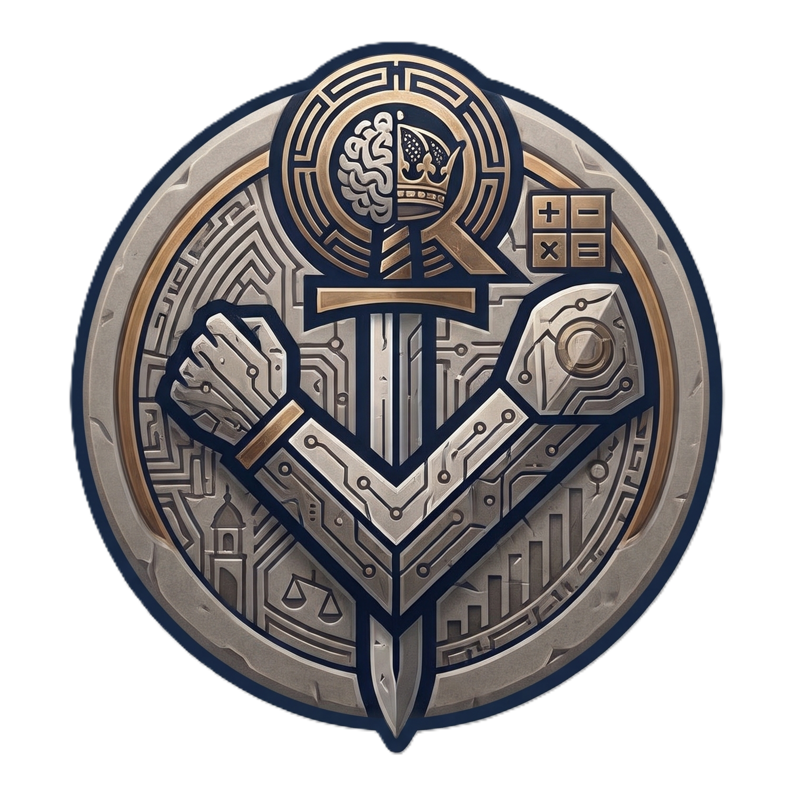

# ObrtnIQ 🏛️⚡
> **Autonomni Klijentski Operativni Sustav i ERP za Hrvatske Paušalne i Dohodovne Obrte**  
> *"Non bene pro toto libertas venditur auro"* — Sloboda i suverenost vašeg obrta bez poslužitelja, bez mjesečnih pretplata i bez kompromisa.

<p align="center">
  
</p>

<p align="center">
  <a href="#-o-aplikaciji"></a>
  <a href="#-kripto-trezor-google-identity-sidro--6h-sesija"></a>
  <a href="#-fiskalizacija-10--20"></a>
  <a href="#-žigo-omni-copilot-gemini-20-byok-function-calling--rh-heuristika"></a>
  <a href="#10-žigo-audio-naracija--google-cloud-text-to-speech-v1"></a>
  <a href="#-verifikacija-i-testovi-338338-prolazi"></a>
</p>

---

## 📖 Sadržaj
1. [O Aplikaciji](#-o-aplikaciji)
2. [Žigo — Digitalni Orlando i Filozofija Sustava](#-žigo--digitalni-orlando-i-filozofija-sustava)
3. [Ključne Značajke (Faza 0 do Faze 19)](#-ključne-značajke)
   - [Brzina i Tipkovnički Workflow (`Alt+N` / `F2`)](#1-brzina-i-tipkovnički-workflow-altn--f2)
   - [Fiskalizacija 1.0 (CIS) i Fiskalizacija 2.0 (e-Račun)](#2-fiskalizacija-10-cis-i-fiskalizacija-20-e-račun)
   - [Vektorski A4 PDF, HUB-3 PDF417 i EPC QR](#3-vektorski-a4-pdf-hub-3-pdf417-i-epc-qr)
   - [KPR & PO-SD Knjigovodstvo i KPR CSV Izvoz](#4-kpr--po-sd-knjigovodstvo-i-kpr-csv-izvoz)
   - [Katalog Artikala & KPD 2025](#5-katalog-artikala--kpd-2025)
   - [Kripto-Trezor, Google Identity Sidro & 6h Sesija](#6-kripto-trezor-google-identity-sidro--6h-sesija)
   - [Google Drive AppData Sinkronizacija](#7-google-drive-appdata-sinkronizacija)
   - [Žigo Omni-Copilot (Gemini 2.0 BYOK, Function Calling & RH Heuristika)](#8-žigo-omni-copilot-gemini-20-byok-function-calling--rh-heuristika)
   - [SystemLog & Slojeviti Arhitekturni Logger](#9-systemlog--slojeviti-arhitekturni-logger)
   - [Žigo Audio Naracija & Google Cloud Text-to-Speech V1](#10-žigo-audio-naracija--google-cloud-text-to-speech-v1)
   - [Govorno Upravljanje & Google Cloud Speech-to-Text V2](#11-govorno-upravljanje--google-cloud-speech-to-text-v2)
   - [Google Sigurnosni i Autentifikacijski Model](#12-google-sigurnosni-i-autentifikacijski-model)
4. [Arhitektura Sustava (Zero-Server)](#-arhitektura-sustava-zero-server)
5. [O Autoru: Matija Miloslavić ("Mate Fox" / "m@tise")](#-o-autoru-matija-miloslavić)
6. [Obrt Robot Hand Made](#-obrt-robot-hand-made)
7. [Brzi Početak (Quickstart & Razvoj)](#-brzi-početak)
8. [Verifikacija i Testovi (338/338 Prolazi)](#-verifikacija-i-testovi-338338-prolazi)
9. [Atribucija i Licenca](#-atribucija-i-licenca)

---

## 💡 O Aplikaciji

**ObrtnIQ** je autonomni, klijentski operativni sustav razvijen specifično za **hrvatske paušalne i dohodovne obrte**. 

U svijetu gdje većina računovodstvenog softvera nameće mjesečne pretplate, zaključava podatke korisnika na zatvorenim serverima i prodaje baze trećim stranama, ObrtnIQ se temelji na radikalnoj premisi:

> **Vaši financijski podaci pripadaju isključivo vama.** Cjelokupna aplikacija, baza podataka (IndexedDB), kriptografski trezor (Web Crypto API) i poslovna logika izvršavaju se **100% lokalno u vašem web pregledniku**. Niti jedan račun, OIB, IBAN ili iznos ne napušta vaš uređaj bez vaše izričite i kriptirane komande.

Aplikacija u potpunosti podržava sve aktualne i nadolazeće zakonske propise Republike Hrvatske:
* **Fiskalizaciju 1.0 (CIS)** gotovinskih i kartičnih računa (SOAP XML, ZKI generiranje, JIR, offline red čekanja).
* **Fiskalizaciju 2.0 (e-Račun)** prema europskoj normi EN 16931 i CIUS-HR (UBL 2.1 XML).
* Obveznu novu **Klasifikaciju proizvoda po djelatnostima (KPD 2025)**.
* **Godišnji prag od 40.000 €** za paušalno oporezivanje s dinamičkim praćenjem u stvarnom vremenu.
* **Knjigu prometa (KPR)** i automatizirani izvoz obrasca **PO-SD u XML-u za ePoreznu**.
* Vektorski **A4 PDF račun** s **HUB-3 PDF417 barkodom** za m-Banking i **EPC SEPA QR kodom**.

---

## 🛡️ Žigo — Digitalni Orlando i Filozofija Sustava

<p align="center">
  <em>„Ni milimetra više državi nego što joj pripada, ni centa manje da ti ne zatvore vrata.”</em>
</p>

Duhovni čuvar, digitalni suputnik i maskota ObrtnIQ sustava zove se **Žigo**.

Žigo u sebi nosi autentični mentalni sklop Dubrovačke Republike: diplomaciju koja rješava krizu bez ispaljenog metka, mudrost Senata zapakiranu u dvije rečenice i stoički kameni stav **dubrovačkog viteza Orlanda s mačem u ruci**.

### Persona i Karakter: Kameni Vitez iz Grada
* **Prijatelj koji reže ravno na stvar**: Žigo je saveznik i suborac hrvatskog obrtnika, no nije brbljav niti sklon praznoj kurtoaziji. Neće vas gnjaviti pitanjima *"kako si"* ili *"što ima novoga"* — radije se blago našali na račun porezne birokracije i siječe ravno u srž problema. Pitanja postavlja isključivo ako situacija to izričito nalaže i ako prijatelj zaslužuje da ga se mudro propita.
* **Autohtona dubrovačka fonologija i leksik**: Žigo govori kao pravi stari gospar iz Grada: dosljedno koristi završetke na `-n` umjesto `-m` (*vidihnuh*, *gledan*, *duman*, *računan*), čuva glas `h` (*strah*, *ishod*, *hvala*) i služi se autohtonim leksikom raguzejske mudrosti (*mir u Gradu*, *nema preše*, *naredba Senata*, *orlandov lakat*).
* **Živa svjesnost ekrana (Live Screen Awareness)**: Žigo u svakom trenutku "vidi" vašu radnu plohu — zna nalazite li se u unosu novog računa, u pregledu Knjige prometa (KPR), u katalogu artikala ili u postavkama certifikata. Prati neplaćene račune, stanje fiskalnog certifikata i trenutačnu udaljenost od praga od 40.000 €.
* **Dinamičko dumanje**: Kada razmišlja o vašem upitu ili kalkulaciji, Žigovo dumanje izravno odražava kontekst otvorenog ekrana (*„Žigo duma nad poreznim limitom...”*, *„Žigo duma nad stavkama računa...”*, *„Žigo duma nad fiskalnim pečatom...”*).
* **Tipka STOP („Zaustavi dumanje”)**: Korisnik ima potpunu kontrolu. Pritiskom na tipku STOP u bilo kojem trenutku trenutačno se prekida mrežni poziv prema AI modelu putem ugrađenog `AbortController` mehanizma, bez čekanja i bez neželjenog aktiviranja fallbacka.
* **Žigin „Rez”**: Kada se u poslu pojavi kognitivno preopterećenje, jednim klikom uklanja sav šum s ekrana i ostavlja samo tri jasne točke: *Što gori*, *Što čeka* i *Jedna akcija sad*.

---

## ⚡ Ključne Značajke

### 1. Brzina i Tipkovnički Workflow (`Alt+N` / `F2`)
* **Split-screen radna ploha**: 58% prostora namijenjeno je ultra-brzom unosu podataka, a 42% prikazuje živi A4 račun u stvarnom vremenu.
* **Tipkovnički prečaci**:
  * <kbd>Alt+N</kbd> — Trenutačno dodavanje nove stavke računa bez dodirivanja miša.
  * <kbd>F2</kbd> — Trenutačno izdavanje i zaključavanje računa (`IZDANO`).
* **Immutability & Storno**: Jednom izdani račun je trajno zaštićen od nehotičnih izmjena; storniranje se obavlja prema strogim računovodstvenim pravilima uz kreiranje korektivnog dokumenta.

### 2. Fiskalizacija 1.0 (CIS) i Fiskalizacija 2.0 (e-Račun)
* **ZKI & JIR Algoritam**: Klijentski izračun Zaštitnog koda izdavatelja (ZKI) prema specifikaciji Porezne uprave (MD5 digest, RSA potpis privatnim ključem, heksadecimalni ZKI).
* **Fiskalizacija 1.0**: Generiranje SOAP XML poruka za CIS poslužitelj, validacija certifikata i automatski offline red čekanja (`Offline Queue`) u slučaju prekida interneta.
* **Fiskalizacija 2.0 (UBL 2.1 e-Račun)**: Potpuno klijentsko generiranje `Invoice` XML-a sukladno CIUS-HR profilu i EN 16931 europskoj normi.
* **FINA Trezor**: Lokalni zaštićeni repozitorij za digitalne certifikate (`.p12` / `.pfx`) s provjerom valjanosti.

### 3. Vektorski A4 PDF, HUB-3 PDF417 i EPC QR
* **ISO 32000-1 Klijentski PDF Generator**: Generira čiste, vektorske A4 PDF račune u manje od 100 ms bez slanja podataka vanjskom PDF servisu.
* **HUB-3 PDF417 2D Barkod**: Generiran u skladu sa strogim standardom Hrvatske udruge banaka (HUB), točno 14 redaka, razina ispravljanja pogrešaka 4 (ECC 4) za instantno plaćanje u svim hrvatskim m-Banking aplikacijama.
* **EPC SEPA QR kod**: Standardizirani europski platni kod (EPC069-12 v002) za prekogranična i domaća plaćanja.
* **Fiskalni QR kod**: U skladu s Pravilnikom Porezne uprave RH za provjeru računa putem skenera.

### 4. KPR & PO-SD Knjigovodstvo i KPR CSV Izvoz
* **Knjiga Prometa (KPR)**: Automatsko evidentiranje svih gotovinskih i bezgotovinskih uplata razvrstanih po kvartalima (Q1, Q2, Q3, Q4).
* **Dinamički Prag (40.000 €)**: Vizualni widget u zaglavlju aplikacije koji u realnom vremenu prikazuje postotak iskorištenosti zakonskog limita za paušalne obrte.
* **PO-SD ePorezna XML**: Izvoz službenog XML obrasca spremnog za direktno učitavanje na portal ePorezna na kraju porezne godine.
* **KPR CSV / Excel Izvoz**:
  * Počinje s **UTF-8 BOM (`\uFEFF`)** markerom kako bi Microsoft Excel na Windowsima u hrvatskim regionalnim postavkama automatski prikazao dijakritike (`Č, Ć, Ž, Š, Đ`).
  * Točka-zarez (`;`) kao separator i hrvatski decimalni zarez (`,`) za novčane iznose.

### 5. Katalog Artikala & KPD 2025
* **Katalog Usluga i Proizvoda**: Predlošci artikala s nazivom, šifrom, poreznom stopom, cijenom i mjernom jedinicom (`sat`, `kom`, `paušal`, `dan`, `mjesec`, `projekt`, `kartica`, `km`).
* **Službeni KPD 2025**: Integrirani birač službenih šifara hrvatske *Klasifikacije proizvoda po djelatnostima* koje su zakonski obvezne za e-Račun.
* **Dvosmjerna integracija**: *"Odaberi iz cjenika"* na računu i *"Spremi u cjenik"* izravno iz stavke računa.

### 6. Kripto-Trezor, Google Identity Sidro & 6h Sesija
* **Zero-Knowledge Kripto Paket (`.obrtniq`)**: Izvoz i uvoz cjelokupne baze kriptirane pomoću **AES-256-GCM** algoritma s ključem izvedenim kroz **PBKDF2** (100.000 iteracija, SHA-256).
* **Google Identity Kripto-Sidro**:
  * Koristi trajni 21-znamenkasti korisnički `googleSub` identifikator dobiven putem službenog Google Identity Services (GIS) SDK-a kao determinističko sidro.
  * Korisnik ne mora pamtiti dugu lozinku pri svakoj sinkronizaciji — kripto ključ se izvodi lokalno na klijentu (`OBRTNIQ:GOOGLE_SUB:<id>[:pin]`).
* **Produžena radna sesija (6 sati)**:
  * Umjesto standardnog 1-satnog isteka, validnost pristupnog tokena za radnu sesiju ObrtnIQ-a proširena je na **6 sati** (`GOOGLE_TOKEN_VALIDITY_SECONDS = 21,600s`).
  * **Tiho pozadinsko obnavljanje (`requestSilentToken`)**: Ako je do isteka preostalo manje od 5 minuta, sustav automatski i nečujno obnavlja token u pozadini bez ometanja korisnika skočnim prozorima.
  * **Intuitivni prikaz aktivnosti**: U postavkama clouda prikazuje se točno preostalo vrijeme u satima i minutama (npr. *„Vrijedi još 5h 59 min (auto-refresh aktivan)”*).
* **Offline Demo Identitet**: Ugrađeni deterministički demo korisnik za lokalni razvoj i demonstraciju bez postavljanja Client ID-a.

### 7. Google Drive AppData Sinkronizacija
* **Izolirana mapa `appDataFolder`**: Sigurnosne kopije pohranjuju se u skriveni prostor aplikacije na korisnikovom privatnom Google Driveu (15 GB besplatnog prostora). Datoteke su nevidljive u redovnom drive.google.com sučelju, čime se sprječava slučajno brisanje.
* **Klijentski REST API v3**: Izravan multipart prijenos bez posrednog poslužitelja.
* **Disaster Recovery**: U slučaju gubitka ili zamjene računala, prijavom na Google račun dohvaća se povijest točaka oporavka i baza se obnavlja jednim klikom.

### 8. Žigo Omni-Copilot (Gemini 2.0 BYOK, Function Calling & RH Heuristika)
* **Bring-Your-Own-Key (BYOK)**: Korisnik unosi svoj Google AI Studio API ključ koji se pohranjuje isključivo lokalno.
* **Agentni Function Calling (Izvršne Akcije na Radnoj Plohi)**: Žigo nije pasivni chatbot — on posjeduje ugrađene alate kojima može izravno manipulirati sučeljem:
  * Dodavanje i ažuriranje stavki na aktivnom računu.
  * Dodjela KPD 2025 šifara i predlaganje tržišnih jediničnih cijena.
  * Dinamička navigacija između ekrana (Račun, KPR pregled, Postavke, Cjenik artikala).
  * Priprema storniranja i filtriranje prometa.
* **Live Screen Context Snapshot**: Prilikom svakog upita, Žigo automatski analizira trenutačno stanje ekrana (otvoreni obrazac, stavke, OIB partnera, status fiskalnog certifikata, iskorištenost poreznog limita).
* **Robusno procesiranje grešaka (503 Overloaded & Graceful Fallback)**:
  * Potpuno eliminiran problem nečitljivih grešaka (`UnknownError: [object Object]`).
  * U slučaju preopterećenja Google poslužitelja (HTTP 503 Unavailable) ili pada interneta, Žigo ne prekida rad, već trenutno i transparentno preuzima kontrolu putem lokalne Orlandove heuristike.
* **100% Offline RH Heuristički Fallback**: Čak i ako korisnik nema uneseni API ključ ili nema interneta, ugrađeni deterministički algoritam analizira preko 14 domenskih pravila i nudi točne odgovore s autentičnom dubrovačkom retorikom.

### 9. SystemLog & Slojeviti Arhitekturni Logger
* **Hijerarhijski Scoped Logeri (`appLogger`)**: Cjelokupni sustav pokriven je namenskim kanalima (`AGENT:CHAT`, `AGENT:ACTION`, `AI:GEMINI:REQ`, `AI:GEMINI:RES`, `AI:GEMINI:ERROR`, `AUTH:GOOGLE`, `SERVICE:GOOGLE_TTS`, `SERVICE:GOOGLE_STT`, `FISCAL:CIS`, `STORAGE`, `SETTINGS`).
* **Sigurnosna Sanitizacija**: Automatsko cenzuriranje osjetljivih podataka (`***REDACTED***`) za lozinke, tokene, tajne i privatne RSA ključeve prije ulaska u logove.
* **Strukturirani Stack Parser**: Razlučuje interne okvire aplikacije od knjižnica trećih strana (`node_modules`), omogućujući trenutačnu dijagnostiku točne linije koda.
* **Fleksibilni Prikaz Dnevnika**:
  * Podrška za **obrnuti redoslijed** (najnovije poruke na vrhu za trenutni uvid u zadnje akcije).
  * Podrška za **kronološki redoslijed** s ugrađenim automatskim scrollanjem i fokusom na dno pri zaprimanju novih unosa.
* **SystemLogDrawer**: Vizualna konzola unutar postavki koja omogućuje pretragu u stvarnom vremenu, filtriranje po stupnjevima (ERROR, WARN, INFO, DEBUG, VERBOSE), kopiranje dijagnostičkog izvještaja i inteligentnu detekciju uzroka grešaka (npr. Google OAuth scopes naspram API ključa).

### 10. Žigo Audio Naracija & Google Cloud Text-to-Speech V1
* **Viteški Muški Bariton (`hr-HR-Wavenet-B`)**:
  * Žigo govori stamenim, dubljim glasom dubrovačkog viteza Orlanda zahvaljujući pažljivo ugođenim audio parametrima:
    * **Visina tona (Pitch):** `-2.0 semitona` za autoritativan, smiren bariton.
    * **Brzina govora (Speaking Rate):** `0.94` za odmjerenu, mudru dikciju bez žurbe.
* **In-Memory Audio Caching (Zero-Lag & Zero-Waste)**:
  * Svaka sintetizirana rečenica pohranjuje se kao audio Blob u radnu memoriju (`URL.createObjectURL`). Ponavljajuće poruke ili navigacije ne troše dodatne API kvote niti stvaraju latenciju.
* **Fleksibilni Formati Zvuka**: Podrška za `MP3` (najšira podrška, niska latencija) i `OGG_OPUS` (visoka kompresija).
* **Trostruka Fallback Hijerarhija**:
  1. *Google Cloud Text-to-Speech API* (vrhunska WaveNet sinteza).
  2. *Lokalni preglednički Web Speech API* (offline Microsoft ili sistemski muški glasovi).
  3. *Vizualni titlovi i poruke u sučelju*.
* **Panel za Testiranje i Debugiranje**: Mjerenje mrežne latencije u milisekundama uz trenutnu reprodukciju testnog uzorka u zvučnicima korisnika.

### 11. Govorno Upravljanje & Google Cloud Speech-to-Text V2
* **Hibridni STT Motor**:
  * **Preglednički Web Speech API:** 100% lokalno u pregledniku, besplatno, bez API ključeva i trenutno spremno za rad.
  * **Google Cloud Speech-to-Text V2 (Chirp 2):** Vrhunski model za prepoznavanje govora na hrvatskom jeziku s podrškom za poreznu i računovodstvenu terminologiju te raguzejski leksik.
* **Jednostavno Dijeljenje Ključa (`useSttApiKey`)**: Jednim klikom korisnik može koristiti isti Google Cloud API ključ i za govorno prepoznavanje (STT) i za glasovnu sintezu (TTS).
* **Audio Transport**: Praćenje statusa reprodukcije naratora, automatsko čišćenje i ponovno stvaranje transportne trake nakon promjene konfiguracije.

### 12. Google Sigurnosni i Autentifikacijski Model
ObrtnIQ koristi pažljivo osmišljenu sigurnosnu arhitekturu koja strogo razdvaja infrastrukturu aplikacije od privatnih podataka korisnika:

```
┌─────────────────────────────────────────────────────────────────────────────────┐
│                    SIGURNOSNO RAZDVAJANJE VJERODAJNICA                          │
├───────────────────────────────────────┬─────────────────────────────────────────┤
│    KORISNIČKI GOOGLE RAČUN (OAuth)    │     GOOGLE CLOUD API KLJUČ (Infrastr.)  │
├───────────────────────────────────────┼─────────────────────────────────────────┤
│ • ya29... Pristupni Token             │ • AIzaSy... API Ključ                   │
│ • Isključivo za identitet i backup    │ • Za Text-to-Speech i Speech-to-Text    │
│ • Scopes: openid, email, profile,     │ • NEMA skočnih prozora za korisnika     │
│   drive.appdata                       │ • Korisnik NE MORA imati GCP račun      │
│ • Podaci obrtnika ostaju 100% privatni│ • Zaštićen restrikcijom domene i API-ja │
└───────────────────────────────────────┴─────────────────────────────────────────┘
```

* **Prioritet određivanja aktivne vjerodajnice:**
  1. Korisnički prilagođeni ključ unesen u postavkama (`config.apiKey`)
  2. Ugrađeni aplikacijski Web Client API ključ iz `.env` (`VITE_GOOGLE_CLIENT_API_KEY` / `VITE_GOOGLE_API_KEY`)
  3. Dijeljeni STT ključ (`useSttApiKey`)
  4. Naslijeđeni Gemini AI API ključ
  5. OAuth 2.0 Web Client sesijski token
* **Preporučena GCP zaštita ključa:**
  * **Application restrictions (Websites):** Ograničeno na `http://localhost:5173/*` i produkcijsku domenu aplikacije.
  * **API restrictions:** Ograničeno isključivo na `Cloud Text-to-Speech API` i `Cloud Speech-to-Text API`.

---

## 🏗️ Arhitektura Sustava (Zero-Server)

ObrtnIQ je strukturiran kao moderan **TypeScript monorepo** s potpunim razdvajanjem čiste domenske logike i prezentacijskog sloja:

```
ObrtnIQ/
├── packages/core/              # Čista domena (Pure TypeScript, Zero DOM dependencies)
│   ├── src/
│   │   ├── domain/             # Kalkulator, OIB MOD 11, IBAN MOD 97, KPR CSV, PO-SD, Audio Transport
│   │   ├── fiscal/             # Fiskalizacija 1.0 (ZKI, SOAP), Fiskalizacija 2.0 (UBL 2.1)
│   │   ├── pdf/                # ISO 32000-1 struktura, HUB-3 barkod generator, EPC QR
│   │   ├── storage/            # Kripto-trezor (AES-256-GCM, PBKDF2, Google Sub sidro)
│   │   └── logger/             # Arhitekturni Logger, Scoped Logeri, Sanitizacija, Stack Parser
│   └── tests/                  # 22 testne datoteke, 127/127 testova prolazi (100%)
│
└── apps/web/                   # Web aplikacija (React 19, Vite 6, Dexie.js, Sharp UI)
    ├── src/
    │   ├── components/         # Sharp UI, InvoiceDesk, ZigoCopilotPanel, GoogleSttSettingsCard, SystemLogDrawer
    │   ├── hooks/              # useInvoiceWorkflow, useGoogleAuth, useGoogleDriveSync, useZigoAgent
    │   ├── services/           # google-tts-service, google-stt-service, app-client-credentials, gemini-service
    │   └── storage/            # Dexie.js IndexedDB perzistencija (Računi, KPR, Zigo memorija)
    └── tests/                  # 21 testna datoteka, 211/211 testova prolazi (100%)
```

### Shema Kripto-Sidra i Prijenosa Podataka:
```
┌────────────────────────────────────────────────────────────────────────┐
│                        KORISNIKOV PREGLEDNIK                           │
│                                                                        │
│   ┌─────────────────────┐               ┌──────────────────────────┐   │
│   │ Dexie.js IndexedDB  │ ────────────► │ Web Crypto API (Subtle)  │   │
│   │ (Obrt, KPR, Računi) │               │ PBKDF2 100k + AES-256    │   │
│   └─────────────────────┘               └─────────────┬────────────┘   │
│              ▲                                        │                │
│              │ Restauracija                           ▼                │
│              │                           ┌──────────────────────────┐   │
│              └────────────────────────── │ Kriptirani .obrtniq paket│   │
│                                          └─────────────┬────────────┘   │
└────────────────────────────────────────────────────────┼───────────────┘
                                                         │
                                  Direktan REST v3 HTTPS │ (Google Token)
                                                         ▼
                                          ┌──────────────────────────────┐
                                          │ Google Drive (appDataFolder) │
                                          │ 15 GB Skrivena Izolirana     │
                                          │ Sigurnosna Pohrana           │
                                          └──────────────────────────────┘
```

---

## 👨‍💻 O Autoru: Matija Miloslavić

<p align="center">
  <strong>Matija Miloslavić</strong> (poznat i kao <strong>Mate Fox</strong> / <strong>Mate Fox Banchila</strong>, ranije <strong>m@tise</strong>)<br />
  <em>Polimatični tehnolog, inženjer, maker, dizajner, zvukopisac i edukator iz Dubrovnika.</em>
</p>

Put Matije Miloslavića odražava rijetku konvergenciju umjetnosti, inženjerstva i poduzetništva na jadranskoj obali:

### 1. Dubrovačka klupska renesansa i digitalni arhivi (`m@tise` & `Clubpages`)
Krajem devedesetih i početkom dvijetisućitih, u postratnom Dubrovniku, Matija je bio jedan od pionira klupske scene pod pseudonimom **DJ m@tise**. Nastupajući u kultnim **Lazaretima**, prostorima karantene pretvorenim u središte urbane emancipacije, donosio je zvukove progressive housea i techna.  
Prepoznavši internet kao moćan alat kulturne dokumentacije prije pojave društvenih mreža, sudjelovao je u stvaranju i vođenju portala **Clubpages** — digitalnog epicentra regionalne elektroničke scene čiji arhivi i danas predstavljaju najvažniji povijesni izvor dubrovačke subkulture. Kroz rad na Clubpagesu, Matija je rano povezao kôd, estetiku i zajednicu.

### 2. Glazbena zrelost: Mate Fox Banchila
Evolucijom zvuka nastaje novi alias — **Mate Fox Banchila**. Njegov stil seli se s klupskih podija u sofisticiranije zvučne sfere (Deep House, Melodic Techno, Organic House). Njegove glazbene kronike i autorski setovi dostupni su globalno na [Mixcloud platformi (banchilo)](https://www.mixcloud.com/banchilo/), gdje se prepoznaje specifičan mediteranski senzibilitet prožet preciznom studijskom produkcijom.

### 3. Digitalni dizajn i Pixel Design
Kao suosnivač dubrovačkog studija **Pixel Design**, Matija je godinama vodio digitalnu transformaciju lokalnih poduzetnika, kulturnih institucija i turističkog sektora, postavljajući visoke standarde u razvoju web sustava, korisničkih sučelja (UI/UX) i digitalnog brendiranja.

### 4. Profesor i edukator (UNIDU)
Logičan nastavak bogate karijere bio je prijenos znanja. U suradnji sa **Sveučilištem u Dubrovniku (UNIDU)**, kroz Odjel za elektrotehniku i računarstvo te Odjel za medije i kulturu društva, Matija sudjeluje u edukaciji novih generacija. Predaje praktične kolegije iz web tehnologija, 3D modeliranja, aditivne proizvodnje i digitalnog dizajna, djelujući kao most između tromog akademskog sustava i dinamičnog svijeta tehnološkog poduzetništva.

---

## 🤖 Obrt Robot Hand Made

<p align="center">
  <strong>ROBOT HAND MADE, obrt za računalno programiranje i proizvodnju</strong><br />
  <em>Vlasnik: Matija Miloslavić | Pod Brašinom 48, 20207 Mlini (Dubrovnik)</em>
</p>

Kruna Miloslavićevog poduzetništva je obrt **Robot Hand Made**. Smješten u Brašini (Župa dubrovačka), obrt je registriran za računalno programiranje (NKD 62.01), ali njegova stvarna aktivnost predstavlja jedinstveni laboratorij u kojem se susreću **digitalni algoritam i fizički objekt**.

Kroz vlastiti autorski i inženjerski laboratorij, Robot Hand Made istražuje granice aditivne tehnologije (3D printanje), parametarskog dizajna, unikatnog nakita, dekorativnih interijerskih formi i industrijskog prototipiranja:

> **Filozofija imena:** Naziv *"Robot Hand Made"* namjerni je i duboki paradoks. Iako robot (3D printer ili numerički vođen stroj) fizički nanosi slojeve materijala, **ljudski um programera i ruka obrtnika** su ti koji daju dušu, matematiku i formu svakom gotovom proizvodu.

ObrtnIQ je proizašao upravo iz svakodnevnih potreba obrta Robot Hand Made — softver koji je obrtnik stvorio za obrtnike, poštujući njihovo vrijeme, novac i slobodu.

---

## 🚀 Brzi Početak

### Preduvjeti
* **Node.js** (verzija 18.0 ili novija)
* **npm** (verzija 9.0 ili novija)

### 1. Kloniranje repozitorija
```bash
git clone https://github.com/matise/ObrtnIQ.git
cd ObrtnIQ
```

### 2. Instalacija ovisnosti
```bash
npm install
```

### 3. Konfiguracija okruženja (Opcionalno za Cloud servise)
Kopirajte predložak `.env.example` u `.env` ako želite konfigurirati ugrađeni Google Cloud API ključ ili Google OAuth Client ID:
```bash
cp .env.example .env
```
Dostupne varijable:
* `VITE_GOOGLE_CLIENT_API_KEY`: Ugrađeni Web Client API ključ aplikacije za Google Cloud Text-to-Speech (sintezu viteza Orlanda) i Speech-to-Text V2. Korisnik ne mora unositi ključ niti davati OAuth privolu.
* `VITE_GOOGLE_CLIENT_ID`: Google OAuth 2.0 Web Client ID za privatni Google Drive `appDataFolder` backup.
* `VITE_GEMINI_API_KEY`: Opcionalni zadani ključ za Žigo AI model ako se ne unosi kroz korisničko sučelje (BYOK).

### 4. Pokretanje razvojnog poslužitelja
```bash
npm run dev
```
Aplikacija će biti dostupna na lokalnoj adresi: `http://localhost:5173/`

### 5. Izgradnja produkcijskog paketa
```bash
npm run build
```
Generirani optimizirani statički bundle nalazi se u mapi `apps/web/dist/`. Budući da je sustav 100% klijentski, izgrađeni paket možete poslužiti s bilo kojeg statičkog hostinga (Cloudflare Pages, GitHub Pages, Netlify, Vercel ili lokalni USB stick).

---

## ✅ Verifikacija i Testovi (338/338 Prolazi)

Cjelokupni monorepo pokriven je strogim automatiziranim testovima u okruženju **Vitest**:

```bash
# Pokretanje svih testova na cijelom projektu (43 testne datoteke, 338 testova)
npm test

# Pokretanje testova domenskog paketa (@obrtniq/core - 127 testova)
npm test --workspace=@obrtniq/core

# Pokretanje testova web aplikacije (@obrtniq/web - 211 testova)
npm test --workspace=@obrtniq/web
```

### Sažetak verifikacije:
* **@obrtniq/core**: 22 testne datoteke, **127 testova** prolaze sa 100% uspješnošću:
  * Domenski algoritmi: OIB MOD 11, IBAN MOD 97, decimalni kalkulator, KPR CSV izvoz s UTF-8 BOM-om, PO-SD ePorezna XML.
  * Fiskalizacija 1.0 (CIS SOAP XML, ZKI izračun, JIR validacija) i Fiskalizacija 2.0 (UBL 2.1 e-Račun prema CIUS-HR).
  * Vektorski PDF (ISO 32000-1), HUB-3 PDF417 2D barkod (14 redaka, ECC 4), EPC SEPA QR kod i fiskalni QR.
  * Audio Transport: Model zvučnog transporta, stanja reprodukcije naracije i validacija glasovnih profila.
  * Kriptografski trezor: PBKDF2 (100k iteracija), AES-256-GCM enkripcija, Google Sub kripto-sidro.
  * Arhitekturni Logger: Ring-buffer, sanitizacija osjetljivih podataka, strukturirani stack trace parser.
* **@obrtniq/web**: 21 testna datoteka, **211 testova** prolaze sa 100% uspješnošću:
  * Žigo Omni-Copilot: Persona, autentični dubrovački leksik, heuristička pravila (14/14), live screen awareness.
  * Google Cloud Audio & TTS: WaveNet sinteza viteza Orlanda (`hr-HR-Wavenet-B`), in-memory Blob caching, fallback na preglednički Web Speech API, detekcija 403 `insufficient authentication scopes` i prepoznavanje ugrađenog API ključa (23/23 testa).
  * Stop & Error Handling: `AbortController` prekid zahtjeva na zahtjev korisnika, robusno 503 Overloaded procesiranje bez `[object Object]`, automatsko prebacivanje na Orlandov fallback.
  * Google OAuth & Cloud Sync: 6-satna radna sesija (`GOOGLE_TOKEN_VALIDITY_SECONDS = 21,600s`), tiho pozadinsko obnavljanje, Google Drive `appDataFolder` sinkronizacija, cloud dijagnostika.
  * Korisničko sučelje & Dnevnik: SettingsDrawer modularizacija, reverzibilni SystemLog (najnovije na vrhu / kronološki s auto-scrollom), E2E matrica Z-01 do Z-07.
* **Ukupno**: **338 / 338 testova prolazi sa 100% uspješnošću** (0 grešaka, 0 preskočenih).

---

## 📜 Atribucija i Licenca

* **Autor & Arhitekt**: Matija Miloslavić (Mate Fox)
* **Matični Obrt**: ROBOT HAND MADE, vl. Matija Miloslavić, Mlini / Dubrovnik
* **Kulturna inspiracija**: Dubrovačka Republika, Orlando, Lazareti, Clubpages arhiv
* **Licenca**: Autorsko pravo © 2026 Matija Miloslavić, Robot Hand Made. Otvoreni kôd licenciran pod [MIT Licencom](LICENSE) — slobodno za korištenje, učenje i prilagodbu uz očuvanje autorstva.

---

<p align="center">
  <em>Stvoreno s ponosom u Dubrovniku i Brašini. Čuvajte svoj obrt, radite pošteno i mirno spavajte.</em>
</p>
