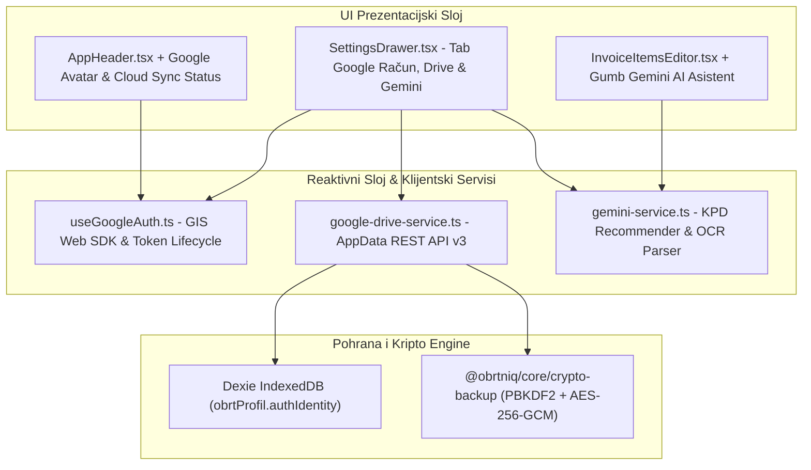

# Plan Implementacije i Validacije: Faza 10 – Google Identity kao Kripto Sidro, Povezani Servisi (Google Drive AppData Sync & Gemini AI Asistent)

Ovaj dokument definira detaljnu arhitekturu, sigurnosni model, korisničko sučelje, korake implementacije i **potpuni validacijski protokol s Gate-Check kriterijima** za **Fazu 10** sustava [ObrtnIQ](file:///d:/Documents/Robot%20Hand%20Made/ObrtnIQ).

---

## 1. Analiza i Opseg Faze 10

### 1.1. Status sustava prije Faze 10
Nakon dovršetka Faze 9, sustav ima zaokružene sve lokalne poslovne funkcije:
* Kompletno izdavanje računa, cjenik artikala s KPD 2025 šiframa, Knjigu Prometa (KPR) s Excel CSV izvozom, PO-SD XML za ePoreznu, Fiskalizaciju 1.0 (CIS) & 2.0 (UBL 2.1 e-Račun) i lokalni AES-256-GCM backup.

### 1.2. Cilj Faze 10 (Povezivanje na korisničke Cloud i AI servise bez centralnog poslužitelja)
U skladu s temeljnim načelom **Zero-Server & Zero-Cost Arhitekture**, Faza 10 omogućuje obrtniku povezivanje na njegov vlastiti Google račun bez postojanja centralnog poslužitelja:
1. **Google Identity kao Kriptografsko & Identifikacijsko Sidro (Zero-Server Auth)**:
   - Autentikacija putem **Google Identity Services (GIS) Web SDK-a** izravno u pregledniku.
   - Povezivanje Google identifikatora (`sub` - trajni jedinstveni 21-znamenkasti ID korisnika) s lokalnim profilom u Dexie bazi.
   - Kriptografsko izvođenje lokalnog master ključa iz Google `sub`-a putem Web Crypto API-ja (`PBKDF2` s 100.000 iteracija SHA-256 + `AES-256-GCM`) za zaključavanje trezora certifikata i sigurnosnih kopija.
2. **Google Drive AppData Storage (Besplatni skriveni Cloud Backup)**:
   - Korištenje posebne mape **Application Data folder** (`drive.appdata` scope) unutar korisničkog Google Drivea.
   - Skrivena od korisničkog regularnog sučelja (čistoća i zaštita od slučajnog brisanja).
   - Automatska i 1-klik sinkronizacija kriptiranih `.obrtniq` (AES-256-GCM) arhiva uz nula troškova poslužitelja.
   - Prikaz povijesti verzija i vraćanje baze (Restore) na bilo kojem računalu.
3. **Gemini API Integracija (Google AI Studio / BYOK)**:
   - Bring-Your-Own-Key model: Korisnik unosi svoj besplatni Google AI Studio API ključ.
   - Povezivanje s modelom **Gemini 2.0 Flash / 1.5 Flash** za:
     * **Smart KPD 2025 birač**: Preporuka točne KPD šifre iz prirodnog opisa posla.
     * **OCR analiza uplatnica i računa**: Izdvajanje podataka (OIB, IBAN, iznos, stavke) iz fotografija/PDF-ova.
     * **Porezni savjetnik**: Pojašnjenja zakonskih rokova i paušalnih pravila u RH.
4. **Priprema za Firebase / Cloud Firestore**:
   - Predviđeno sučelje za unos Firebase konfiguracije (`apiKey`, `projectId`) za korisnike koji žele opcionalni multi-device live sync.

---

## 2. Arhitektura Faze 10



---

## 3. Detaljni Pregled Modula i Komponenti

### 3.1. Google Identity i Kriptografsko Sidro

#### A. Zero-Server OAuth 2.0 Flow
1. Preglednik dinamički učitava Google Identity Services SDK (`https://accounts.google.com/gsi/client`).
2. Inicijalizira se `google.accounts.oauth2.initTokenClient` s Client ID-jem i scopeovima (`openid`, `profile`, `email`, `https://www.googleapis.com/auth/drive.appdata`).
3. Google vraća JWT s poljima:
   - `sub`: Trajni Google Subject ID (npr. `108392174981273981273`).
   - `email`: Poslovni/privatni email.
   - `name`: Ime i prezime.
   - `picture`: URL avatara.

#### B. Kriptografsko izvođenje lokalnog ključa (Web Crypto)
$$\text{MasterKey} = \text{PBKDF2}(\text{googleSub} + \text{LocalDeviceSalt}, \text{iter}=100.000, \text{SHA-256}, \text{AES-256-GCM})$$
* **Prednosti**:
  - Privatnost: Financijski podaci, računi i FINA certifikati ostaju šifrirani; Google vidi samo neprobojni šifrat.
  - Multi-device kontinuitet: Prijavom s istim Google računom na novom uređaju i unosom PIN-a, korisnik otključava bazu povučenu s Google Drivea.

#### C. Domenski modeli (`packages/core/src/domain/types.ts`)
```typescript
export interface GoogleAuthIdentity {
  provider: 'GOOGLE' | 'LOCAL';
  googleSub?: string;            // Jedinstveni nepromjenjivi Google ID
  email?: string;
  name?: string;
  pictureUrl?: string;
  connectedAt?: string;
  scopes?: string[];
}

export interface ConnectedServicesConfig {
  googleDriveEnabled: boolean;
  googleDriveLastSync?: string;
  geminiApiKey?: string;         // Korisnikov Google AI Studio API ključ
  geminiModel?: string;          // Zadani model: 'gemini-2.0-flash'
  firebaseConfig?: {
    apiKey: string;
    projectId: string;
    appId: string;
  };
}
```

---

### 3.2. Google Drive AppData Cloud Sync (`google-drive-service.ts`)

#### A. Zašto `appDataFolder`?
- **Skriveni prostor**: Datoteke unutar `appDataFolder` mape nisu vidljive korisniku u redovnom Google Drive sučelju (nema nereda među osobnim datotekama).
- **Sigurnost**: Pristup ima isključivo ObrtnIQ s autorizacijom korisnika.
- **Nula troškova servera**: Koristi se besplatni Google Drive prostor (15 GB).

#### B. Operacije servisa
1. **Upload kriptirane arhive**:
   - Generira se `.obrtniq` paket (AES-256-GCM).
   - Šalje se multipart POST/PATCH na `https://www.googleapis.com/upload/drive/v3/files?uploadType=multipart` s `parents: ['appDataFolder']`.
2. **Dohvat i popis verzija**:
   - GET `https://www.googleapis.com/drive/v3/files?spaces=appDataFolder&orderBy=createdTime desc`.
3. **Restore iz oblaka**:
   - Preuzimanje najnovijeg backupa, lokalna dekripcija i atomsko ažuriranje IndexedDB baze.

---

### 3.3. Gemini API Integracija (`gemini-service.ts`)

#### A. Bring-Your-Own-Key (BYOK) model
Korisnik unosi svoj besplatni Google AI Studio API ključ u postavkama. Ključ se čuva isključivo u lokalnom IndexedDB-u i koristi se za izravne pozive službenog Google REST API-ja (`generativelanguage.googleapis.com`).

#### B. Funkcije AI asistenta
1. **`recommendKpdCode(description: string)`**:
   - Analizira slobodni tekst korisnika i pronalazi odgovarajuću šifru iz službene KPD 2025 nomenklature uz obrazloženje.
2. **`parseInvoiceReceipt(imageBlob: Blob)`**:
   - Analizira sliku ili PDF računa/uplatnice i ekstrahira naziv partnera, OIB, IBAN, datum i stavke za automatsko popunjavanje forme.
3. **Porezni asistent**:
   - Brza pojašnjenja o paušalnim limitima i rokovima predaje PO-SD obrasca.

---

### 3.4. UI Komponente i Integracija

1. **[AppHeader.tsx](file:///d:/Documents/Robot%20Hand%20Made/ObrtnIQ/apps/web/src/components/layout/AppHeader.tsx)**:
   - Prikaz Google avatara korisnika i statusne točke sinkronizacije (zeleni oblak = sinkronizirano, žuti = promjene na čekanju).
2. **[SettingsDrawer.tsx](file:///d:/Documents/Robot%20Hand%20Made/ObrtnIQ/apps/web/src/components/SettingsDrawer.tsx)**:
   - Novi Tab: *"Google Račun & Povezani Servisi"*.
   - Google Login / Logout gumb.
   - Preklopnik za Google Drive sinkronizaciju s gumbom *"Sinkroniziraj sada"* i popisom verzija.
   - Unos Gemini API ključa uz test povezivanja.
   - Kartica za opcionalnu Firebase konfiguraciju.
3. **[InvoiceItemsEditor.tsx](file:///d:/Documents/Robot%20Hand%20Made/ObrtnIQ/apps/web/src/components/desk/InvoiceItemsEditor.tsx)**:
   - Gumb *"AI Asistent (Gemini)"* pored KPD birača za automatsku preporuku šifre.

---

## 4. Akcijski Plan Koraka (Faza 10)

1. **Korak 1 (Core)**: Proširiti `packages/core/src/domain/types.ts` s `GoogleAuthIdentity` i `ConnectedServicesConfig`.
2. **Korak 2 (Google Auth)**: Izraditi `apps/web/src/services/google-auth-service.ts` i hook `useGoogleAuth.ts` (GIS integracija, token client, demo mod).
3. **Korak 3 (Kripto sidro)**: Povezati izvođenje ključa iz `googleSub` s Web Crypto modulom.
4. **Korak 4 (Drive Sync)**: Izraditi `apps/web/src/services/google-drive-service.ts` (multipart upload/download u `appDataFolder`).
5. **Korak 5 (Gemini AI)**: Izraditi `apps/web/src/services/gemini-service.ts` za KPD 2025 preporuku i OCR analizu računa.
6. **Korak 6 (Postavke UI)**: Dodati tab *"Google Račun & Povezani Servisi"* u `SettingsDrawer.tsx`.
7. **Korak 7 (Radna Ploha UI)**: Ugraditi AI pomoć u `InvoiceItemsEditor.tsx` i status oblaka u `AppHeader.tsx`.
8. **Korak 8 (Validacija)**: Pokrenuti cjelokupni validacijski protokol Faze 10.

---

## 5. Protokol Validacije i Gate-Check Kriteriji za Fazu 10

### 5.1. Automatski testovi (Vitest)
```bash
# Pokretanje testova za Google Auth mapping i kripto izvođenje
npx vitest run apps/web/tests/google-auth.test.ts apps/web/tests/gemini.test.ts

# Pokretanje svih testova u monorepou
npm test
```

### 5.2. Tablica Gate-Check Kriterija (Faza 10)

| # | Kriterij provjere | Očekivani rezultat | Način provjere |
|---|---|---|---|
| **V10-1** | **Google Identity & Token Lifecycle** | GIS SDK uspješno inicijalizira prijavu, preuzima `sub`, email i avatar; podržan je i offline/demo profil ako klijent nema interneta. | Test u pregledniku i mock test |
| **V10-2** | **Kriptografsko Sidro iz Google ID-a** | `PBKDF2` uspješno izvodi 256-bitni AES-GCM ključ iz `googleSub` i lokalnog sola. Šifrirani podaci se uspješno otključavaju isključivo s istim identitetom. | Web Crypto unit test |
| **V10-3** | **Google Drive AppData Sync** | Kriptirana `.obrtniq` arhiva uspješno se sprema u skriveni `appDataFolder` Google Drivea i po potrebi preuzima za vraćanje na drugom računalu. | REST API integracijski test |
| **V10-4** | **Gemini AI KPD Preporuka** | Unos opisa usluge (npr. *"izrada responzivnog dizajna i logotipa"*) putem Gemini API-ja točno preporučuje KPD 2025 šifru `74.10.11`. | Mock / Live API test |
| **V10-5** | **UI Integracija & Prikaz Profila** | Uspješna prijava prikazuje Google avatar u zaglavlju (`AppHeader`) i zelenu ikonu aktivne cloud sinkronizacije. | Interaktivni UI test |
| **V10-6** | **Nulta regresija koda** | Svi postojeći testovi (Faze 1 do 9) i novi testovi Faze 10 prolaze bez grešaka, uz čisti `tsc -b && vite build`. | `npm test` && `npm run build` |

---

## 6. Protokol Zajedničke Integracijske Validacije (End-to-End: Faza 9 + Faza 10)

Ovaj protokol testira sinergiju i neprekinuti tok podataka između modula Faze 9 (Cjenik, KPR CSV, Lokalni Backup) i Faze 10 (Google Identity, Drive AppData Sync, Gemini AI Asistent).

```
┌────────────────────────────────────────────────────────────────────────────────────────┐
│               ZAJEDNIČKI PROTOKOL INTEGRACIJSKE VALIDACIJE (FAZA 9 + FAZA 10)          │
├────────────────────────────────────────────────────────────────────────────────────────┤
│ 1. [FAZA 10] Google Login ──► Izvođenje Kripto Ključa (PBKDF2 iz googleSub)            │
│ 2. [FAZA 10 + 9] Gemini AI ──► Preporuka KPD 2025 ──► Spremanje u Cjenik (Artikli)    │
│ 3. [FAZA 9] Cjenik ──► 1-klik Dodavanje na Račun ──► Izdavanje (F2)                    │
│ 4. [FAZA 9] KPR Evidencija ──► Generiranje i provjera KPR_2026.csv (Excel standard)   │
│ 5. [FAZA 9 + 10] Kriptirani .obrtniq Backup ──► Google Drive AppData Cloud Sync        │
│ 6. [DISASTER RECOVERY] Čišćenje baze ──► Google Restore s Drivea ──► 100% Integritet   │
└────────────────────────────────────────────────────────────────────────────────────────┘
```

### 6.1. Scenarij Z1: Pametno Punjenje Cjenika uz Gemini AI (Faza 9 + 10)
1. **Korak**: Korisnik otvara ladicu cjenika ([ArticleDrawer.tsx](file:///d:/Documents/Robot%20Hand%20Made/ObrtnIQ/apps/web/src/components/ArticleDrawer.tsx)) ili unosi stavku na radnoj plohi.
2. **Akcija**: Unosi se opis usluge: *"izrada responzivnog weba i optimizacija performansi"*. Klikne se ikona Gemini asistenta.
3. **Provjera**: Gemini asistent vraća točnu KPD šifru `62.01.11` i naziv djelatnosti. Korisnik klikne *"Spremi u cjenik"*. Artikl se sprema u Dexie bazu `artikli`.

### 6.2. Scenarij Z2: Google Identity Kripto Sidro (Faza 10)
1. **Korak**: Korisnik se prijavi putem Google računa u postavkama.
2. **Provjera**:
   - `useGoogleAuth` dohvaća `sub`, `email` i `picture`.
   - Web Crypto izvodi AES-256-GCM ključ iz `sub` ID-a i lokalnog sola.
   - U zaglavlju ([AppHeader.tsx](file:///d:/Documents/Robot%20Hand%20Made/ObrtnIQ/apps/web/src/components/layout/AppHeader.tsx)) prikazuje se avatar korisnika.

### 6.3. Scenarij Z3: Izdavanje, KPR i Knjigovodstveni CSV Izvoz (Faza 9)
1. **Korak**: S novim artiklom iz cjenika izdaje se račun (npr. `1/POSL1/1` na iznos `750,00 €`).
2. **Akcija**: U Knjizi Prometa evidentira se uplata. Otvara se [KprDrawer.tsx](file:///d:/Documents/Robot%20Hand%20Made/ObrtnIQ/apps/web/src/components/KprDrawer.tsx) i klikne se *"Preuzmi KPR (CSV / Excel)"*.
3. **Provjera**:
   - Datoteka `KPR_2026.csv` sadrži UTF-8 BOM (`\uFEFF`), točka-zarez (`;`) i decimalni zarez (`750,00`).
   - Excel otvara datoteku s ispravnim hrvatskim dijakritičkim znakovima (Č, Ć, Ž, Š, Đ).

### 6.4. Scenarij Z4: End-to-End Cloud Disaster Recovery (Faza 9 + 10)
1. **Korak (Sync)**: U postavkama se pokreće *"Sinkroniziraj na Google Drive"*.
   - Lokalna baza (profil, partneri, cjenik, izdani računi, KPR) enkriptira se AES-256-GCM algoritmom u `.obrtniq` paket.
   - Paket se uspješno šalje u skriveni Google Drive `appDataFolder`. Prikazuje se zeleni status *"Sinkronizirano"*.
2. **Korak (Simulacija gubitka uređaja)**:
   - U postavkama se klikne *"Obriši sve podatke (Reset na tvorničke postavke)"*.
   - Lokalna IndexedDB baza se potpuno prazni (0 računa, 0 artikala, 0 partnera).
3. **Korak (Cloud Restore)**:
   - Korisnik se prijavljuje Google računom.
   - Klikne *"Vrati podatke s Google Drivea"*.
   - Sustav dohvaća najnoviju `.obrtniq` arhivu iz `appDataFolder` mape, dekriptira je i atomski puni bazu.
4. **Provjera**:
   - Svi računi, cjenik iz Faze 9, partneri iz Faze 8 i KPR evidencija su 100% vraćeni bez gubitka ijednog podatka.

### 6.5. Cjelokupni Automatizirani Testni Cjevovod (Faza 9 + 10)
```powershell
# Pokretanje svih jediničnih i integracijskih testova za Fazu 9 i Fazu 10
npm test

# Produkcijska provjera tipova i bundling
npm run build --workspaces

# Provjera liveness signala aplikacije
Invoke-WebRequest -Uri "http://localhost:5173/" -UseBasicParsing | Select-Object StatusCode, StatusDescription
```
* **Kriterij prolaznosti**: 100% prolaznih testova, 0 grešaka u kompilaciji, dev server HTTP 200 OK.

