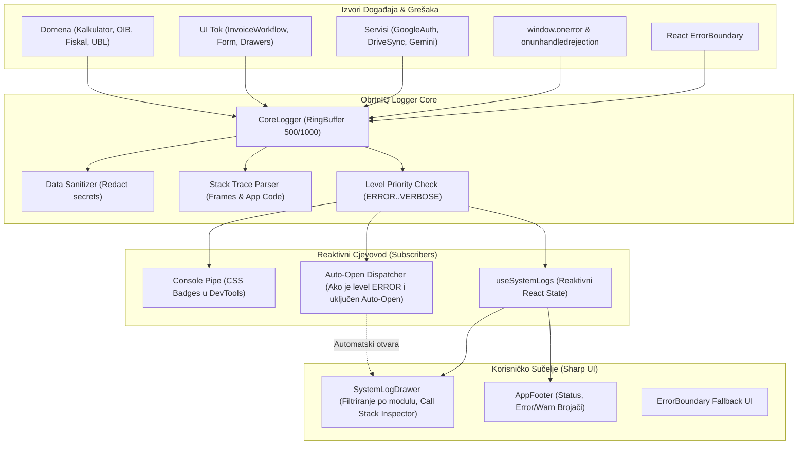

# Plan Implementacije i Validacije: Među-faza 10.5 – Sveobuhvatni Dijagnostički & Telemetrijski Sustav (Core & Web Logging, Scope Filtri, Interaktivni Call Stack Inspector, Global Error Trapping & Auto-Open)

Ovaj dokument definira detaljan plan implementacije za **Među-fazu 10.5** sustava [ObrtnIQ](file:///d:/Documents/Robot%20Hand%20Made/ObrtnIQ). Svrha ove faze je uspostaviti vrhunski, deterministički dijagnostički sustav koji omogućuje potpunu prozirnost rada aplikacije, automatsko hvatanje svih grešaka s točnim *Call Stackom*, filtriranje po razinama i modulima, te pripremu telemetrijske podloge za **Fazu 11** ([Žigo Autonomni Klijentski Agent](file:///d:/Documents/Robot%20Hand%20Made/ObrtnIQ/docs/plan_implementacije_faza_11.md)).

---

## 1. Analiza Postojećeg Logging Sustava

### 1.1. Što sustav trenutno posjeduje?
1. **U paketu [`@obrtniq/core`](file:///d:/Documents/Robot%20Hand%20Made/ObrtnIQ/packages/core/src/logger/):**
   - **`types.ts`:** Definirani nivoi (`ERROR` = 0, `WARN` = 1, `INFO` = 2, `DEBUG` = 3, `VERBOSE` = 4), sučelja `LogEntry`, `ILogger`, `IScopedLogger`.
   - **`logger.ts`:** Klasa `CoreLogger` s cirkularnim spremnikom `RingBuffer<LogEntry>(500)`.
   - **Sanitizacija:** Automatski prepoznaje ključeve s lozinkama, tokenima i tajnama te ih zamjenjuje s `***REDACTED***`.
   - **Greške:** Funkcija `parseError(err)` izvlači `name`, `message` i sirovi string `stack`.
2. **U aplikaciji [`apps/web`](file:///d:/Documents/Robot%20Hand%20Made/ObrtnIQ/apps/web/src/services/logger.ts):**
   - **`appLogger`:** Instanca koja perzistira odabrani prag logiranja u `localStorage` pod ključem `obrtniq_log_level`.
   - **Console Pipe:** Sluša nove zapise i ispisuje ih u konzolu web preglednika (`console.log`, `console.warn`, `console.error`) s obojanim CSS bedževima.
   - **Export:** Funkcija `exportDiagnosticLog()` za preuzimanje JSON datoteke.
   - **UI komponenta [`SystemLogDrawer.tsx`](file:///d:/Documents/Robot%20Hand%20Made/ObrtnIQ/apps/web/src/components/SystemLogDrawer.tsx):** Donji sklopivi panel (400px) s tabovima po razinama, pretragom teksta i pregledom JSON payload-a.
   - **Widget u zaglavlju/podnožju:** [`AppFooter.tsx`](file:///d:/Documents/Robot%20Hand%20Made/ObrtnIQ/apps/web/src/components/layout/AppFooter.tsx) prikazuje broj grešaka i upozorenja te otvara konzolu na klik.

### 1.2. Uočeni nedostaci i razlozi za Fazu 10.5
1. **Nepotpuna pokrivenost pozivima (Missing Logs):**
   - Mnoga ključna mjesta u domeni i formi imaju prazne `catch { }` blokove ili koriste običan `console.error` (npr. `barcode.ts`, `SettingsDrawer.tsx`, `InvoiceItemsEditor.tsx`, `dexie-db.ts`).
   - Kalkulator, OIB/IBAN validatori, fiskalizacijski potpisnik i UBL XML generator nemaju telemetriju na `DEBUG` i `VERBOSE` razini.
2. **Neuhvaćene globalne greške (Uncaught Exceptions):**
   - Ako JavaScript baci neuhvaćenu grešku (`window.onerror`) ili pukne asinkroni Promise (`unhandledrejection`), `appLogger` to ne zabilježi. Korisnik doživi zamrzavanje ili bijeli ekran bez traga u logeru.
3. **Nema automatskog otvaranja logera na grešku (Auto-Open on Error):**
   - Kad se dogodi kritična greška (npr. neuspjelo generiranje PDF-a, Google 403 Drive odbijenica, nevaljani certifikat), loger ostaje zatvoren. Korisnik ne zna što se dogodilo osim ako sam ne primijeti crveni broj u footeru i klikne ga.
4. **Sirovi i nepregledni Call Stack:**
   - Stack trace se prikazuje kao običan neoblikovani tekstualni blok. Nema razlikovanja između korisničkog koda aplikacije (`src/...`) i stotina linija biblioteka (`node_modules`).
5. **Ograničeno filtriranje:**
   - Može se filtrirati samo po točnoj razini (npr. samo WARN ili samo ERROR), a ne po "minimalnoj razini" (npr. "Prikaži sve od WARN naviše").
   - Ne postoji filtriranje po modulu/kontekstu (npr. filtriraj samo `DRIVE:*` ili samo `AUTH:*`).

---

## 2. Ciljevi i Opseg Među-faze 10.5

1. **Uspostava strukturiranog Call Stack analizatora (Stack Trace Parser):**
   - Raščlanjivanje stack tracea na strukturirane okvire (*Stack Frames*): naziv funkcije, datoteka, linija, stupac, te isticanje aplikacijskog koda u odnosu na vanjske pakete.
2. **Global Error Trapping & React Error Boundary:**
   - Presretanje svih neuhvaćenih grešaka u pregledniku (`window.onerror`, `window.onunhandledrejection`) i React komponentama (`ErrorBoundary`).
3. **Mehanika automatskog otvaranja konzole na grešku (*Auto-Open on Error*):**
   - Reaktivno otvaranje `SystemLogDrawer` panela s automatskim fokusom i skrolanjem na nastalu grešku, uz mogućnost uključivanja/isključivanja opcije u zaglavlju konzole (`obrtniq_auto_open_log_on_error`).
4. **Sveobuhvatna instrumentacija koda (Vraćanje i obogaćivanje log poziva):**
   - Pokrivanje svih domenskih modula, skladišta podataka, mrežnih servisa i UI tijeka rada jasnim i strukturiranim log zapisima kroz svih 5 nivoa.
5. **Napredno filtriranje u `SystemLogDrawer`:**
   - Dodavanje padajućeg izbornika modula/konteksta (`Svi moduli`, `AUTH`, `DRIVE`, `INVOICE`, `STORAGE`, `FISCAL`, `PDF`, `GEMINI`).
   - Uvođenje min-level filtra i vizualnog prepoznavanja stack tracea.

---

## 3. Arhitektura i Dizajn Rješenja



---

## 4. Taksonomija Nivoa i Pravila Korištenja

| Razina | Prioritet | Kada se koristi? | Primjer konteksta | Primjer poruke |
| :--- | :---: | :--- | :--- | :--- |
| **`ERROR`** | **0** | Kritični kvarovi koji prekidaju akciju korisnika, neuspjele mrežne transakcije, pad baze, neuspjelo generiranje PDF-a. | `INVOICE:ERROR`, `DRIVE:SYNC`, `GLOBAL:UNCAUGHT` | *"Greška pri fiskalizaciji računa br. 1/POSL1/1"* |
| **`WARN`** | **1** | Neočekivana stanja iz kojih se sustav može oporaviti, validacijska upozorenja, približavanje isteka tokena, nevažeći format unosa. | `AUTH:TOKEN`, `OIB:VALIDATION`, `STORAGE:QUOTA` | *"Google token istječe za 4 min; pokrećem tiho obnavljanje"* |
| **`INFO`** | **2** | Ključni poslovni i životni događaji aplikacije: izdavanje računa, uspješna sinkronizacija, prijava, uvoz baze. | `INVOICE:WORKFLOW`, `DRIVE:SYNC`, `AUTH:GOOGLE` | *"Račun br. 1/POSL1/1 uspješno izdan i zaključan (1.050,00 €)"* |
| **`DEBUG`** | **3** | Tehnički detalji za dijagnostiku: trajanje operacije u ms, veličina datoteke, parametri upita, odobreni scopeovi. | `PDF:VECTOR`, `GEMINI:API`, `STORAGE:DEXIE` | *"Vektorski PDF generiran u 34 ms (veličina: 13.680 B)"* |
| **`VERBOSE`**| **4** | Mikro-telemetrija za razvoj: koraci algoritma, kontrolni zbroj OIB-a, izračun rabata po stavci, promjene unosa polja. | `CALC:ITEM`, `ISO7064:STEP`, `THEME:CHANGE` | *"Izračunata stavka: 2 kom * 50,00 € - 10% rabat = 90,00 €"* |

---

## 5. Matrica Instrumentacije: Popis Datoteka i Mjesta za Logiranje

### 5.1. Sloj Domene (`packages/core/src/`)
1. **`calculator.ts` (`CALC:ENGINE`):**
   - `VERBOSE`: Ulazne stavke i međurezultati osnovice, popusta i PDV-a.
   - `DEBUG`: Završni zbroj računa i raspodjela po poreznim stopama.
   - `WARN`: Stavka s negativnom cijenom ili rabatom većim od 100%.
2. **`oib.ts` & `iban.ts` (`VALIDATION:OIB`, `VALIDATION:IBAN`):**
   - `VERBOSE`: Koraci ISO 7064 Mod 11,10 algoritma i MOD 97 izračuna IBAN-a.
   - `DEBUG`: Prepoznata banka na temelju vodećih znamenki IBAN-a (npr. ZABA, PBZ).
   - `WARN`: Neispravna kontrolna znamenka unesenog OIB-a ili IBAN-a.
3. **`fiskalizacija.ts` (`FISCAL:CORE`):**
   - `DEBUG`: Sastavljanje zaštitnog koda izdavatelja (ZKI) s datumom, vremenom i brojem računa.
   - `INFO`: Uspješno potpisan račun privatnim ključem.
   - `ERROR`: Nevaljani certifikat, istekao ključ ili greška pri MD5/SHA-1 sažetku.
4. **`crypto-anchor.ts` (`CRYPTO:ANCHOR`):**
   - `DEBUG`: Izvođenje ključa preko PBKDF2 (100.000 iteracija) iz `googleSub` i PIN-a.
   - `INFO`: Generiran deterministički salt za lokalnu bazu.
5. **`kpr-csv.ts` & `posd.ts` (`EXPORT:KPR_CSV`, `EXPORT:POSD_XML`):**
   - `DEBUG`: Broj stavki KPR-a uključenih u CSV/XML, provjera UTF-8 BOM-a.
   - `INFO`: Uspješno generiran XML za ePoreznu ili KPR CSV s točnim zbrojem.
   - `WARN`: Preskočene neplaćene ponude ili računi bez datuma uplate.

### 5.2. Sloj Baze Podataka (`apps/web/src/storage/`)
1. **`dexie-db.ts` (`STORAGE:DEXIE`):**
   - `INFO`: Inicijalizacija Dexie baze (verzija 2), otvaranje tablica.
   - `DEBUG`: Izvršavanje transakcije (dodavanje računa, ažuriranje partnera, brojanje zapisa).
   - `WARN`: Upozorenje na veliku količinu lokalnih podataka (> 50 MB) ili sporo izvršavanje upita (> 100 ms).
   - `ERROR`: `DexieError`, `QuotaExceededError` ili greška pri zaključavanju indeksa.

### 5.3. Sloj Mrežnih & Vanjskih Servisa (`apps/web/src/services/`)
1. **`google-auth-service.ts` (`AUTH:GOOGLE`):**
   - `DEBUG`: Učitavanje GIS skripte, provjera Client ID formata, `inspectToken` poziv.
   - `INFO`: Uspješna Google prijava, preuzet korisnički profil (`sub`), spremljena sesija.
   - `DEBUG`: Tiho pozadinsko obnavljanje tokena (`requestSilentToken` s `prompt: ''`).
   - `WARN`: Token istječe za manje od 5 minuta; korisnik otkazao prijavu.
   - `ERROR`: Google OAuth greške (`invalid_client`, `origin_mismatch`, `interaction_required`).
2. **`google-drive-service.ts` (`DRIVE:SYNC`, `DRIVE:API`):**
   - `DEBUG`: Upit prema `appDataFolder` mapi, slanje probnog zahtjeva.
   - `INFO`: Započet / dovršen prijenos sigurnosne kopije na Google Drive (veličina u bajtovima).
   - `WARN`: Google Drive API nije omogućen (`403 accessNotConfigured`) s priloženom poveznicom za konzolu.
   - `ERROR`: Mrežni prekid tijekom sinkronizacije ili greška pri raspakiravanju preuzete kopije.
3. **`gemini-service.ts` (`AI:GEMINI`):**
   - `DEBUG`: Slanje prompta prema modelu (`gemini-2.0-flash`), trajanje odgovora u ms.
   - `INFO`: Uspješno preporučene KPD 2025 šifre na temelju opisa računa.
   - `WARN`: Prekoračena kvota (HTTP 429), neispravan BYOK ključ ili nesiguran sadržaj (Safety Block).
   - `ERROR`: Neuspjelo spajanje s modelom ili nemogućnost parsiranja JSON odgovora.
4. **`fiscal-service.ts` (`FISCAL:SERVICE`):**
   - `DEBUG`: Slanje SOAP poruke Poreznoj upravi (CIS).
   - `INFO`: Zaprimljen JIR (Jedinstveni Identifikator Računa).
   - `WARN`: Prebacivanje u offline način izdavanja (rok 48h za naknadnu fiskalizaciju).
   - `ERROR`: Odbijenica Porezne uprave (neispravan OIB, neusklađen certifikat).

### 5.4. Sloj Korisničkog Sučelja & Tijekova (`apps/web/src/hooks/` & `components/`)
1. **`useInvoiceWorkflow.ts` (`INVOICE:WORKFLOW`):**
   - `INFO`: Pokrenuto izdavanje računa, zaključavanje statusa (`IZDANO`), generiran ZKI.
   - `INFO`: Storniranje računa br. X, kreiran korektivni storno račun s negativnim predznakom.
   - `WARN`: Korisnik pokušava izdati račun s neispravnim OIB-om ili bez stavki (blokada).
   - `ERROR`: Greška pri spremanju računa u bazu ili ažuriranju brojača.
2. **`pdf-generator.ts` (`PDF:VECTOR`):**
   - `DEBUG`: Inicijalizacija jsPDF instance, učitavanje Roboto/Outfit vektorskih fontova.
   - `DEBUG`: Crtanje memoranduma, tablice stavki i digitalnog pečata.
   - `INFO`: PDF račun uspješno generiran i spreman za preuzimanje (vrijeme izvođenja u ms).
   - `ERROR`: Greška pri renderiranju slike pečata/loga ili Canvas vektora.
3. **`barcode.ts` (`BARCODE:ENGINE`):**
   - `DEBUG`: Generiranje HUB-3 PDF417 barkoda ili EPC QR koda.
   - `ERROR`: Zamjena postojećeg `console.error` sa strukturiranim `appLogger.scope('BARCODE').error(...)`.

---

## 6. Mehanizam za Strukturirani Prikaz Call Stacka

### 6.1. Stack Trace Parser
Implementirati u `@obrtniq/core/src/logger/stack-parser.ts`:
```typescript
export interface StackFrame {
  raw: string;
  functionName: string;
  fileName: string;
  relativePath: string;
  lineNumber: number;
  columnNumber: number;
  isAppCode: boolean; // true ako je unutar src/, false ako je node_modules ili browser internal
}

export function parseStackTrace(stack?: string): StackFrame[] {
  if (!stack) return [];
  const lines = stack.split('\n');
  const frames: StackFrame[] = [];

  for (const line of lines) {
    const trimmed = line.trim();
    if (!trimmed.startsWith('at ') && !trimmed.includes('@')) continue;

    // Regex za Chrome / Edge / Node ("at FunctionName (http://localhost:5173/src/file.ts:12:34)")
    const chromeMatch = trimmed.match(/^at\s+(?:(.+?)\s+\()?(?:(.+?):(\d+):(\d+)\)?$/);
    if (chromeMatch) {
      const functionName = chromeMatch[1] || '<anonymous>';
      const fileName = chromeMatch[2] || '';
      const lineNumber = parseInt(chromeMatch[3] || '0', 10);
      const columnNumber = parseInt(chromeMatch[4] || '0', 10);
      const isAppCode = fileName.includes('/src/') && !fileName.includes('node_modules');
      
      frames.push({
        raw: trimmed,
        functionName,
        fileName,
        relativePath: fileName.split('/src/')[1] ? `src/${fileName.split('/src/')[1]}` : fileName,
        lineNumber,
        columnNumber,
        isAppCode,
      });
    }
  }

  return frames;
}
```

### 6.2. UI Prikaz Call Stacka u `SystemLogDrawer`
Kada je zapis razine `ERROR` i posjeduje `entry.error`:
1. **Vizualno istaknuti prvi aplikacijski okvir:** Linija koda u ObrtnIQ repozitoriju koja je uzrokovala grešku prikazuje se na vrhu velikim slovima s direktnim linkom (npr. `src/hooks/useInvoiceWorkflow.ts:142:15`).
2. **Razvrstavanje okvira:**
   - Aplikacijski okviri (`isAppCode: true`): Prikazuju se podebljano u bijeloj/žutoj boji s oznakom `[APP]`.
   - Vanjski paketi (`node_modules`): Zatamnjeni u sivoj boji, sklopivi pod linkom *"Prikaži sistemske okvire (+8)"*.
3. **Gumb "Kopiraj Call Stack":** Jednim klikom kopira cjeloviti čisti stack trace spreman za analizu ili slanje programeru.

---

## 7. Global Error Trapping, Error Boundary & Auto-Open Mehanika

### 7.1. Global Error Trap (`apps/web/src/services/global-error-trap.ts`)
Inicijalizira se u `main.tsx` prije pokretanja React aplikacije:
```typescript
export function initGlobalErrorTrap(): void {
  // 1. Neuhvaćene JavaScript iznimke
  window.addEventListener('error', (event) => {
    appLogger.scope('GLOBAL:UNCAUGHT').error(
      event.message || 'Neuhvaćena JavaScript pogreška',
      event.error || new Error(event.message),
      { filename: event.filename, lineno: event.lineno, colno: event.colno }
    );
  });

  // 2. Neobrađeni asinkroni Promise rejections
  window.addEventListener('unhandledrejection', (event) => {
    const reason = event.reason;
    const err = reason instanceof Error ? reason : new Error(String(reason));
    appLogger.scope('GLOBAL:PROMISE').error(
      `Neobrađeno asinkrono odbijanje: ${err.message}`,
      err
    );
  });
}
```

### 7.2. React `AppErrorBoundary.tsx`
Hvata greške unutar komponentnog stabla Reacta (npr. pogreška pri renderiranju računa ili drawer panela):
- Zapisuje grešku u `appLogger.scope('REACT:CRASH').error(...)` zajedno s `componentStack`.
- Prikazuje "Sharp UI" ekran s upozorenjem, gumbom *"Osvježi aplikaciju"* i gumbom *"Pregledaj u Dnevniku Grešaka"*.

### 7.3. Auto-Open on Error mehanizam
U sustavu se definira reaktivni mehanizam:
1. `localStorage` sprema korisničku preferencu: `obrtniq_auto_open_log_on_error` (`true` po defaultu).
2. U `useSystemLogs.ts` dodaje se slušatelj:
   ```typescript
   appLogger.subscribe((entry) => {
     if (entry.level === 'ERROR' && getAutoOpenPreference()) {
       openLogDrawerWithHighlight(entry.id);
     }
   });
   ```
3. U gornjoj traci [`SystemLogDrawer.tsx`](file:///d:/Documents/Robot%20Hand%20Made/ObrtnIQ/apps/web/src/components/SystemLogDrawer.tsx) dodaje se sklopka:
   `[✓] Automatski otvori na grešku (Auto-Open on Error)`.
   Korisnik je može isključiti jednim klikom ako ne želi da mu skočni panel ometa rad.

---

## 8. Unapređenje Korisničkog Sučelja: `SystemLogDrawer.tsx`

Novi izgled i mogućnosti konzolnog panela:
1. **Traka s filtrima (Filter Toolbar):**
   - **Tabovi po razinama:** `Sve`, `ERROR`, `WARN`, `INFO`, `DEBUG`, `VERBOSE`.
   - **Padajući izbornik modula (Konteksti):**
     `Svi moduli` | `INVOICE` | `AUTH` | `DRIVE` | `STORAGE` | `FISCAL` | `PDF` | `AI` | `GLOBAL`.
   - **Pretraga teksta:** Pretražuje poruke, kontekst i podatke uživo.
   - **Prekidač "Auto-Open":** Brzo uključivanje/isključivanje automatskog otvaranja.
2. **Konzolni zapisnik:**
   - Obojani bedževi za nivoe (Crveno za ERROR, Narančasto za WARN, Zeleno za INFO, Plavo za DEBUG, Siva za VERBOSE).
   - Oznaka modula s bojom konteksta.
   - Sklopivi detalji s dva taba:
     - **Tab 1: Podaci (JSON Payload)** — Sintaksno obojan JSON.
     - **Tab 2: Call Stack Inspector** — Strukturirani prikaz linija koda s oznakama aplikacijskih datoteka.
3. **Akcijska traka:**
   - **Izvezi JSON:** Preuzimanje cjelovitog sanitiziranog paketa za dijagnostiku.
   - **Kopiraj odabrano:** Kopiranje pojedinačnog zapisa s kompletnim stackom u međuspremnik.
   - **Isprazni (Clear):** Čišćenje memorije jednim klikom.

---

## 9. Protokol Verifikacije i Gate-Check Kriteriji

### 9.1. Automatizirani Testovi (Novi test paket: `apps/web/tests/logging-system.test.ts`)
Napisati novi set testova koji verificira:
1. **L-01 (Nivoi i filtriranje):** Provjera da `CoreLogger` ispravno poštuje prag filtriranja (ako je prag `INFO`, pozivi `DEBUG` i `VERBOSE` ne ulaze u prstenasti spremnik).
2. **L-02 (Sanitizacija podataka):** Provjera da objekti koji sadrže polja `password`, `token`, `secret`, `privateKey` bivaju zamijenjeni s `***REDACTED***`.
3. **L-03 (Stack Trace Parser):** Provjera da `parseStackTrace` ispravno prepoznaje nazive funkcija, datoteke, linije i označava aplikacijski kod (`isAppCode: true`).
4. **L-04 (Global Error Trap):** Provjera da umjetno izazvana neuhvaćena greška ili odbijeni Promise bivaju zabilježeni u logeru s razinom `ERROR`.
5. **L-05 (Auto-Open mehanizam):** Provjera da emitiranje `ERROR` zapisa aktivira callback za automatsko otvaranje kada je postavka uključena, a miruje kada je isključena.
6. **L-06 (Prstenasti buffer - nema curenja memorije):** Provjera da se nakon 600 unosa spremnik zaustavlja na točno 500 najnovijih zapisa (FIFO princip).

### 9.2. Gate-Check Kriteriji za prijelaz na Fazu 11
- [ ] Svih 120 postojećih testova + 6 novih testova prolaze sa 100% uspjehom (ukupno 126+ testova).
- [ ] `npm run build` prolazi s kodom 0 (čisti TypeScript i Vite produkcijski bundle).
- [ ] Umjetno izazvana greška u sučelju automatski otvara `SystemLogDrawer` i jasno prikazuje točnu liniju u izvornom kodu.
- [ ] Cijeli logging sustav ostaje 100% lokalno u memoriji preglednika bez slanja telemetrije na vanjske servere (Zero-Server invariant).
