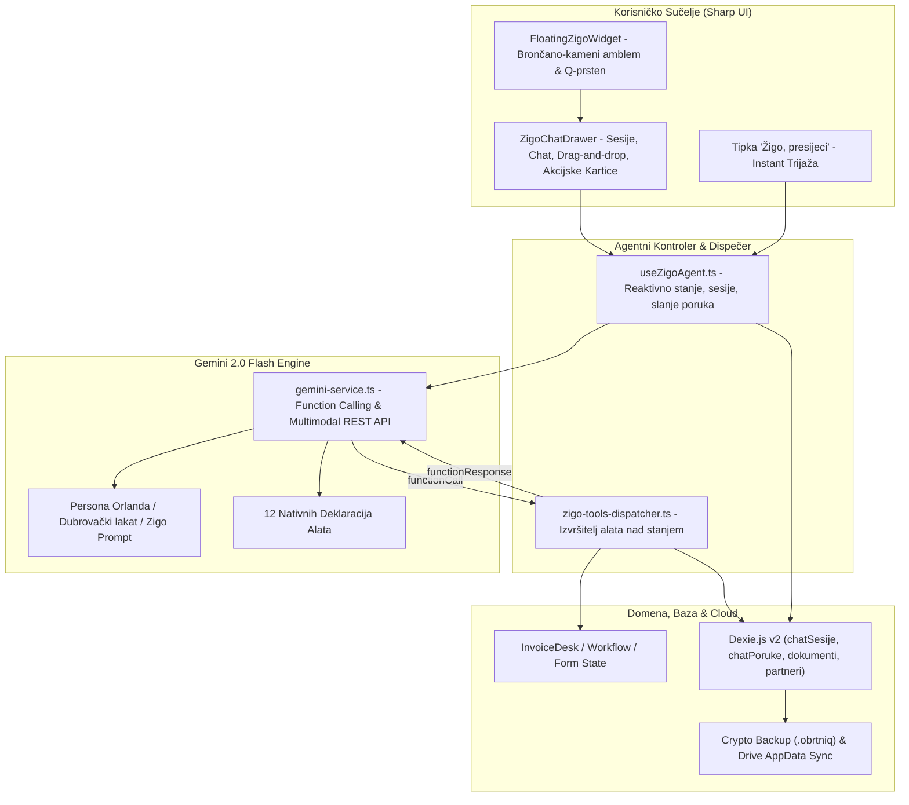

# Plan Implementacije i Validacije: Faza 11 – Žigo Autonomni Klijentski Agent (Gemini 2.0 Function Calling, Multimodalna Obrada, Perzistentni Chat & Žigin Rez)

Ovaj dokument definira detaljnu arhitekturu, sigurnosni model, korisničko sučelje, korake implementacije i **potpuni validacijski protokol s Gate-Check kriterijima** za **Fazu 11** sustava [ObrtnIQ](file:///d:/Documents/Robot%20Hand%20Made/ObrtnIQ).

---

## 1. Analiza i Opseg Faze 11

### 1.1. Status sustava prije Faze 11
Nakon dovršetka Faze 10 i zajedničke validacije Faza 9 i 10, sustav ima:
* 120/120 automatiziranih testova koji prolaze sa 100% uspješnošću.
* Kompletno lokalno fakturiranje, immutability, storno, KPR, PO-SD XML za ePoreznu, KPR CSV (Excel BOM), cjenik s KPD 2025 šiframa, Fiskalizaciju 1.0 (CIS) & 2.0 (UBL 2.1 e-Račun), vektorski A4 PDF, HUB-3 PDF417 barkod i EPC QR kod.
* Google Identity kao kriptografsko sidro, automatsku Google Drive AppData sinkronizaciju (15 GB besplatno, `drive.appdata`) i bazičnu Gemini AI KPD preporuku.

### 1.2. Cilj Faze 11 (Žigo kao Autonomni Agent Sustava)
U Fazi 11, ObrtnIQ nadograđuje pasivni KPD birač u **punokrvnog autonomnog klijentskog agenta pod imenom Žigo (Digitalni Orlando)**:
1. **Autonomno Izvršavanje Akcija (Gemini 2.0 Function Calling)**:
   - Agent ne daje samo savjete u tekstu, već **izvršava operacije na sustavu** putem nativnih deklaracija funkcija (Tool Calling).
   - Može popuniti radnu plohu unosa, dodati stavke, stvoriti partnera, provjeriti OIB, izdati račun (F2 uz potvrdu), izvesti KPR CSV ili pripremiti PO-SD XML.
2. **Perzistentni Chat & Konteksti (Zero-Server Dexie.js Baza)**:
   - Sve sesije i poruke pohranjuju se lokalno u novim tablicama `chatSesije` i `chatPoruke`.
   - Razgovori se automatski uključuju u enkriptirani `.obrtniq` paket (AES-256-GCM) i sinkroniziraju na korisnikov privatni Google Drive.
3. **Multimodalni Ulaz (Slike i PDF Dokumenti)**:
   - Korisnik u chat može povući fotografiju računa (npr. račun za gorivo ili uredski materijal) ili ulazni PDF e-Račun.
   - Agent analizira sliku putem Gemini 2.0 Visiona, procjenjuje poslovnu opravdanost troška prema poreznim propisima RH i nudi automatski unos.
4. **Osobnost prema [`zigo_info.md`](file:///d:/Documents/Robot%20Hand%20Made/ObrtnIQ/docs/zigo_info.md)**:
   - Duh i diplomacija Dubrovačke Republike: miran, stoički, duhovit, kirurški precizan, reže birokratsku dramu, spušta puls na 60 i servira točno jedno dugme za rješenje.
   - Dubrovački lakat: *„Ni milimetra više državi nego što joj pripada, ni centa manje da ti ne zatvore vrata.”*
5. **Specijalna Mehanika: Žigin „Rez”**:
   - Jednim klikom gasi preopterećenje i skenira bazu te nudi sažetak u tri točke:
     1. *Što gori* (rok < 24h).
     2. *Što čeka* (neka kisne do ponedjeljka).
     3. *Jedna akcija sad* (veliko glavno dugme).

---

## 2. Arhitektura Faze 11



---

## 3. Detaljni Pregled Modula i Komponenti

### 3.1. Proširenje Domenskog Modela i Baze Podataka (Dexie v2)
U `@obrtniq/core` i `apps/web/src/storage/dexie-db.ts` dodaju se modeli i tablice:

```typescript
export interface ZigoChatSesija {
  id: string;               // UUID
  naslov: string;           // npr. "Priprema ponude za klijenta iz Hamburga"
  kreirano: string;         // ISO datum
  azurirano: string;        // ISO datum
  arhivirano: boolean;
  zadnjiKpdContext?: string;
}

export interface ZigoChatPoruka {
  id: string;               // UUID
  sesijaId: string;         // FK na ZigoChatSesija
  uloga: 'user' | 'assistant' | 'tool';
  tekst: string;
  privitci?: Array<{
    naziv: string;
    mimeType: string;
    base64Data: string;     // Slika ili PDF u Base64 obliku
    velicinaBajtova: number;
  }>;
  toolPoziv?: {
    imeFunkcije: string;
    argumenti: Record<string, any>;
  };
  toolRezultat?: {
    uspjeh: boolean;
    podaci: any;
    poruka?: string;
  };
  kreirano: string;         // ISO datum
}
```

* **Dexie verzija 2**:
  ```typescript
  this.version(2).stores({
    // Postojeće tablice iz v1
    obrtProfil: 'id',
    partneri: 'id, oib, naziv, poreznaZona, aktivan',
    artikli: 'id, sifra, kpdSifra, naziv, aktivan',
    dokumenti: 'id, brojDokumenta, godina, brojSekvenca, [godina+poslovniProstorOznaka+naplatniUredjajOznaka], partnerId, status, vrstaDokumenta, datumIzdavanja',
    naplatePromet: 'id, dokumentId, godina, kvartal, datumNaplate, brojKprStavke',
    // Nove tablice za Agenta u v2
    chatSesije: 'id, kreirano, azurirano, arhivirano',
    chatPoruke: 'id, sesijaId, uloga, kreirano',
  });
  ```

---

### 3.2. Persona i Sistemska Instrukcija (Orlandov Kodeks)
Tekst sistemske instrukcije integrira se u svaki poziv Gemini modela:
* **Dubrovački mir i diplomacija**: Nema kukanja, nema patetike. Kad dođe porezno rješenje, situacija se rješava kao što je Senat rješavao harač — smireno i pametno.
* **Dubrovački lakat**: *„Ođe mjerimo točno po zakonu. Preko lakta ne damo, ispod lakta ne zakidamo.”*
* **Porezni filtar za opravdanost troškova**: Strogo razlikovanje privatnih troškova od poslovnih (zaštita od poreznog nadzora).
* **Čuvar praga od 40.000 €**: Upozorenje na ulazak u sustav PDV-a i savjetovanje o tajmingu fakturiranja.
* **Pad CIS poslužitelja**: *„Pao je i Napoleon, pa Grad eno još stoji đe je i bio. Ja sam račune zapečatio lokalnim kodom, zabilježio milisekundu. Popij čašu vode, nemoj da ti tlak skače radi tuđeg lošeg interneta.”*

---

### 3.3. Šifarnik Alata Sustava (Function Calling)

Gemini modelu se šalje polje `tools` s 12 nativnih funkcija:

| Naziv funkcije | Svrha i Djelovanje | Parametri |
| :--- | :--- | :--- |
| `postavi_kupca` | Popunjava podatke o kupcu na aktivnom računu | `partnerNaziv`, `oib`, `iban`, `taxZone` |
| `dodaj_stavku_racuna` | Dodaje redak stavke s KPD šifrom i iznosom | `naziv`, `kpdSifra`, `kolicina`, `cijena`, `jedinicaMjere` |
| `ocisti_stavke_racuna` | Briše sve stavke s trenutnog nacrta | *(nema)* |
| `izdaj_aktivni_racun` | Priprema račun za izdavanje i traži potvrdu (F2) | *(nema)* |
| `storniraj_racun` | Pokreće proceduru storniranja dokumenta | `brojDokumenta`, `razlog` |
| `pretrazi_cjenik` | Pretražuje lokalni katalog artikala i usluga | `pojam` |
| `dodaj_u_cjenik` | Sprema novu uslugu s KPD 2025 šifrom u cjenik | `naziv`, `kpdSifra`, `cijena`, `jedinicaMjere` |
| `pretrazi_partnere` | Pretražuje lokalni adresar partnera | `pojam` |
| `dohvati_financijski_status` | Vraća KPR stanje i preostali iznos do 40.000 € | *(nema)* |
| `izvezi_kpr_csv` | Pokreće generiranje i preuzimanje KPR CSV-a | *(nema)* |
| `izvezi_posd_xml` | Pokreće generiranje PO-SD XML-a za ePoreznu | *(nema)* |
| `aktiviraj_zigin_rez` | Trijaža stanja: 1. Što gori, 2. Što čeka, 3. Akcija | *(nema)* |

---

### 3.4. Multimodalna Analiza (Slike i PDF)
* Korisnik može povući sliku (račun, slip za gorivo, ponuda dobavljača) ili PDF u chat.
* Klijent pretvara datoteku u Base64 i šalje je unutar `contents[].parts[]`:
  ```json
  {
    "inlineData": {
      "mimeType": "image/jpeg",
      "data": "..."
    }
  }
  ```
* Žigo analizira sliku, prepoznaje tekst (OCR), izdvaja OIB, IBAN, stavke i iznose, te odgovara:
  * Ako je trošak opravdan: Nudi spremanje dobavljača ili kreiranje naloga za plaćanje.
  * Ako je trošak sumnjiv (roštilj, parfem): Upozorava korisnika na rizik inspekcije uz Orlandov humor.

---

### 3.5. Korisničko Sučelje: Sharp UI i Orlandov Widget

#### A. Plutajući Amblem (`FloatingZigoWidget.tsx`)
* Smješten u donjem desnom kutu ekrana (`fixed bottom-6 right-6 z-40`).
* Kućište s teksturom klesanog kamena i brončanim detaljima.
* **Rotirajući Q-prsten**: Kad model analizira ili pokreće funkciju, vanjski prsten slova Q se animirano vrti brzinom centrifuge.

#### B. Ladica za Razgovor (`ZigoChatDrawer.tsx`)
* Bočna ladica s listom sesija i glavnim prozorom razgovora.
* Prikaz poruka uz diferencijaciju korisnika i Žiga.
* **Interaktivne Akcijske Kartice (Action Cards)**:
  Kada Žigo pripremi račun ili akciju, u chatu se prikazuje pregledna kartica:
  ```
  ┌────────────────────────────────────────────────────────┐
  │ 📋 ŽIGO JE PRIPREMIO RAČUN                            │
  │ Kupac: ACME Solutions GmbH (Njemačka, EU)              │
  │ Stavka: Razvoj softvera (60 sati x 60 €)               │
  │ Ukupno: 3.600,00 €                                     │
  │                                                        │
  │ [ Primijeni na Radnu Plohu ]   [ Izdaj Račun (F2) ]   │
  └────────────────────────────────────────────────────────┘
  ```
* **Tipka „Žigo, presijeci”**: Istaknuti gumb na dnu za trenutnu trijažu i smanjenje stresa.

---

## 4. Plan Rada po Koracima (Implementacijska Faza)

| Korak | Naziv zadatka | Detalji izvedbe |
| :---: | :--- | :--- |
| **K11.1** | **Baza i Domena** | Proširenje Dexie baze na verziju 2 (`chatSesije`, `chatPoruke`), kreiranje repozitorija i ažuriranje snapshot backup enginea. |
| **K11.2** | **Gemini Tool Engine** | Proširenje [`gemini-service.ts`](file:///d:/Documents/Robot%20Hand%20Made/ObrtnIQ/apps/web/src/services/gemini-service.ts) za podršku Function Callinga (`tools`, `functionDeclarations`, `functionResponse`) i multimodalnog unosa slika/PDF-ova. |
| **K11.3** | **Zigo Tools Dispatcher** | Izrada kontrolera `zigo-tools-dispatcher.ts` koji povezuje deklaracije alata s radnom plohom (`form`, `items`, `workflow`), bazom partnera, cjenikom i KPR-om. |
| **K11.4** | **Reaktivna Kuka `useZigoAgent`** | Upravljanje stanjem sesija, poviješću poruka, statusom razmišljanja (Q-prsten) i slanjem multimodalnih upita. |
| **K11.5** | **UI Komponente** | Izrada `FloatingZigoWidget.tsx`, `ZigoChatDrawer.tsx`, `ZigoMessageList.tsx` i `ZigoActionCard.tsx` u Sharp UI estetici. |
| **K11.6** | **Integracija u Aplikaciju** | Uvezivanje u [`App.tsx`](file:///d:/Documents/Robot%20Hand%20Made/ObrtnIQ/apps/web/src/App.tsx) i [`AppHeader.tsx`](file:///d:/Documents/Robot%20Hand%20Made/ObrtnIQ/apps/web/src/components/layout/AppHeader.tsx), dodavanje kartice za FAZU 11 u [`PhaseOverviewGrid.tsx`](file:///d:/Documents/Robot%20Hand%20Made/ObrtnIQ/apps/web/src/components/layout/PhaseOverviewGrid.tsx). |
| **K11.7** | **Testovi i Validacija** | Izrada testova `apps/web/tests/zigo-agent.test.ts` (tool calling, sesije, multimodal, trijaža). |

---

## 5. Protokol Validacije i Gate-Check Kriteriji

### 5.1. Testni Scenariji (V11-1 do V11-8)

| Oznaka | Područje | Scenarij i Koraci | Kriterij Uspjeha |
| :---: | :--- | :--- | :--- |
| **V11-1** | **Baza Podataka** | Stvaranje sesije, dodavanje poruka s privitkom u Dexie v2. | Podaci su uspješno spremljeni i dohvaćeni bez gubitka. |
| **V11-2** | **Function Calling: Račun** | Korisnik: *"Pripremi račun za ACME d.o.o., OIB 12345678903, 10 sati programiranja po 60 eura"*. | Žigo poziva `postavi_kupca` i `dodaj_stavku_racuna`; forma se popunjava. |
| **V11-3** | **Function Calling: Cjenik** | Korisnik: *"Spremi mi novu uslugu dizajn logotipa u cjenik po 250 eura"*. | Žigo poziva `dodaj_u_cjenik` s KPD šifrom `74.10.11`; artikl je u cjeniku. |
| **V11-4** | **Status Praga i KPR** | Korisnik: *"Koliko mi je još ostalo do praga od 40 tisuća?"*. | Žigo poziva `dohvati_financijski_status` i odgovara točnim preostalim iznosom. |
| **V11-5** | **Žigin „Rez” Trijaža** | Korisnik klikne *"Žigo, presijeci"*. | Žigo poziva `aktiviraj_zigin_rez` i servira sažetak: 1. Što gori, 2. Što čeka, 3. Akcija sad. |
| **V11-6** | **Porezni Filtar (Ćevapi Test)** | Korisnik šalje sliku računa za privatni roštilj. | Žigo duhovito odbija pravdanje privatnog troška i štiti korisnika od inspekcije. |
| **V11-7** | **Multimodalni Sken** | Korisnik uploada sliku računa za uredski papir. | Žigo ekstrahira OIB i iznos te nudi automatski unos u evidenciju. |
| **V11-8** | **Zero-Server Kripto Backup** | Izvoz baze u `.obrtniq` paket s uključenim chat sesijama. | Cjelokupna povijest razgovora je kriptirana i uspješno se restaurira. |

### 5.2. Gate-Check Kriteriji za Prijelaz Faze
1. **Vitest**: 100% prolaznih testova na cijelom monorepou (svi postojeći testovi 1 do 10 + novi testovi V11).
2. **TypeScript**: `tsc -b` prolazi sa **0 grešaka** u `@obrtniq/core` i `@obrtniq/web`.
3. **Vite produkcijski build**: `npm run build` završava s izlaznim kodom 0.
4. **Dev Server**: `http://localhost:5173/` vraća `StatusCode: 200 OK`.
5. **Git repozitorij**: Sve promjene komitane s čistim stablom.
