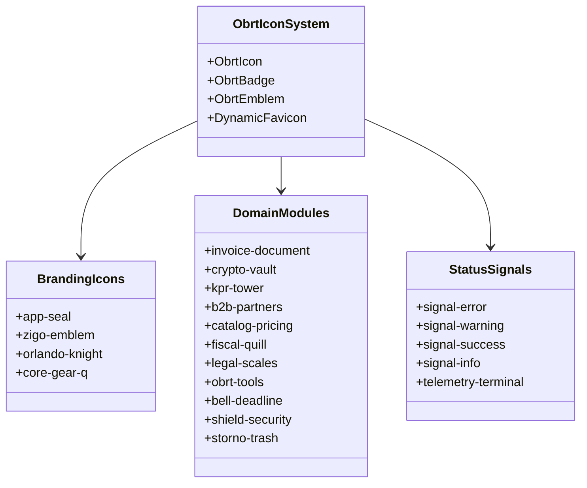

# Faza 12: ObrtnIQ Sharp Icon System & Dinamički SVG Vektorski Engine

**Dokument:** Arhitektonska specifikacija i plan implementacije Faze 12  
**Status:** Spreman za implementaciju  
**Cilj:** Implementacija prilagođenog, visoko-skalabilnog SVG vektorskog sustava ikona temeljenog na stilu "Dubrovačke Kripto-Republike" i "Sharp Cyber-Stone" estetike, od dinamičkog favicona i generičkih statusnih signala (Error, Warn, Info, Success) do specifičnih domenskih amblema i bedževa, s podrškom za dinamičku promjenu tona (Hue / Color Map) u skladu s temom i interaktivnim CSS micro-animacijama na hover/evente.

---

## 1. Analiza Vizualnog Stila i Inspiracije (Dizajnerski DNK)

Na temelju priloženih grafičkih predložaka definirana su tri ključna vizualna stila:

```
┌────────────────────────────────────────────────────────────────────────────────────────┐
│                        DIZAJNERSKI DNK: DUBROVAČKA KRIPTO-REPUBLIKA                    │
├────────────────────────────────────────────────────────────────────────────────────────┤
│  1. KAMENI RELJEF & MEANDRI      2. DUKATNO ZLATO & ČELIK      3. KIBERNETIČKI VODOVI  │
│  - Masivne kružne konture        - Zlatni obrubi i krune       - Mikroprocesorske veze │
│  - Pukotine i klesane teksture   - Vitez Orlando i mač         - Neonski cijan akcenti │
│  - Geometrijski labirinti        - Kamene kule i vage pravde   - "Q" jezgra procesora  │
└────────────────────────────────────────────────────────────────────────────────────────┘
```

### 1.1. Dekonstrukcija Priloženih Slika
1. **Slika 1 (Matrica 16 Okruglih Bedž Ikona - `ObrtIQ_Icons01.png`):**
   - **Format:** Kružni medaljoni s tamnoplavom/škriljevac podlogom (`#162032` / `#1E293B`), dvostrukim vanjskim prstenom i stiliziranim ikonografskim motivima.
   - **Karakteristike:** Čiste vektorske linije s urezanim sjenama, kombinacija čelično-sive, zlatno-brončane i tamne podloge.
   - **16 identificiranih motiva:**
     1. *Vitez Orlando:* Oklop, šljem, mač i lebdeća kruna s "Q" oznakom (Persona Žigo agenta).
     2. *Kula Minčeta s grafom rasta:* Kamena utvrda s uzlaznom linijom prometa (Promet / KPR).
     3. *Službeni račun:* Dokument s oznakama `+ - * =` i Euro kovanicom (Izdavanje računa).
     4. *Vaga pravde s novcem:* Dvostruka vaga s tegovima od kovanica (Paušalni porez & zakoni).
     5. *Kripto-trezor:* Kameno-čelični sef s Euro znakom i tiskanim krugovima (AES-256 backup).
     6. *Stupčasti dijagram s kulom:* Analitika prihoda i kvartalni obračuni.
     7. *Most i rukovanje partnera:* Gradska vrata s figurama u dogovoru (B2B partneri / adresar).
     8. *Katalog s cjenikom:* Otvorena knjiga s etiketom cijene i zupčanikom (Cjenik usluga s KPD 2025).
     9. *Trokut upozorenja s alarmom:* Napukli trokut sa sirenom i mikro-vodovima (Sustavni dnevnik / greške).
     10. *Zvono s kalendarom:* Zlatno zvono s oznakom dana (Dospijeća plaćanja i 48h offline rok).
     11. *Štit s ključanicom:* Kameni štit s vertikalnim ključem i krugovima (FINA Web Crypto trezor).
     12. *Procesorski zupčanik "Q":* Zupčanik s integriranim krugom i oznakom Q (ObrtnIQ Core Engine).
     13. *Zupčanik s perom i ugovorom:* Guščje pero, zupčanik i papir (Fiskalizacija 1.0 & e-Račun UBL 2.1).
     14. *Kanta za otpad sa zupčanicima:* Metalna kanta s industrijskim elementima (Storno & reset baze).
     15. *Prekriženi čekić i ravnalo:* Zanatski i mjerni alati (Postavke obrta i poslovanja).
     16. *Vaga trgovačkog prava:* Klasična ravnotežna vaga (Članak 90. st. 2 & porezni propisi).

2. **Slika 2 (Amblem Žigo Agenta - `ZigoIcon01.png`):**
   - Višeslojni kiber-kameni amblem: središnji okomiti mač presječen uzlaznom cik-cak munjom, robotski mozak s krugovima na lijevoj strani, mehanički zupčanici na desnoj, sidro u dnu te neonsko-plave svjetlosne linije duž labirintskog obruba.

3. **Slika 3 (Glavni Pečat ObrtnIQ - `ObrtnIQ_Icon01.png`):**
   - Glavni identitetski pečat aplikacije: robotska oklopljena ruka savijena pod pravim kutom (**"dubrovački lakat"** - 51.2 cm, povijesna mjera s Orlandova stupa), mač, kruna spojena s mozgom unutar "Q" aureole, kalkulator, kula i vaga. Savršen izvor za **aplikacijski logotip i dinamički SVG Favicon**.

---

## 2. Arhitektura Ikonskog Sustava i Tehnološki Izbor

### 2.1. Zašto prilagođeni SVG React sustav umjesto generičkih font-ikona?
1. **100% Vektorska Skalabilnost:** Prikaz je kristalno oštar na svakoj razlučivosti (od 16x16px u tabu preglednika do 512x512px na Retina 4K ekranima).
2. **Nula Vanjskih Teških Biblioteka:** Izbjegava se uvođenje masivnih paketa (FontAwesome, Material Icons od više megabajta). Koristi se nativni React SVG s inline JSX elementima.
3. **Slojevito Bojanje (Multi-Layer Color Mapping):** Standardne ikone (poput `lucide-react`) imaju samo jednu boju (`currentColor`). Naš sustav uvodi **semantičke slojeve unutar samog SVG-a**, omogućujući istovremeni prikaz kamene podloge, zlatnog akcenta, čeličnih rubova i neonskog svjetla.
4. **CSS Varijable i Reaktivnost:** Svaki sloj koristi CSS custom properties povezane s temom (`--theme-hue`, `--accent-primary`), što znači da promjena teme s Amethyst na Emerald ili Bronze **trenutačno preslikava sve ikone u sučelju bez ponovnog renderiranja DOM-a**.

### 2.2. Slojeviti Model SVG Podataka (Layered Color Mapping)

Unutar svakog SVG vektora definirano je 5 standardiziranih semantičkih slojeva:

```svg
<svg viewBox="0 0 48 48" class="obrt-icon">
  <!-- SLOJ 1: Pozadinski medaljon (kamen/škriljevac usklađen s temom) -->
  <circle class="obrt-layer-base" cx="24" cy="24" r="22" />
  
  <!-- SLOJ 2: Metalni i klesani reljef (čelik/kamen) -->
  <path class="obrt-layer-metal" d="..." />
  
  <!-- SLOJ 3: Zlatno-dukatni akcenti (dubrovački dukat / primarni akcent) -->
  <path class="obrt-layer-accent" d="..." />
  
  <!-- SLOJ 4: Kiber-neonski sjaj i statusni signali (cijan / zeleno / crveno) -->
  <path class="obrt-layer-glow" d="..." />
  
  <!-- SLOJ 5: Glavne konture i urezani vodovi -->
  <path class="obrt-layer-stroke" d="..." />
</svg>
```

### 2.3. Dinamičko Povezivanje s HSL Theme Engineom

U datoteci `apps/web/src/index.css` definiramo ikonske tokene izvedene iz kuta tona (`--theme-hue`):

```css
:root {
  /* Zadani kut tona: 268° (Midnight Amethyst) */
  --theme-hue: 268;

  /* Ikonski slojevi prilagođeni temi */
  --icon-layer-base:         hsl(var(--theme-hue) 35% 10%);
  --icon-layer-base-border:  hsl(var(--theme-hue) 30% 22%);
  --icon-layer-metal:        hsl(var(--theme-hue) 15% 70%);
  --icon-layer-metal-dark:   hsl(var(--theme-hue) 20% 40%);
  --icon-layer-accent:       var(--accent-primary);
  --icon-layer-gold:         #F59E0B; /* Postojano dukatno zlato */
  --icon-layer-stroke:       hsl(var(--theme-hue) 35% 85%);
  --icon-layer-glow:         hsla(var(--theme-hue), 90%, 65%, 0.4);

  /* Statusni signali (neovisni o temi radi zakonske jasnoće) */
  --icon-signal-error:       #EF4444;
  --icon-signal-warning:     #F59E0B;
  --icon-signal-success:     #10B981;
  --icon-signal-info:        #38BDF8;
}
```

Kada korisnik odabere drugu temu:
- **Obsidian Emerald (`--theme-hue: 155`):** Kameni medaljoni poprimaju duboki smaragdni odsjaj, a akcenti postaju neonsko-zeleni.
- **Cyber Cobalt (`--theme-hue: 218`):** Medaljoni postaju safirno-plavi, naglašavajući visokotehnološki bankovni ugođaj.
- **Titanium Bronze (`--theme-hue: 34`):** Medaljoni se savršeno stapaju s toplim zlatno-brončanim klesanim motivima viteza Orlanda.
- **Carbon Monolith (`--theme-hue: 0`, siva):** Medaljoni postaju 100% neutralno sivi klesani granit s bijelim gravurama.

---

## 3. Katalog Ikona (Taksonomija i Nazivlje)

Katalog ikona podijeljen je u tri skupine:



### 3.1. Brending & Identitet (Amblemi)
1. **`app-seal` (Glavni Pečat ObrtnIQ):** Puna kompozicija sa slike 3 – robotska ruka ("dubrovački lakat"), mač, kruna/mozak Q-halo, kalkulator, vaga i kula.
2. **`zigo-emblem` (Amblem Žigo Agenta):** Kompozicija sa slike 2 – mač, cik-cak munja, kibernetički mozak, zupčanici i sidro.
3. **`orlando-knight` (Vitez Orlando):** Glava viteza sa šljemom, oklopom, mačem i lebdećom krunom (ikona 1 na slici 1).
4. **`core-gear-q` (Mikročip Jezgra):** Zupčanik s centralnim mikroprocesorom i slovom "Q" (ikona 12 na slici 1).

### 3.2. Domenski Poslovni Moduli
5. **`invoice-document`:** Dokument računa s kovanicom eura i operacijama `+ - * =` (ikona 3).
6. **`crypto-vault`:** Kameni sef sa simbolom eura i tiskanim vodovima (ikona 5).
7. **`kpr-tower`:** Kula Minčeta sa stupčastim grafikonom i uzlaznom strelicom (ikona 2 i 6).
8. **`b2b-partners`:** Kameni gradski luk s rukovanjem partnera (ikona 7).
9. **`catalog-pricing`:** Otvoreni cjenik s etiketom i zupčanikom (ikona 8).
10. **`fiscal-quill`:** Zupčanik s guščjim perom i ovjerenim dokumentom (ikona 13).
11. **`legal-scales`:** Vaga pravde s hrpom kovanica (ikona 4 i 16).
12. **`obrt-tools`:** Prekriženi čekić i ravnalo majstora (ikona 15).
13. **`bell-deadline`:** Zlatno zvono s kalendarom rokova (ikona 10).
14. **`shield-security`:** Štit s ključem i sigurnosnim krugom (ikona 11).
15. **`storno-trash`:** Industrijska kanta za storniranje sa zupčanicima (ikona 14).

### 3.3. Statusni i Dijagnostički Signali
16. **`signal-error`:** Štit s crvenim alarmom i napuklim kamenom (za neuspjele mrežne operacije i padove).
17. **`signal-warning`:** Trokut upozorenja s alarmnom sirenom i tiskanim vezama (ikona 9).
18. **`signal-success`:** Kameni štit s potpunom zlatno-zelenom kvačicom (za uspješnu fiskalizaciju i verifikaciju).
19. **`signal-info`:** Kružni čelični simbol s informativnim "i" ili neonskim pulsiranjem.
20. **`telemetry-terminal`:** Terminalski okvir s promptom `>_` i neonskim kursorom (Sustavni dnevnik).

---

## 4. Sustav CSS Micro-Animacija & Interakcija (Hover, Eventi, Glow)

Sve animacije implementiraju se putem optimiziranih CSS transformacija koje opterećuju GPU i ne uzrokuju reflow stranice:

```css
/* apps/web/src/components/icons/icons.css */

/* 1. Rotacija zupčanika na hover ili tijekom obrade */
.obrt-icon:hover .obrt-anim-gear,
.obrt-icon-loading .obrt-anim-gear {
  transform-origin: center;
  animation: obrt-spin 8s linear infinite;
}

@keyframes obrt-spin {
  from { transform: rotate(0deg); }
  to { transform: rotate(360deg); }
}

/* 2. Pulsiranje kiber-neonskih vodova */
.obrt-icon .obrt-anim-pulse {
  animation: obrt-glow-breathe 3s ease-in-out infinite;
}

@keyframes obrt-glow-breathe {
  0%, 100% { opacity: 0.6; filter: drop-shadow(0 0 1px var(--icon-layer-accent)); }
  50% { opacity: 1; filter: drop-shadow(0 0 4px var(--icon-layer-accent)); }
}

/* 3. Blagi uzgon mača na hover */
.obrt-icon:hover .obrt-anim-sword {
  transform: translateY(-2px);
  transition: transform 0.25s cubic-bezier(0.16, 1, 0.3, 1);
}

/* 4. Dinamički trzaj strelice rasta */
.obrt-icon:hover .obrt-anim-arrow {
  transform: translate(1px, -1px);
  transition: transform 0.2s ease-out;
}

/* 5. Radarsko širenje za alarme i greške */
.obrt-icon-error .obrt-anim-radar {
  transform-origin: center;
  animation: obrt-radar-pulse 1.8s cubic-bezier(0.24, 0, 0.38, 1) infinite;
}

@keyframes obrt-radar-pulse {
  0% { transform: scale(0.9); opacity: 1; }
  70% { transform: scale(1.15); opacity: 0; }
  100% { transform: scale(1.15); opacity: 0; }
}

/* Pristupačnost: isključi kretnje ako korisnik ima uključen prefers-reduced-motion */
@media (prefers-reduced-motion: reduce) {
  .obrt-anim-gear,
  .obrt-anim-pulse,
  .obrt-anim-sword,
  .obrt-anim-arrow,
  .obrt-anim-radar {
    animation: none !important;
    transition: none !important;
  }
}
```

---

## 5. Dinamički Vektorski Favicon Sustav

Favicon web preglednika (`<link rel="icon">`) postat će dinamičan i reaktivan na temu i status:

```typescript
// apps/web/src/hooks/useDynamicFavicon.ts

import { useEffect } from 'react';
import { useTheme } from './useTheme';

export function useDynamicFavicon(hasErrors: boolean = false) {
  const { settings } = useTheme();

  useEffect(() => {
    const link = document.querySelector("link[rel*='icon']") as HTMLLinkElement || document.createElement('link');
    link.type = 'image/svg+xml';
    link.rel = 'shortcut icon';

    // Boja akcenta usklađena s aktivnim kutom tona
    const accentColor = hasErrors 
      ? '#EF4444' 
      : settings.preset === 'carbon' 
        ? '#FFFFFF' 
        : `hsl(${settings.customHue}, 85%, 60%)`;

    const glowColor = hasErrors ? '#EF4444' : '#06B6D4';

    // Generiranje inline SVG data URI-ja sa stiliziranim Q-mačem i krunom
    const svg = `
      <svg xmlns="http://www.w3.org/2000/svg" viewBox="0 0 32 32">
        <circle cx="16" cy="16" r="15" fill="#0F172A" stroke="${accentColor}" stroke-width="2"/>
        <circle cx="16" cy="16" r="11" fill="none" stroke="#334155" stroke-dasharray="2 2"/>
        <!-- Središnji vertikalni mač -->
        <path d="M16 4 L18 8 L18 24 L16 27 L14 24 L14 8 Z" fill="${accentColor}"/>
        <!-- Kruna / Aureola na vrhu s neonskim sjajem -->
        <circle cx="16" cy="11" r="5" fill="none" stroke="${glowColor}" stroke-width="1.5"/>
        <path d="M13 11 L14 9 L16 10 L18 9 L19 11 Z" fill="#F59E0B"/>
      </svg>
    `.trim();

    link.href = `data:image/svg+xml,${encodeURIComponent(svg)}`;
    document.getElementsByTagName('head')[0].appendChild(link);
  }, [settings.customHue, settings.preset, hasErrors]);
}
```

---

## 6. Komponentna Arhitektura u Aplikaciji (`apps/web`)

Struktura novih datoteka u projektu:

```
apps/web/src/components/icons/
├── types.ts                     # TypeScript definicije (imena ikona, veličine, varijante)
├── icons.css                    # CSS animacije, HSL tokeni i hover efekti
├── ObrtIcon.tsx                 # Glavna komponenta za inline ikone
├── ObrtBadge.tsx                # Kružni bedževi s dvostrukim prstenom (Slika 1)
├── ObrtEmblem.tsx               # Glavni detaljni amblemi (Slike 2 i 3)
├── registry.tsx                 # Definicije čistih SVG pathova i slojeva
└── index.ts                     # Javni izvoz komponente
```

### 6.1. Sučelje Komponente (`ObrtIcon.tsx`)
```tsx
import React from 'react';
import { ObrtIconName, ObrtIconVariant } from './types';
import { ICON_REGISTRY } from './registry';
import './icons.css';

export interface ObrtIconProps extends React.SVGProps<SVGSVGElement> {
  name: ObrtIconName;
  size?: number | string;
  variant?: 'glyph' | 'badge' | 'monochrome';
  accentColor?: string;
  isAnimated?: boolean;
  className?: string;
}

export const ObrtIcon: React.FC<ObrtIconProps> = ({
  name,
  size = 24,
  variant = 'glyph',
  accentColor,
  isAnimated = false,
  className = '',
  ...rest
}) => {
  const definition = ICON_REGISTRY[name];
  if (!definition) return null;

  return (
    <svg
      width={size}
      height={size}
      viewBox={definition.viewBox || '0 0 48 48'}
      fill="none"
      xmlns="http://www.w3.org/2000/svg"
      className={`obrt-icon ${isAnimated ? 'obrt-icon-animated' : ''} ${className}`}
      style={{
        ...(accentColor ? { '--icon-layer-accent': accentColor } as any : {}),
      }}
      {...rest}
    >
      {definition.render(variant)}
    </svg>
  );
};
```

### 6.2. Komponenta Kružnog Medaljona (`ObrtBadge.tsx`)
Za prikaz u navigaciji, karticama faza i zaglavljima ladica:
```tsx
export const ObrtBadge: React.FC<{
  name: ObrtIconName;
  size?: 32 | 40 | 48 | 64;
  isActive?: boolean;
  glow?: boolean;
}> = ({ name, size = 48, isActive = false, glow = false }) => {
  return (
    <div className={`relative inline-flex items-center justify-center rounded-full p-1 bg-[var(--icon-layer-base)] border border-[var(--icon-layer-base-border)] shadow-md transition-all hover:scale-105 ${glow ? 'shadow-[0_0_12px_var(--icon-layer-glow)]' : ''}`}>
      <ObrtIcon name={name} size={size} variant="badge" isAnimated />
    </div>
  );
};
```

---

## 7. Faze Implementacije i Akcijski Plan

```
┌────────────────────────────────────────────────────────────────────────────────────────┐
│                        AKCIJSKI PLAN IMPLEMENTACIJE FAZE 12                            │
├────────────────────────────────────────────────────────────────────────────────────────┤
│  FAZA 12.1: Arhitektura, Tipovi i CSS Varijable (index.css & types.ts)                 │
│  FAZA 12.2: Izrada Čistih Vektorskih SVG Pathova u registry.tsx (16 motiva + 2 amblema)│
│  FAZA 12.3: Izrada React Komponenti (ObrtIcon, ObrtBadge, ObrtEmblem)                  │
│  FAZA 12.4: Dinamički Favicon Hook (useDynamicFavicon) & Favicon.svg u /public         │
│  FAZA 12.5: Ugradnja u UI (Header, PhaseGrid, SettingsDrawer, KPR, Fiscal, Žigo)       │
│  FAZA 12.6: Testiranje, Verifikacija Responzivnosti i Vitest Pokrivenost               │
└────────────────────────────────────────────────────────────────────────────────────────┘
```

### Faza 12.1: Arhitektura, Tipovi i CSS Varijable
- Dopuna `apps/web/src/index.css` s `--icon-layer-*` tokenima povezanim s `--theme-hue`.
- Kreiranje `types.ts` s definicijama svih 20 ikona, varijanti i veličina.
- Dodavanje `icons.css` s GPU animacijama (`obrt-spin`, `obrt-glow-breathe`, `obrt-radar-pulse`).

### Faza 12.2: Vektorska Izrada Matrice Ikona (`registry.tsx`)
- Definiranje točnih, matematički čistih SVG staza za 16 bedževa iz predloška `ObrtIQ_Icons01.png`.
- Definiranje glavnog amblema `app-seal` iz `ObrtnIQ_Icon01.png` i `zigo-emblem` iz `ZigoIcon01.png`.
- Razdvajanje svakog simbola na 5 semantičkih slojeva (`obrt-layer-base`, `obrt-layer-metal`, `obrt-layer-accent`, `obrt-layer-stroke`, `obrt-layer-glow`).

### Faza 12.3: Izrada React Komponenti
- `ObrtIcon`: Fleksibilna komponenta za inline korištenje u gumbima, tablicama i unosima.
- `ObrtBadge`: Kružni medaljon za istaknute prikaze, kartice i navigacijske module.
- `ObrtEmblem`: Veliki interaktivni pečat za Hero banner i Žigo agent widget.

### Faza 12.4: Dinamički Favicon Sustav
- Izrada `public/favicon.svg` s izvornim vektorom pečata.
- Implementacija `useDynamicFavicon` kuke koja dinamički ažurira boju u tabu preglednika na temelju aktivnog kuta tona (`--theme-hue`) ili crvene oznake u slučaju grešaka.

### Faza 12.5: Zamjena i Obogaćivanje Korisničkog Sučelja
- **AppHeader:** Zamjena standardnih ikona s tematskim bedževima za KPR (`kpr-tower`), Fiskalizaciju (`fiscal-quill`), Cjenik (`catalog-pricing`), Postavke (`obrt-tools`) i Žigo Agenta (`zigo-emblem`).
- **PhaseOverviewGrid:** Svaka od 11 kartica faza dobiva svoj odgovarajući medaljon iz matrice 16 ikona.
- **SettingsDrawer:** Svaki od 5 tabova dobiva tematsku ikonu (Osnovni podaci, Poslovni prostor, Memorandum, Kripto Trezor, Google & AI).
- **FloatingZigoWidget:** Implementacija `ObrtEmblem` sa slobodno rotirajućim Q-prstenom i mačem.
- **SystemLogDrawer:** Novi gumb `[⚡ Test]` i statusni bedževi koriste `telemetry-terminal` i `signal-error`/`signal-warning`.

### Faza 12.6: Testiranje i Verifikacija
- Izrada novih testova `apps/web/tests/icon-system.test.ts`:
  - Provjera prisutnosti svih 20 ikona u registru.
  - Provjera skalabilnosti (16px, 24px, 48px, 64px, 128px) i ispravnog renderiranja SVG staza.
  - Provjera dinamičkog prosljeđivanja CSS varijabli i `accentColor` svojstva.
  - Provjera rada `useDynamicFavicon` kuke.
- Pokretanje kompletnog testnog cjevovoda (`npm test` i `npm run build`).

---

## 8. Kriteriji Prihvaćanja (Definition of Done za Fazu 12)

1. **Vektorska Oštrina:** Sve ikone su 100% SVG vektori, bez zamućenja ili gubitka oštrine pri skaliranju od 16px do 512px.
2. **Potpuna Usklađenost s Temom:** Promjena teme (Amethyst, Emerald, Cobalt, Bronze, Carbon) trenutačno mijenja akcente i podloge svih ikona.
3. **Animacije na Hover:** Zupčanici se vrte, svjetlosni krugovi pulsiraju, a mač reagira na pomak miša bez zastajkivanja (60 FPS).
4. **Dinamički Favicon:** Tab preglednika prikazuje vektor ObrtnIQ logotipa i mijenja boju u skladu s odabranom temom obrta.
5. **Nulta Regresija:** Svi postojeći testovi (191/191) prolaze, a novi testovi ikonskog sustava prolaze s kodom 0.
