# Plan Implementacije i Validacije: Faza 17 – Sveobuhvatno Knjigovodstvo Obrta (Obvezni Doprinosi, HUB-3 Nalozi Državnog Proračuna, Troškovnik i Uvoz Bankovnih Izvoda)

> **Dokument:** Arhitektonska specifikacija, domenski model i plan implementacije Faze 17  
> **Verzija:** 1.0.0 (Faza 17)  
> **Status:** Spreman za faznu implementaciju  
> **Pravni okvir:** Zakon o doprinosima RH (NN 84/08 do 114/23), Naredba o iznosima osnovica za obračun doprinosa za 2026. godinu, Zakon o porezu na dohodak (Paušalno oporezivanje samostalnih djelatnosti), Pravilnik o porezu na dohodak, HUB standard naloga za plaćanje (HUB-3 / HUB-3A HRVHUB30).  
> **Temeljna maksima:** *"Daj caru carevo, državi harač do 15. u misecu, a obrtniku miran san i čist račun jednim skenom mobitela."*

---

## 1. Analiza Postojećeg Stanja vs. Knjigovodstvena Stvarnost Hrvatskog Obrta

### 1.1. Što je trenutno implementirano u sustavu ObrtnIQ (Faze 0 – 16)
Sustav ObrtnIQ ima vrhunski riješen prodajni i izlazni segment poslovanja:
* **Fakturiranje i izdavanje**: Više-stavčani računi s KPD 2025 šiframa, nepromjenjivost (`IZDANO`), storno automat, HUB-3 PDF417 i EPC QR kodovi na računima, A4 PDF engine.
* **Fiskalizacija 1.0 & 2.0**: CIS SOAP gotovinski računi s automatskim ZKI/JIR-om i 48h offline fallbackom; UBL 2.1 CIUS-HR B2B e-Račun.
* **KPR i PO-SD**: Evidencija stvarno naplaćenog prometa po danu izvoda/gotovine, razvrstavanje po kvartalima (Q1–Q4), nadzor praga 40.000 € kroz 5 poreznih razreda, službeni PO-SD XML za ePoreznu (shema v2.0) i KPR CSV izvoz s UTF-8 BOM za Excel.
* **Žigo Omni-Copilot**: Real-time kontekst, Eyes-on-Glass praćenje forme, STT v2 i TTS Orlando glasovni narator.

### 1.2. Knjigovodstveni Vakuum: Zašto KPR sam po sebi nije dovoljan za obrt?
Iako je Knjiga Prometa (KPR) jedina zakonom propisana evidencija primitaka za paušalni obrt, **stvarno knjigovodstvo obrta u Republici Hrvatskoj obuhvaća znatno širi krug obveza** s kojima se obrtnik susreće svakog mjeseca:

1. **Obvezni mjesečni doprinosi (MIO I, MIO II, HZZO)**:
   * Svaki vlasnik obrta kojem je obrt glavno zanimanje mora do **15. u tekućem mjesecu za prethodni mjesec** uplatiti tri zasebna doprinosa:
     - MIO I. stup (15%) na račun Državnog proračuna.
     - MIO II. stup (5%) na poseban račun REGOS-a.
     - Zdravstveno osiguranje HZZO (16.5%) na račun Državnog proračuna.
   * Neplaćanje ili kašnjenje povlači zatezne kamate, porezne opomene i blokadu računa.
   * **Problem:** Obrtnici svakog mjeseca ručno prepisuju komplicirane 21-znamenkaste IBAN-ove i pozive na broj modela `HR68` (npr. `8214-OIB-2610`), pri čemu se često događaju greške u uplatama.
2. **Kvartalne akontacije paušalnog poreza na dohodak**:
   * Plaćaju se svaka tri mjeseca (do 31.03., 30.06., 30.09. i 31.12.).
   * Uplaćuju se na račun grada ili općine u kojoj obrtnik ima prebivalište, uz specifičnu šifru općine i model `HR68`.
3. **Knjiga ulaznih računa i troškovnik (Evidencija izdataka)**:
   * Paušalist ne plaća porez na dobit/dohodak po stvarnom trošku, ali **mora pratiti troškove**:
     - Radi vlastite kontrole likvidnosti i stvarnog novčanog toka (Cash-Flow: *Koliko sam naplatio minus koliko sam stvarno potrošio na poslovanje*).
     - Evidencija nabavljene dugotrajne imovine i opreme (računala, strojevi, alati) s garancijama i serijskim brojevima.
     - Zaprimanje ulaznih B2B e-Računa (dobavljači šalju račune u UBL 2.1 formatu).
     - Priprema za potencijalni prijelaz u obrt na dohotku (ako se probije 40.000 €).
4. **Povezivanje i uvoz bankovnih izvoda (Automatsko saldiranje)**:
   * Umjesto ručnog otvaranja KPR ladice i ručnog upisivanja svake uplate: obrtnik uveze izvod banke (CSV ili PDF/tekst), sustav prepozna uplate po pozivu na broj i jednim klikom označi račune kao `PLACENO` i upiše ih u KPR!

---

## 2. Arhitektura Faze 17

```mermaid
graph TD
    subgraph UI_Sloj ["Korisničko Sučelje (UI Layer)"]
        BookkeepingDrawer[BookkeepingDrawer.tsx / Prošireni KPR & Knjigovodstvo]
        TabKpr[Tab 1: Knjiga Prometa KPR & Excel CSV]
        TabPosd[Tab 2: Obrazac PO-SD & ePorezna XML]
        TabDoprinosi[Tab 3: Obvezni Doprinosi & Porezi s HUB-3 Nalozima]
        TabTroskovi[Tab 4: Troškovnik Obrta & Ulazni Računi URA]
        TabIzvodi[Tab 5: Uvoz Bankovnih Izvoda & Automatsko Saldiranje]
        Hub3Modal[Hub3PaymentModal.tsx - Skeniraj m-bankingom za 15 sekundi]
    end

    subgraph Hooks_Sloj ["Reaktivno Upravljanje Stanjem (Hooks)"]
        useDoprinosi[useDoprinosi.ts - Obračun doprinosa i poreza za godinu]
        useTroskovnik[useTroskovnik.ts - Evidencija izdataka i kategorizacija]
        useBankStatement[useBankStatementParser.ts - Parsiranje izvoda banaka]
        useKpr[useKpr.ts - Centralizirani KPR i PO-SD agregator]
    end

    subgraph Core_Domain ["Domenski Sloj (@obrtniq/core)"]
        DoprinosiEngine["domain/doprinosi.ts - Stope, osnovice i HR68 pravila"]
        TroskovnikEngine["domain/troskovi.ts - Modeli troškova i amortizacije"]
        BankStatementParser["domain/bank-statement.ts - CSV/CAMT/TXT parseri izvoda"]
        Hub3GovGenerator["utils/hub3-gov.ts - Specijalizirani HUB-3 za državni proračun"]
        CashFlowCalc["utils/cashflow.ts - Neto dobit i financijska metrika"]
    end

    subgraph Storage_Layer ["Lokalna Pohrana (Dexie IndexedDB)"]
        DexieKpr[(db.kpr - Naplaćeni primici)]
        DexieTroskovi[(db.troskovi - Ulazni računi i izdaci)]
        DexieDoprinosi[(db.doprinosiUplate - Evidencija plaćenih doprinosa)]
    end

    BookkeepingDrawer --> TabKpr
    BookkeepingDrawer --> TabPosd
    BookkeepingDrawer --> TabDoprinosi
    BookkeepingDrawer --> TabTroskovi
    BookkeepingDrawer --> TabIzvodi

    TabDoprinosi --> Hub3Modal
    TabDoprinosi --> useDoprinosi
    TabTroskovi --> useTroskovnik
    TabIzvodi --> useBankStatement

    useDoprinosi --> DoprinosiEngine
    useDoprinosi --> Hub3GovGenerator
    useTroskovnik --> TroskovnikEngine
    useBankStatement --> BankStatementParser

    useDoprinosi --> DexieDoprinosi
    useTroskovnik --> DexieTroskovi
    useKpr --> DexieKpr
```



---

## 3. Domenski Modeli i Tipizacija (`packages/core/src/domain/`)

### 3.1. Model Obveznih Doprinosa (`doprinosi.ts`)

```typescript
// packages/core/src/domain/doprinosi.ts

export type StatusDoprinosa = 'CEKA_UPLATU' | 'UPLACENO' | 'PREKORACEN_ROK';

export type TipDjelatnostiObrtnika = 
  | 'GLAVNA_DJELATNOST'       // Obrt je jedino i glavno zanimanje (puni doprinosi)
  | 'DRUGA_DJELATNOST';      // Obrt uz radni odnos (godišnji doprinosi po rješenju)

export interface DoprinosiPostavke {
  godina: number;
  osnovicaMjesecnaEur: number;     // Za 2026. npr. 719,20 € (koeficijent 0.65 x prosječna plaća)
  stopaMio1: number;               // 15.00% (0.15)
  stopaMio2: number;               // 5.00%  (0.05)
  stopaHzzo: number;               // 16.50% (0.165)
  ibanDrzavniProracun: string;     // HR1210010051863000160
  ibanRegosMio2: string;           // HR8410010051863000213
  sifraOpćine: string;             // Četveroznamenkasta šifra općine/grada za porez (npr. "0097" za Dubrovnik)
  ibanGradskiProracun?: string;    // IBAN grada/općine za paušalni porez
}

export interface MjesecniObracunDoprinosa {
  id: string;                      // npr. "doprinos-2026-10"
  godina: number;                  // 2026
  mjesec: number;                  // 1 - 12 (10 = Listopad)
  rokPlacanja: string;             // YYYY-MM-DD (npr. "2026-11-15")
  status: StatusDoprinosa;
  datumUplate?: string;
  
  // 1. MIO I. stup (generacijska solidarnost - 15%)
  iznosMio1Eur: number;
  pozivNaBrojMio1: string;         // "HR68 8214-OIB-2610"
  ibanMio1: string;
  hub3StringMio1: string;
  
  // 2. MIO II. stup (individualna kapitalizirana štednja - 5%)
  iznosMio2Eur: number;
  pozivNaBrojMio2: string;         // "HR68 2054-OIB-2610"
  ibanMio2: string;
  hub3StringMio2: string;

  // 3. Zdravstveno osiguranje HZZO (16.5%)
  iznosHzzoEur: number;
  pozivNaBrojHzzo: string;         // "HR68 8478-OIB-2610"
  ibanHzzo: string;
  hub3StringHzzo: string;

  // Zbirno
  ukupnoDoprinosiEur: number;      // Mio1 + Mio2 + Hzzo (točan iznos u cent)
}

export interface KvartalniPausalniPorezNalog {
  godina: number;
  kvartal: 1 | 2 | 3 | 4;
  rokPlacanja: string;             // Zadnji dan kvartala (31.03., 30.06., 30.09., 31.12.)
  porezniRazred: 1 | 2 | 3 | 4 | 5;
  iznosPorezaEur: number;          // Npr. 51.75 € (Razred 1), 67.50 € (Razred 2), 90.00 € (Razred 3)
  pozivNaBrojPoreza: string;       // "HR68 1414-OIB-SIFRAOPCINE"
  ibanProracun: string;
  hub3StringPorez: string;
  status: 'CEKA_UPLATU' | 'UPLACENO';
  datumUplate?: string;
}
```

### 3.2. Model Troškovnika i Knjige Ulaznih Računa (`troskovi.ts`)

```typescript
// packages/core/src/domain/troskovi.ts

export type KategorijaTroska = 
  | 'OPREMA_I_HARDVER'      // Računala, 3D printeri, alati, uredski namještaj
  | 'SOFTVERSKE_PRETPLATE'  // Google Workspace, Figma, JetBrains, GitHub, AI alati
  | 'TELEKOMUNIKACIJE_NET'  // Internet, mobitel, hosting domene
  | 'BANKOVNE_NAKNADE'      // Vođenje poslovnog računa, transakcijske naknade, POS provizije
  | 'UREDSKI_MATERIJAL'     // Papir, toneri, filamenti za 3D print, ambalaža
  | 'KNJIGOVODSTVO_PRAVNO'  // Knjigovodstveni servisi, odvjetnici, bilježnici
  | 'KOMUNALIJE_REZANJE'    // Struja, voda, zakup poslovnog prostora
  | 'EDUKACIJA_I_LITERATURA'// Stručne knjige, tečajevi, certifikati
  | 'GORIVO_I_PUTOVANJA'    // Službena putovanja, loko vožnja, cestarine
  | 'OSTALO_POSLOVNO';

export interface UlazniTrosak {
  id: string;                      // UUID
  brojUlaznogDokumenta: string;    // Npr. "RAČ-2026-981" ili "INV-04128"
  dobavljacNaziv: string;
  dobavljacOib?: string;
  datumRacuna: string;             // YYYY-MM-DD
  datumDospijeca: string;          // YYYY-MM-DD
  datumPlacanja?: string;          // YYYY-MM-DD (ako je plaćeno)
  kategorija: KategorijaTroska;
  opis: string;                    // Npr. "Godišnja pretplata za Google Cloud i STT v2"
  iznosBezPdvEur: number;
  iznosPdvEur: number;
  ukupnoEur: number;               // Ukupni plaćeni/zaduženi iznos
  nacinPlacanja: 'TRANSAKCIJSKI_RACUN' | 'KARTICA_POSLOVNA' | 'GOTOVINA';
  status: 'PLACENO' | 'NEPLACENO';
  jeDugotrajnaImovina: boolean;    // Iznad 663,61 € (5.000 kn) i vijek > 1 god.
  serijskiBrojOpreme?: string;
  prilogDataUrl?: string;          // Opcionalno skeniran PDF ili slika računa
}

export interface TroskovnikSazetak {
  godina: number;
  ukupnoTroskovaEur: number;
  ukupnoPlacenoEur: number;
  ukupnoNeplacenoEur: number;
  poKategorijama: Record<KategorijaTroska, number>;
  dugotrajnaImovinaUkupnoEur: number;
}
```

### 3.3. Model Bankovnih Izvoda i Automatskog Saldiranja (`bank-statement.ts`)

```typescript
// packages/core/src/domain/bank-statement.ts

export type FormatBankovnogIzvoda = 
  | 'CSV_HR_BANKE'           // ZABA, PBZ, Erste, HPB, OTP (delimiter ; ili ,)
  | 'REVOLUT_BUSINESS_CSV'   // Revolut Business statement
  | 'CAMT_053_XML';          // SEPA standardizirani ISO 20022 XML izvod

export interface StavkaIzvoda {
  id: string;
  brojIzvoda: string;
  datumKnjizenja: string;          // YYYY-MM-DD
  nazivPartnera: string;
  oibPartnera?: string;
  ibanPartnera?: string;
  smjer: 'UPLATA' | 'ISPLATA';     // Krediti vs Debiti
  iznosEur: number;
  pozivNaBroj?: string;
  opisPlacanja: string;
  
  // Povezivanje (Reconciliation)
  statusPovezivanja: 'POVEZANO_KPR' | 'POVEZANO_TROSAK' | 'NEPOVEZANO' | 'IGNORIRANO';
  povezaniDokumentId?: string;     // ID izdanog računa
  povezaniTrosakId?: string;       // ID ulaznog troška
}

export interface BankStatementParseResult {
  brojIzvoda: string;
  datumIzvoda: string;
  ibanRacuna: string;
  brojStavaka: number;
  ukupnoUplateEur: number;
  ukupnoIsplateEur: number;
  stavke: StavkaIzvoda[];
}
```

---

## 4. Poslovna Matematika i Algoritmi

### 4.1. Algoritam Obračuna Doprinosa i Generiranje Poziva na Broj (Model HR68)
Za kalendarsku godinu, Ministarstvo financija RH donosi *Naredbu o iznosima osnovica za obračun doprinosa za obvezna osiguranja*.
Za samostalnu djelatnost obrta (glavno zanimanje), osnovica iznosi:
$$\text{Osnovica} = \text{Prosječna bruto plaća u RH} \times 0.65$$
Primjer zakonskih stopa i iznosa:
* **MIO I. stup (15%)**: $\text{Iznos} = \text{round2}(\text{Osnovica} \times 0.15)$
* **MIO II. stup (5%)**: $\text{Iznos} = \text{round2}(\text{Osnovica} \times 0.05)$
* **HZZO zdravstveno (16.5%)**: $\text{Iznos} = \text{round2}(\text{Osnovica} \times 0.165)$

#### Format Poziva na Broj (Model HR68):
Strogo prema uputama Porezne uprave i FINA-e:
* **MIO I. stup**: `HR68 8214-OIB-GGMM` (gdje je `8214` šifra prihoda, `OIB` 11 znamenki, a `GGMM` dvoznamenkasta godina i dvoznamenkasti mjesec za koji se doprinos plaća, npr. `2610` za listopad 2026.).
* **MIO II. stup**: `HR68 2054-OIB-GGMM` (šifra prihoda `2054`).
* **HZZO**: `HR68 8478-OIB-GGMM` (šifra prihoda `8478`).
* **Paušalni porez**: `HR68 1414-OIB-SIFRAOPCINE` (šifra prihoda `1414`).

### 4.2. Specijalizirani HUB-3 Generator za Državni Proračun (`hub3-gov.ts`)
Za razliku od običnih HUB-3 uplatnica između partnera:
1. IBAN primatelja je račun Državnog proračuna (`HR1210010051863000160`) ili poseban račun MIO II (`HR8410010051863000213`).
2. Model je obavezno `HR68`.
3. Šifra namjene je obavezno `GOVT` (Porezi i doprinosi vladi) ili `OTHR`.
4. Opis plaćanja je normiran: *"Doprinos za MIO I 10/2026"*, *"Doprinos za HZZO 10/2026"*, *"Paušalni porez Q3/2026"*.

---

## 5. Korisničko Sučelje: Evolucija u `BookkeepingDrawer`

Postojeći `KprDrawer.tsx` prerasta u jedinstveni, moćni financijski centar pod nazivom **Knjigovodstvo i KPR (`BookkeepingDrawer.tsx`)** s 5 logičkih tabova:

```
┌────────────────────────────────────────────────────────────────────────────────────────┐
│ KNJIGOVODSTVO I FINANCIJE OBRTA (2026)                      [X Zatvori] [Esc]          │
├──────────────┬──────────────┬────────────────────────┬─────────────┬───────────────────┤
│ 1. KPR Promet│ 2. PO-SD XML │ 3. Doprinosi & Porezi  │ 4. Troškovnik│ 5. Uvoz Izvoda   │
├──────────────┴──────────────┴────────────────────────┴─────────────┴───────────────────┤
│ STATUS TRAKA:                                                                          │
│ [Ukupno naplaćeno: 18.450,00 €] • [Troškovi: 3.210,00 €] • [Neto dobit: 15.240,00 €]  │
│ [Sljedeći rok: Doprinosi za 10/2026 dospijevaju za 4 dana (15.11.) ⚠️]                 │
├────────────────────────────────────────────────────────────────────────────────────────┤
│ TAB 3: OBVEZNI MJESEČNI DOPRINOSI I KVARTALNI POREZ                                    │
│                                                                                        │
│ ┌────────────────────────────────────────────────────────────────────────────────────┐ │
│ │ MJESEC: Listopad 2026. (Dospijeće: 15.11.2026.)               Status: [ČEKA UPLATU]│ │
│ │                                                                                    │ │
│ │ 1. MIO I. stup (15%):     107,88 €   [Prikaži Uplatnicu & HUB-3 QR]   [Označi Plaće]│ │
│ │ 2. MIO II. stup (5%):      35,96 €   [Prikaži Uplatnicu & HUB-3 QR]   [Označi Plaće]│ │
│ │ 3. HZZO zdravstvo (16.5%): 118,67 €  [Prikaži Uplatnicu & HUB-3 QR]   [Označi Plaće]│ │
│ │ ────────────────────────────────────────────────────────────────────────────────── │ │
│ │ UKUPNO ZA LISTOPAD:        262,51 €   [⚡ PLATI SVE ZA 15 SEKUNDI (Zbirni HUB-3)] │ │
│ └────────────────────────────────────────────────────────────────────────────────────┘ │
│                                                                                        │
│ ┌────────────────────────────────────────────────────────────────────────────────────┐ │
│ │ KVARTALNI PAUŠALNI POREZ: IV. Kvartal 2026. (Dospijeće: 31.12.2026.)               │ │
│ │ Razred 3 (do 20.000 €):    90,00 €   [Prikaži HUB-3 Uplatnicu]       [Označi Plaće]│ │
│ └────────────────────────────────────────────────────────────────────────────────────┘ │
└────────────────────────────────────────────────────────────────────────────────────────┘
```

### 5.1. HUB-3 Skočni Prozor za Mobilno Plaćanje (`Hub3PaymentModal.tsx`)
Kada korisnik klikne *"Prikaži Uplatnicu & HUB-3 QR"* ili *"Plati sve"*:
* Otvara se modal visoke rezolucije s:
  1. Velikim, kristalno jasnim **HUB-3 PDF417 barkodom** (čita ga svaka domaća m-banking aplikacija: George, PBZ, ZABA m-ba, Erste, OTP, itd.).
  2. Alternativnim **EPC SEPA QR kodom**.
  3. Formatiranim prikazom uplatnice (Platitelj, Primatelj, IBAN, Iznos, Model, Poziv na broj).
  4. Gumbom *"Kopiraj IBAN i poziv na broj"* za korisnike koji plaćaju putem web/desktop bankarstva.
  5. Gumbom *"Preuzmi nalog kao PDF"* ili *"Ispiši uplatnicu"*.
  6. Gumbom *"Označi kao plaćeno"* koji sprema datum uplate u bazu i ažurira status.

---

## 6. Integracija u Agenta Žiga (Orlandov Knjigovodstveni Rez)

Žigo dobiva 4 nova autonomna oruđa (Function Calling) u `zigo-tools-dispatcher.ts`:
1. `dohvati_obveze_doprinosa`: Provjerava jesu li doprinosi za prethodni mjesec plaćeni. Ako nisu, i ako je datum između 10. i 15. u mjesecu, Žigo proaktivno opominje:
   > *"Gosparu, gledan u kalendar, 12. je u misecu. Do 15-og imaš platit 262,51 € harača za mirovinsko i zdravstvo. Nemoj da ti Porezna šalje čestitke sa zateznim kamatama. Ovdje su ti tri HUB-3 naloga, izvuci mobitel, skeniraj i spavaj mirno k'o knez u Dvoru."*
2. `generiraj_uplatnice_doprinosa`: Vraća gotove HUB-3 payload stringove za trenutno plaćanje.
3. `evidentiraj_ulazni_trosak`: Korisnik u chat napiše *"Platio sam internet 35 eura T-Comu"* ili pošalje sliku računa za gorivo; Žigo analizira sliku, prepozna iznos, dodijeli kategoriju `TELEKOMUNIKACIJE_NET` ili `GORIVO_I_PUTOVANJA` i spremi ga u Troškovnik.
4. `analiziraj_financijsku_sliku`: Žigo izračunava neto cash-flow: naplaćeni primici, stvarni izdaci, plaćeni doprinosi i projicirana porezna obveza.

---

## 7. Detaljni Koraci Implementacije (Step-by-Step)

### Korak 1: Domenski Sloj i Poslovna Matematika (`packages/core`)
* Kreirati datoteke:
  - `packages/core/src/domain/doprinosi.ts`: Izračun osnovica, stopa, poziva na broj `HR68`, IBAN-ova državnog proračuna.
  - `packages/core/src/domain/troskovi.ts`: Tipovi troškova, kategorizacija, izračun amortizacije/dugotrajne imovine.
  - `packages/core/src/domain/bank-statement.ts`: Univerzalni parser CSV izvoda hrvatskih banaka i Revoluta.
  - `packages/core/src/utils/hub3-gov.ts`: Generator HUB-3 payload stringova za doprinose i poreze.
  - `packages/core/src/utils/cashflow.ts`: Kalkulator neto dobiti i financijskih metrika.
* Izvoz novih modula kroz `packages/core/src/index.ts`.
* Napisati jedinične testove: `packages/core/tests/doprinosi.test.ts`, `troskovi.test.ts`, `bank-statement.test.ts`.

### Korak 2: Proširenje Sloja Pohrane (Storage & Dexie IndexedDB)
* U `packages/core/src/storage/interfaces.ts` dodati sučelja:
  - `IDoprinosiRepository`
  - `ITroskoviRepository`
* U `apps/web/src/storage/dexie-db.ts`:
  - Povećati verziju baze Dexie na verziju 3.
  - Dodati tablice: `troskovi` (`id, brojUlaznogDokumenta, datumRacuna, kategorija, status`), `doprinosiUplate` (`id, godina, mjesec, status`).
* U `packages/core/src/storage/crypto-backup.ts`:
  - Uključiti tablice `troskovi` i `doprinosiUplate` u atomski AES-256-GCM backup paket i JSON snapshot.

### Korak 3: Reaktivne Kuke (Hooks) u `apps/web/src/hooks/`
* `useDoprinosi.ts`: Dohvaća postavke obrta, računa dospjele mjesečne doprinose i kvartalni porez, generira HUB-3 naloge i nudi akciju označavanja uplate.
* `useTroskovnik.ts`: CRUD operacije nad ulaznim troškovima, filtriranje po kategorijama i godinama, izračun sažetka.
* `useBankStatementParser.ts`: Učitavanje datoteke izvoda (drag-and-drop CSV), parsiranje stavaka i pametno uparivanje s računima/troškovima.

### Korak 4: Korisničko Sučelje (UI Komponente)
* `apps/web/src/components/bookkeeping/Hub3PaymentModal.tsx`:
  - Prikaz HUB-3 barkoda (visoka razlučivost), EPC QR koda, vizualne uplatnice i gumba za kopiranje/print.
* `apps/web/src/components/bookkeeping/DoprinosiTab.tsx`:
  - Kartice mjeseci, iznosi po stupovima, indikatori dospijeća (zeleno/žuto/crveno), gumbi za pojedinačne i zbirne uplatnice.
* `apps/web/src/components/bookkeeping/TroskovnikTab.tsx`:
  - Tablica ulaznih računa, modal za brzi unos troška, filtri po kategorijama, grafički sažetak troškova.
* `apps/web/src/components/bookkeeping/BankStatementTab.tsx`:
  - Drag-and-drop zona za bankovni izvod, tablica transakcija s oznakama uparenosti, gumb *"Jednoklikno proknjiži u KPR"*.
* Refaktorirati `KprDrawer.tsx` u `BookkeepingDrawer.tsx` objedinjavanjem postojećih tabova (KPR i PO-SD) s tri nova taba.

### Korak 5: Uvezivanje s Glavnim Sučeljem i Navigacijom
* U `AppHeader.tsx`: Ažurirati gumb navigacije iz *"KPR"* u *"Knjigovodstvo"* uz ikonu `kpr-tower` ili `legal-scales`.
* U `InvoiceDeskActions.tsx` i prečacima: Zadržati kompatibilnost postojećih akcija evidentiranja naplate.
* U `PhaseOverviewGrid.tsx`: Ažurirati karticu za **FAZU 17** (status U TIJEKU / GOTOVO).

### Korak 6: Povezivanje s Agentom Žigom
* U `gemini-service.ts`: Dodati 4 deklaracije alata za doprinose, troškove i analizu izvoda.
* U `zigo-tools-dispatcher.ts`: Implementirati logiku izvršavanja novih funkcija.
* Proširiti `LiveScreenContextSnapshot` podacima o dospjelim doprinosima.

---

## 8. Protokol Validacije i Gate-Check Kriteriji (Eliminacijski Testovi)

Prijelaz u status 🟢 **ZAVRŠENO** dopušten je isključivo ako svi testni scenariji prođu sa 100% uspjeha:

| Oznaka | Područje Provjere | Ulazni Podaci / Uvjet | Očekivani Rezultat |
|:---|:---|:---|:---|
| **V17-1** | **Matematika doprinosa** | Osnovica 719,20 € | MIO 1 = 107,88 €, MIO 2 = 35,96 €, HZZO = 118,67 €, Ukupno = 262,51 € točno u cent. |
| **V17-2** | **Poziv na broj HR68** | OIB: `79102730089`, Mjesec: 10/2026 | MIO 1: `8214-79102730089-2610`, MIO 2: `2054-79102730089-2610`, HZZO: `8478-79102730089-2610`. |
| **V17-3** | **HUB-3 Državni Proračun** | Nalog za HZZO doprinos | Generirani HUB-3 string sadrži IBAN `HR1210010051863000160`, model `HR68`, točan 15-znamenkasti iznos u centima i prolazi validaciju barkod enginea. |
| **V17-4** | **Kvartalni porez** | Razred 3 (promet do 20.000 €) | Tromjesečni porez iznosi točno 90,00 €, poziv na broj `1414-OIB-SIFRAOPCINE`. |
| **V17-5** | **Troškovnik CRUD** | Unos računa za softver 45,00 € | Zapis uspješno perzistiran u Dexie `troskovi`, točno ažurira sumu kategorije `SOFTVERSKE_PRETPLATE`. |
| **V17-6** | **Cash-Flow metrika** | Promet: 10.000 €, Troškovi: 2.000 €, Doprinosi: 1.500 € | Neto dobit iznosi točno 6.500,00 €. |
| **V17-7** | **Parser izvoda banke** | ZABA / PBZ CSV izvod s 5 transakcija | Ispravno ekstrahirane uplate i isplate, IBAN i pozivi na broj bez rušenja na hrvatskim dijakriticima. |
| **V17-8** | **Automatsko saldiranje** | Uplata s pozivom na broj `12-2026` | Sustav automatski pronalazi račun `12/POSL1/1`, nudi 1-klik knjiženje u KPR i mijenja status u `PLACENO`. |
| **V17-9** | **Žigo opomena za doprinose** | Sistemski datum 13.11.2026., doprinosi neplaćeni | Žigo autonomno prepoznaje rok za 2 dana i nudi generirane uplatnice kroz `generiraj_uplatnice_doprinosa`. |
| **V17-10**| **Kriptirani Backup** | Izvoz `.obrtniq` paketa s troškovima | Restauracija na praznu bazu vraća 100% troškova, uplatnica i statusa bez gubitka ijednog polja. |

---

## 9. Rezime i Zaključak

Implementacijom **Faze 17**, ObrtnIQ prestaje biti samo aplikacija za izdavanje računa i postaje **potpuni operativni financijski i knjigovodstveni sustav za obrt u Republici Hrvatskoj**:
1. **Nulta briga oko doprinosa:** Nema više traženja IBAN-ova i zivkanja knjigovođe – uplatnice su tu svakog 1. u mjesecu, spremne za m-banking sken.
2. **Potpuni uvid u novčani tok:** Obrtnik u svakom trenutku točno zna koliko je zaradio, koliko je potrošio i koliko mu ostaje čiste zarade.
3. **Maksimalna automatizacija:** Bankovni izvod se jednostavno povuče, računi se sami saldiraju, KPR se sam popunjava.
4. **Zero-Server & Local-First:** Svi podaci o troškovima, izvodima i doprinosima ostaju 100% u pregledniku obrtnika pod zaštitom AES-256-GCM enkripcije.
