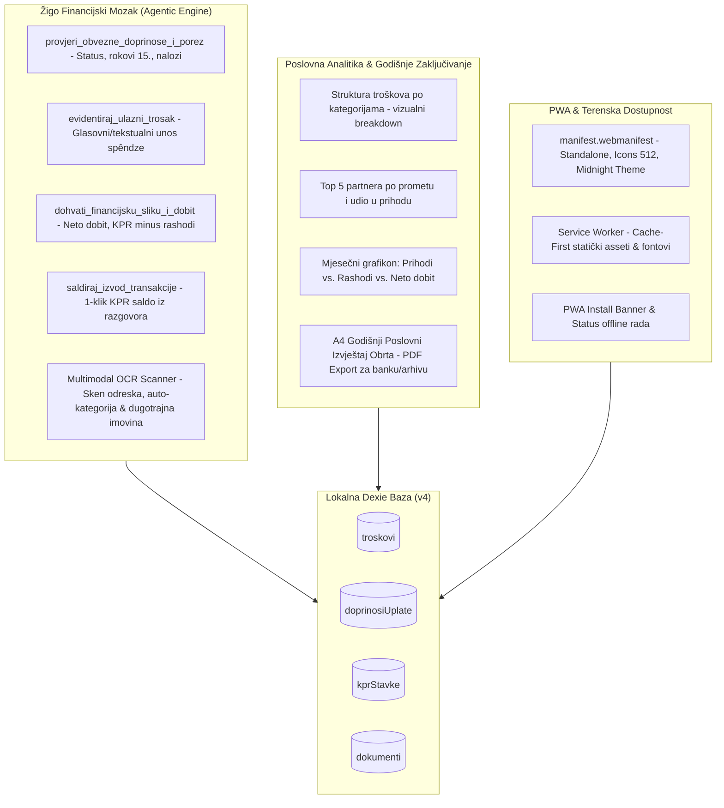

# Plan Implementacije i Validacije: Faza 18 – Žigo Inteligentni Knjigovodstveni Copilot, PWA Offline Instalabilnost & Godišnji Analitički Izvještaji Obrta

> **Dokument:** Arhitektonska specifikacija, domenski model i plan implementacije Faze 18  
> **Verzija:** 1.0.0 (Faza 18)  
> **Status:** Nacrt spreman za faznu implementaciju  
> **Povezani dokumenti:**  
> - [`docs/manifest_i_dnevnik_implementacije.md`](file:///d:/Documents/Robot%20Hand%20Made/ObrtnIQ/docs/manifest_i_dnevnik_implementacije.md)  
> - [`docs/plan_implementacije_faza_17_obrtnicko_knjigovodstvo_i_doprinosi.md`](file:///d:/Documents/Robot%20Hand%20Made/ObrtnIQ/docs/plan_implementacije_faza_17_obrtnicko_knjigovodstvo_i_doprinosi.md)  
> - [`docs/arhitektura_zigo_ai_agenta.md`](file:///d:/Documents/Robot%20Hand%20Made/ObrtnIQ/docs/arhitektura_zigo_ai_agenta.md)  
> - [`docs/plan_kako_da_ziga_postane_prijatelj.md`](file:///d:/Documents/Robot%20Hand%20Made/ObrtnIQ/docs/plan_kako_da_ziga_postane_prijatelj.md)  
> **Temeljna maksima:** *"Kamen koji misli, pamti i bdije nad obrtom: Žigo preuzima knjigovodstvene brige, aplikacija radi u džepu bez mreže, a dukati su izbrojani u cent."*

---

## 1. Analiza Trenutnog Stanja Nakon Faze 17

### 1.1. Postignuća Faze 17 (Što je u potpunosti izgrađeno i stabilno)
Završetkom Faze 17, ObrtnIQ je uspješno proširio svoj opseg s čistog izdavanja računa na cjelokupni operativni i novčani tok obrta:
1. **Domenski sloj (`packages/core`):**
   - Obračun doprinosa za paušaliste za 2026. godinu (MIO 1 = 15%, MIO 2 = 5%, HZZO = 16,5%) s točnim `HR68` pozivima na broj (`8214`, `2054`, `8478`).
   - Obračun kvartalnog paušalnog poreza na dohodak po razredima s dospijećima na kraju kvartala i računom općine/grada (`1414-OIB`).
   - Knjiga ulaznih troškova sa 10 kategorija i zakonskom granicom dugotrajne imovine od **663,61 €** (bivših 5.000 HRK) uz praćenje serijskih brojeva opreme.
   - Izračun poslovnog Cash-Flowa, stvarne neto dobiti i profitne marže.
   - Univerzalni CSV parser bankovnih izvoda (ZABA, PBZ, Erste, HPB, OTP, Revolut) s automatskim prepoznavanjem poziva na broj i uparivanjem s izdanim računima.
   - HUB-3 PDF417 i EPC SEPA QR generator naloga za Državni proračun RH i REGOS.
2. **Sloj pohrane (Storage & IndexedDB):**
   - Dexie baza podataka nadograđena na shemu v4 s tablicama `troskovi` i `doprinosiUplate`.
   - Repozitorijska sučelja `ITroskoviRepository` i `IDoprinosiRepository` integrirana u memorijski adapter i kriptirani `.obrtniq` backup/restore.
3. **Korisničko sučelje (UI):**
   - Objedinjeni 5-tab `BookkeepingDrawer.tsx` (KPR, PO-SD, Doprinosi, Troškovnik, Izvodi).
   - Interaktivni `Hub3PaymentModal.tsx` s bijelim kontrastnim Canvas prikazom za skeniranje mobilnim bankarstvom.
   - Praćenje zakonskog praga od 40.000 € s vizualnim upozorenjima (75%, 90%, crveni alarm).
4. **Metrika kvalitete:**
   - **357/357 testova prolazi (100%)** u cijelom monorepu (140 u core, 217 u web).
   - `npm run build` (`tsc -b && vite build`) završava s **0 TypeScript grešaka** u 4.39 sekundi.

---

### 1.2. Identificirani Jaz i Slabe Točke (Most prema Fazi 18)

Iako je knjigovodstveni modul tehnički dovršen, uočavaju se tri ključna nedostatka u svakodnevnom korisničkom iskustvu obrtnika:

1. **AI Asistent (Žigo) nema uvid u novo knjigovodstvo:**
   - Žigo posjeduje alate za KPR i PO-SD XML, ali **nema alate za doprinose, unos troškova i saldiranje izvoda**.
   - Ako korisnik pita: *"Žigo, jesan li platio doprinose za ovaj mjesec?"* ili *"Koliko mi je ostalo čiste neto dobiti?"*, Žigo nema alat kojim bi pročitao stanje u Dexie bazi troškova i doprinosa.
   - Ako korisnik pošalje sliku računa za gorivo s benzinske postaje, Žigo još nema specijalizirani tijek koji bi automatski pretvorio ekstrahirane podatke u unos u tablicu `troskovi` uz provjeru dugotrajne imovine.

2. **Obrtnik na terenu nema PWA instalaciju (Nema rada bez adresne trake):**
   - Obrtnici rade na terenu (montaže, radionice, dostave, klijentski uredi).
   - Aplikacija se trenutno otvara isključivo kao web stranica unutar preglednika s adresnom trakom, što smanjuje radnu površinu, otežava brz pristup s početnog zaslona mobitela i ovisi o mrežnom dohvaćanju statičkih resursa.
   - Potreban je službeni **PWA (Progressive Web App)** manifest, Service Worker s Cache-First politikom za assete i fontove, te "Instaliraj na uređaj" akcija.

3. **Nedostatak godišnje rekapitulacije i vizualne analitike obrta:**
   - Obrtnik na kraju godine (ili tijekom planiranja) želi vidjeti vizualnu analitiku:
     - Gdje odlaze novci (koje su najveće kategorije troškova)?
     - Tko su mu najvažniji klijenti (Top 5 partnera po prometu)?
     - Mjesečni trend prihoda vs. rashoda kroz godinu.
     - Mogućnost generiranja i ispisa čistog A4 PDF Godišnjeg Poslovnog Izvještaja (prikladnog za arhivu ili predočenje banci pri traženju kredita/leasinga).

---

## 2. Ciljevi Faze 18

Faza 18 definira se kao:  
**Žigo Inteligentni Knjigovodstveni Copilot, PWA Offline Instalabilnost & Godišnji Analitički Izvještaji Obrta**

Glavni ciljevi:
1. **Agentic Bookkeeping:** Opremiti Žiga s 4 nova autonomna alata za doprinose, troškove, cash-flow i izvoze.
2. **Multimodalni OCR Sken Troškova:** Omogućiti korisniku da slika ili povuče račun (odrezak s benzinske, račun za opremu) u chat ili troškovnik, pri čemu Žigo sam prepoznaje dobavljača, iznos, datum i nudi 1-klik knjiženje.
3. **PWA Standalone & Offline Caching:** Uspostaviti Web App Manifest, Service Worker i ikone za instalaciju aplikacije na Windows, macOS, Android i iOS uređaje uz trenutačno pokretanje bez mreže.
4. **Poslovna Analitika & Godišnji Izvještaj:** Interaktivni pregled strukture prihoda i rashoda, grafikoni raspodjele i generiranje profesionalnog A4 Godišnjeg Izvještaja Obrta.

---

## 3. Arhitektura Faze 18



---

## 4. Detaljna Razrada Faze 18 (Korak po Korak)

---

### KORAK 18.1: Proširenje Žigo Alata za Knjigovodstvo i Financije

U `apps/web/src/services/gemini-service.ts` i `apps/web/src/services/zigo-tools-dispatcher.ts` dodaju se 4 nova specijalizirana alata:

#### 1. Alat `provjeri_obvezne_doprinose_i_porez`
- **Svrha:** Provjera statusa uplata za tekuću godinu/mjesec, izračun dana do dospijeća (15. u mjesecu) i ponuda otvaranja HUB-3 uplatnice.
- **Parametri:** `godina?: number`, `mjesec?: number`.
- **Ponašanje:**
  - Čita podatke iz `dexieStorage.doprinosi` i domenskog kalkulatora `izracunajMjesecneDoprinose`.
  - Ako ima neplaćenih dospjelih doprinosa, Žigo u orlandovskom stilu upozorava:  
    *„Gosparu, država čeka svoj harač za MIO i zdravstveno za 10. mjesec (ukupno 262,51 €). Dospijeće je 15.11., nemoj da ti šalju opomene s kamatama. Oćeš da ti otvorim uplatnice sa skenom za m-banking?”*

#### 2. Alat `evidentiraj_ulazni_trosak`
- **Svrha:** Korisnik može glasom ili tekstom zatražiti unos troška (npr. *"Žigo, zabilježi račun od HT-a za optiku 42 eura, plaćeno poslovnom karticom"*).
- **Parametri:**
  - `dobavljacNaziv: string`
  - `ukupnoEur: number`
  - `kategorija: KategorijaTroska`
  - `opis?: string`
  - `datumRacuna?: string`
  - `nacinPlacanja?: 'TRANSAKCIJSKI_RACUN' | 'KARTICA_POSLOVNA' | 'GOTOVINA'`
  - `jePlaceno?: boolean`
  - `serijskiBrojOpreme?: string`
- **Ponašanje:**
  - Automatski provjerava prelazi li iznos zakonski prag dugotrajne imovine (**663,61 €**). Ako prelazi, postavlja oznaku `jeDugotrajnaImovina: true`.
  - Sprema zapis u Dexie tablicu `troskovi`.
  - Žigo potvrđuje: *„Zavedena spêndza: Hrvatski Telekom, 42,00 € (kategorija: Režije i prostor). Tablice su šesne, a novac pod kontrolom.”*

#### 3. Alat `dohvati_financijsku_sliku_i_dobit`
- **Svrha:** Sintetizira KPR primitke i sve evidentirane troškove (operativni troškovi, doprinosi, porez).
- **Parametri:** `godina?: number`.
- **Ponašanje:**
  - Poziva `izracunajCashFlow` iz `@obrtniq/core`.
  - Vraća strukturirane podatke: ukupni primici, ukupni izdaci, čista neto dobit i profitna marža.
  - Žigo u odgovoru servira sažetak: *„Evo kako stoji blagajna u 2026.: U KPR-u imaš 28.500 € primitaka. Na spêndzu, doprinose i porez otišlo je 5.200 €. Čisto ti u džepu ostaje 23.300 € (profitna marža šesnih 81,7%).”*

#### 4. Alat `saldiraj_izvod_transakcije`
- **Svrha:** Omogućuje Žigu da iz chata izravno poveže transakciju s izdanim računom.
- **Parametri:** `transakcijaId: string`, `dokumentId?: string`.
- **Ponašanje:**
  - Zove `evidentirajNaplatu` u KPR i postavlja status računa na `PLACENO`.

---

### KORAK 18.2: Multimodalni OCR Sken Ulaznih Računa u Troškovnik

Obrtnici svakodnevno dobivaju papirnate račune (gorivo na benzinskoj, građevinski materijal, ručak s poslovnim partnerom, komponente, alati). Prepisivanje u tablicu je zamorno i dovodi do zaboravljanja troškova.

1. **Multimodalni Cjevovod u Chatu i Troškovniku:**
   - Korisnik u `ZigoChatDrawer` povuče sliku računa (ili klikne spajalicu / ikonu kamere na mobitelu).
   - Slika se šalje na analizu putem `analyzeReceiptImage` u `gemini-service.ts`.
2. **Specijalizirani Prompt za Hrvatski Maloprodajni i Veleprodajni Račun:**
   - Prepoznavanje: Naziv dobavljača (npr. "INA d.d.", "PEVEX d.d.", "Bauhaus", "Apple"), OIB dobavljača, broj računa (npr. "1245/101/1"), datum računa, ukupni iznos u eurima, osnovica i PDV.
   - Predikcija kategorije troška prema popisu 10 standardnih kategorija iz Faze 17 (`GORIVO_I_VOZILA`, `ALATI_I_OPREMA`, `SOFTVERSKE_PRETPLATE`, `REPREZENTACIJA_I_UGOSTITELJSTVO`...).
   - Detekcija dugotrajne imovine (>663,61 €).
3. **Interaktivna HITL Kartica za Potvrdu Unosa (`ZigoExpenseConfirmationCard.tsx`):**
   - Umjesto automatskog tihog unosa u bazu, Žigo u chatu prikazuje šesnu vizualnu karticu s ekstrahiranim podacima i poljima za brzu korekciju:
     ```
     ┌─────────────────────────────────────────────────────────────┐
     │ 🧾 PREPOZNAT ULAZNI RAČUN (SKENIRANO)                       │
     ├─────────────────────────────────────────────────────────────┤
     │ Dobavljač: INA d.d., Zagreb (OIB: 27759560625)              │
     │ Broj računa: 9812/042/1 • Datum: 24.10.2026.               │
     │ Iznos: 65,40 € (Osnovica: 52,32 €, PDV 25%: 13,08 €)        │
     │ Predložena kategorija: [ Gorivo i prijevoz ▼ ]              │
     │ Status: [✔ Plaćeno poslovnom karticom]                      │
     ├─────────────────────────────────────────────────────────────┤
     │ [ ✔ Potvrdi i upiši u Troškovnik ]     [ ✕ Odbaci sken ]    │
     └─────────────────────────────────────────────────────────────┘
     ```
   - Jednim klikom na *"Potvrdi i upiši u Troškovnik"*, trošak ulazi u Dexie bazu `troskovi`, sažetak se rekalkulira, a korisnik ima evidenciju bez tipkanja.

---

### KORAK 18.3: PWA (Progressive Web App) & 100% Offline Terenski Rad

ObrtnIQ je lokalna aplikacija (Local-First), što znači da nema razloga zašto ne bi radila kao punokrvna instalirana desktop i mobilna aplikacija:

1. **Web App Manifest (`apps/web/public/manifest.webmanifest`):**
   - `name`: "ObrtnIQ – Knjigovodstvo i Računi Obrta"
   - `short_name`: "ObrtnIQ"
   - `description`: "Local-First sustav za izdavanje računa, fiskalizaciju, obvezne doprinose i knjigovodstvo obrta u RH."
   - `theme_color`: "#0F172A" (Midnight Amethyst)
   - `background_color`: "#020617"
   - `display`: "standalone" (nema adresne trake preglednika, izgleda kao nativna aplikacija)
   - `orientation`: "any"
   - `icons`:
     - 192x192 PNG ikona
     - 512x512 PNG ikona (iskoristiti postojeću pripremljenu [`docs/ObrtnIQ_Icon01_512.png`](file:///d:/Documents/Robot%20Hand%20Made/ObrtnIQ/docs/ObrtnIQ_Icon01_512.png))
     - Maskable ikona za Android početne zaslone.
2. **Service Worker (`apps/web/src/service-worker.ts` ili `vite-plugin-pwa`):**
   - **Cache-First strategija:** Svi JS bundleovi, CSS, SVG ikone i web fontovi spremaju se u Cache Storage preglednika.
   - Aplikacija se otvara trenutno (< 100 ms) čak i ako je mobitel u zrakoplovnom modu ili u podrumskoj radionici bez signala.
   - Mrežni zahtjevi prema vanjskim servisima (Gemini, Google Drive, Porezna CIS proxy) prolaze standardno kroz Network-First strategiju uz jasan offline bedem ako veza nije dostupna.
3. **PWA Instalacijska Komponenta (`PwaInstallPrompt.tsx`):**
   - Hvatanje `beforeinstallprompt` događaja preglednika.
   - Diskretna obavijest u zaglavlju ili postavkama: *"Instalirajte ObrtnIQ na računalo / mobitel za brz rad jednim klikom"*.
   - Mogućnost dodavanja ikone na Desktop ili početni zaslon mobitela.

---

### KORAK 18.4: Godišnji Rekapitulacijski Izvještaj & Obrtnička Analitika

Korisniku i njegovom knjigovodstvu potreban je čist, elegantan i pregledan godišnji sažetak poslovanja:

1. **Analitički Tab / Ekran unutar `BookkeepingDrawer.tsx`:**
   - **Grafička raspodjela troškova:** Donut/Bar vizualizacija 10 kategorija troškova s postotnim udjelima (npr. *Alati 45%, Softver 20%, Režije 15%...*).
   - **Top 5 Partnera:** Lista kupaca s najvećim zbrojem uplata u KPR-u, s postotnim udjelom u ukupnom prometu (upozorenje na ovisnost o samo jednom klijentu!).
   - **Mjesečni Cash-Flow trend:** Grafikon stupaca s 12 mjeseci (zeleni stupac primici, crveni stupac rashodi, plava linija neto dobit).
2. **Generator Službenog A4 Godišnjeg Izvještaja (`AnnualReportPdfModal.tsx`):**
   - Generira profesionalno dizajnirani A4 dokument s memorandumom obrta:
     - Osnovni podaci obrta (Naziv, OIB, IBAN, Vlasnik).
     - Rekapitulacija Knjige Prometa (KPR) po kvartalima Q1–Q4.
     - Rekapitulacija plaćenih doprinosa (MIO 1, MIO 2, HZZO) i poreza.
     - Popis dugotrajne imovine nabavljene u godini (>663,61 € sa serijskim brojevima).
     - Konačni financijski rezultat: Ukupni primici, ukupni izdaci, čista neto dobit.
   - Mogućnost izravnog ispisa (`Ctrl+P`) ili preuzimanja u PDF formatu.

---

### KORAK 18.5: Testiranje i Verifikacija

1. **Jedinični testovi u `@obrtniq/core` i `@obrtniq/web`:**
   - Testiranje novih alata u `gemini-service.test.ts` i `zigo-tools-dispatcher.test.ts`.
   - Testiranje logike godišnje analitike i kalkulatora udjela kupaca u `analytics.test.ts`.
   - Testiranje OCR prompt parsera za račune u `receipt-ocr.test.ts`.
2. **Gate-Check verifikacija:**
   - Svi testovi zeleni (cilj: >375 prolaznih testova).
   - TypeScript `tsc -b` bez grešaka.
   - Vite produkcijski bundle uspješno izgrađen.

---

## 5. Protokol Validacije i Gate-Check Kriteriji za Fazu 18 (V18-1 do V18-10)

| Oznaka | Područje Provjere | Ulazni Podaci / Uvjet | Očekivani Rezultat |
|:---|:---|:---|:---|
| **V18-1** | **Žigo Doprinosi Alat** | Korisnik pita: *"Žigo, jesu li mi plaćeni doprinosi za ovaj mjesec?"* | Žigo poziva `provjeri_obvezne_doprinose_i_porez`, očitava status u Dexie bazi i vraća točan orlandovski odgovor s iznosom i rokom dospijeća. |
| **V18-2** | **Žigo Unos Troška** | Naredba: *"Zabilježi trošak za hosting 35 eura, Hetzner, plaćeno karticom"* | Žigo poziva `evidentiraj_ulazni_trosak`, trošak je u tablici `troskovi` s kategorijom `SOFTVERSKE_PRETPLATE`, iznosom 35,00 € i statusom `PLACENO`. |
| **V18-3** | **Dugotrajna Imovina Zaštita** | Unos troška od 850,00 € (npr. *"Kupio sam bušilicu Makita 850 eura"*) | Sustav automatski označava `jeDugotrajnaImovina: true` (iznad 663,61 €) i traži/bilježi serijski broj. |
| **V18-4** | **Žigo Financijska Slika** | Upit: *"Kakvo nam je stanje s neto dobiti?"* | Žigo poziva `dohvati_financijsku_sliku_i_dobit`, točno računa KPR minus sve izdatke i vraća točnu neto dobit u cent. |
| **V18-5** | **Multimodalni OCR Sken** | Učitavanje slike odreska s benzinske (npr. INA račun 50 €) | Gemini OCR točno prepoznaje dobavljača, iznos i predlaže kategoriju `GORIVO_I_VOZILA`; prikazuje se `ZigoExpenseConfirmationCard`. |
| **V18-6** | **PWA Manifest Validacija** | Provjera `manifest.webmanifest` datoteke | Preglednik prepoznaje manifest kao valjan (naziv, standalone mod, 512x512 ikone, tema `#0F172A`). |
| **V18-7** | **Offline Caching (Service Worker)** | Isključivanje mrežne veze u DevTools (Offline mode) i osvježavanje (F5) | Aplikacija se trenutno učitava iz Cache Storagea bez "No internet" ekrana, sve lokalne baze funkcioniraju. |
| **V18-8** | **PWA Instalacijski Tok** | Pokretanje aplikacije u Chrome/Edge pregledniku | Prikazuje se instalacijska ikona u traci preglednika / banner u sučelju, klik uspješno instalira aplikaciju kao standalone prozor. |
| **V18-9** | **Analitika Strukture Troškova** | 10 evidentiranih troškova različitih kategorija | Grafikon u analitičkom tabu točno zbraja udjele i prikazuje ispravne postotke i iznose. |
| **V18-10**| **A4 Godišnji Izvještaj PDF** | Klik na *"Generiraj A4 Godišnji Izvještaj"* | Generira se čist, strukturalno valjan A4 PDF (ISO 32000-1) sa sažetkom KPR-a, rashoda, doprinosa i dugotrajne imovine. |

---

## 6. Rezime Faze 18

Dovršetkom Faze 18, ObrtnIQ postiže vrhunac svoje arhitekture:
1. **Potpuna simbioza čovjeka i AI viteza:** Žigo više nije samo pametni sugovornik, već pravi operativni knjigovođa koji čuva rokove, prepoznaje račune sa slika i bilježi troškove bez muke.
2. **Nativno iskustvo na svakom uređaju:** PWA omogućuje rad na terenu bez ovisnosti o web pregledniku.
3. **Strateški poslovni mir:** Obrtnik u svakom trenutku ima kristalno čist uvid u svoje poslovanje, dobit i porezne obveze.
