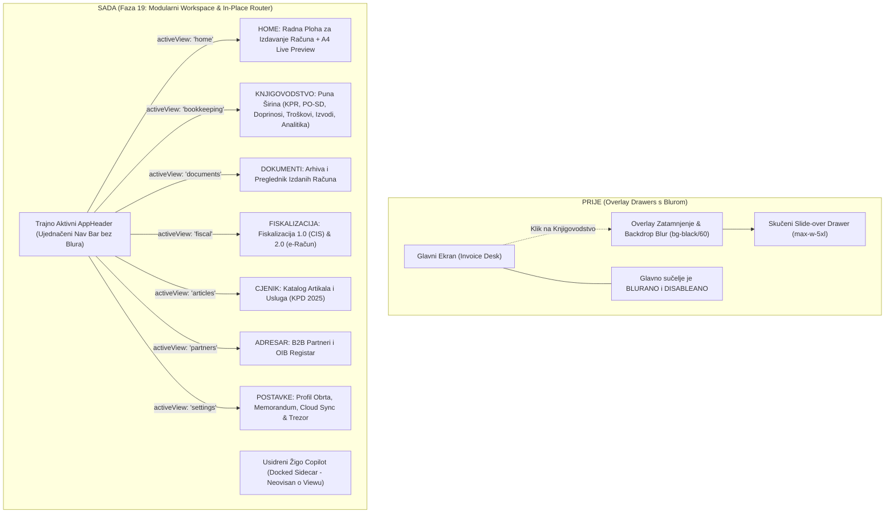

# Plan Implementacije i Validacije: Faza 19 – Modularna Workspace Arhitektura, In-Place Navigacija i Home Radna Ploha (Bez Blur Overlay-a)

> **Dokument:** Arhitektonska specifikacija, tranzicija korisničkog sučelja i plan implementacije Faze 19  
> **Verzija:** 1.0.0 (Faza 19)  
> **Status:** Nacrt spreman za faznu implementaciju  
> **Povezani dokumenti:**  
> - [`docs/manifest_i_dnevnik_implementacije.md`](file:///d:/Documents/Robot%20Hand%20Made/ObrtnIQ/docs/manifest_i_dnevnik_implementacije.md)  
> - [`docs/plan_implementacije_faza_18_zigo_knjigovodstveni_copilot_pwa_i_analitika.md`](file:///d:/Documents/Robot%20Hand%20Made/ObrtnIQ/docs/plan_implementacije_faza_18_zigo_knjigovodstveni_copilot_pwa_i_analitika.md)  
> - [`docs/plan_implementacije_faza_17_obrtnicko_knjigovodstvo_i_doprinosi.md`](file:///d:/Documents/Robot%20Hand%20Made/ObrtnIQ/docs/plan_implementacije_faza_17_obrtnicko_knjigovodstvo_i_doprinosi.md)  
> **Temeljna maksima:** *"Glavno sučelje nikad ne spava i nikad se ne muti: svaki prozor je ravnopravna radna ploha punog raspona, a povratak na Home je trenutačan i siguran."*

---

## 1. Analiza Korisničkog Zahtjeva i Postojećeg Stanja

### 1.1. Korisnički Zahtjev i Problem Trenutnog Rješenja
Korisnik je uočio ključnu frikciju u dosadašnjem UI/UX dizajnu:
1. **Modalni "Blur & Disable" efekt:**
   Kada se otvore Postavke (`SettingsDrawer`), Knjigovodstvo (`BookkeepingDrawer`), Dokumenti (`DocumentDrawer`) ili drugi moduli, aplikacija ih trenutno prikazuje kao bočne preklopne ladice (slide-over drawers) s overlay pozadinom:
   ```html
   <div className="fixed inset-0 z-40 flex justify-end bg-black/60 backdrop-blur-sm ...">
   ```
   To uzrokuje da se **glavni interface zamuti (blur), zatamni i onemogući (disabled)**. Korisnik gubi vizualni kontakt s radnom plohom i navigacijom, a interakcija djeluje kao prekid rada umjesto kao prirodan radni tijek.
2. **Skriveni i skučeni moduli:**
   Knjigovodstvo je naraslo na 6 bogatih cjelina (KPR, PO-SD, Doprinosi, Troškovnik, Izvodi, Godišnja analitika). Prikazivanje tolikog bogatstva podataka u bočnoj ladici širine `max-w-5xl` ograničava preglednost tablica, analitičkih grafikona i uplatnica.
3. **Zahtjev:**
   - Onemogućiti blur i overlay zamračenje pozadine.
   - Kada se klikne Knjigovodstvo, Postavke ili bilo koji drugi modul, taj modul treba **zauzeti mjesto glavnog radnog prozora (in-place workspace view)** u punoj širini ekrana.
   - Sustav mora biti strukturiran oko koncepta **"Home"** – gdje je "Home" primarna radna ploha za unos i izdavanje računa (`InvoiceDesk` + `InvoiceLivePreview`), a korisnik u svakom trenutku jednim klikom ili prečacem (npr. `Alt+H` / `Esc`) bez gubitka unesenih podataka prelazi između Home-a i ostalih modula.

---

## 2. Nova Arhitektura: Workspace View Router & Home Koncept

### 2.1. Konceptualni Dijagram Tranzicije



### 2.2. Temeljna Načela Faze 19
1. **Nema više `backdrop-blur-sm` i zatamnjenja:**
   Glavni moduli se montiraju izravno unutar glavnog `<main>` prostora aplikacije. Sučelje je čisto, oštro i 100% responsivno.
2. **Home je "Sidro":**
   Pritisak na Orlando pečat u zaglavlju, tipku `Alt+H`, ili navigacijsku mrvicu (Breadcrumb) u sekundi vraća korisnika na **Home**.
3. **Immutability i čuvanje stanja nacrta računa:**
   Stanje forme aktivnog računa (`form`, `items`, `workflow`) čuva se u memoriji aplikacije (i Dexie autosave-u). Ako korisnik piše račun, ode u Knjigovodstvo provjeriti uplatu, i vrati se na Home – **niti jedno slovo, stavka ni kupac nisu izgubljeni**.
4. **Usidreni Žigo Copilot (Docked Companion):**
   Žigo Copilot na desnoj strani ostaje usidren i dostupan neovisno o tome koji modul je otvoren. Ako je otvoren modul Knjigovodstva, Žigo automatski prati taj kontekst (`aktivniEkran: 'Bookkeeping'`)!
5. **Brzi odabir (Quick Picker):**
   Ako korisnik unutar Home forme klikne ikonu partnera ili cjenika za brzi odabir u formu, zadržavamo mogućnost brzog odabira ili skoka na modul s povratkom na Home po odabiru.

---

## 3. Tehnička Specifikacija po Koracima Implementacije

### Korak 19.1: Workspace View Router & Stanje Navigacije (`useWorkspaceRouter.ts`)
- **Datoteka:** `apps/web/src/hooks/useWorkspaceRouter.ts`
- **Tipovi radnih površina:**
  ```typescript
  export type WorkspaceView = 
    | 'home'          // Primarna radna ploha za unos računa + A4 preglednik
    | 'bookkeeping'   // Knjigovodstveni centar obrta (6 tabova)
    | 'documents'     // Baza izdanih i spremljenih računa
    | 'fiscal'        // Fiskalizacija 1.0 (CIS) & 2.0 (e-Račun)
    | 'articles'      // Cjenik i katalog usluga s KPD 2025
    | 'partners'      // B2B Adresar partnera
    | 'settings'      // Postavke obrta, memorandum i trezor
    | 'logs';         // Dijagnostička konzola sustava
  ```
- **Mogućnosti:**
  - `activeView: WorkspaceView`
  - `viewParams?: { tab?: string; id?: string; returnTo?: WorkspaceView }`
  - `navigateTo(view: WorkspaceView, params?: any): void`
  - `navigateHome(): void`
  - Sinkronizacija s hash rutom u URL-u (`#home`, `#bookkeeping`, `#settings`, `#documents` itd.) – omogućuje browser back/forward tipke i osvježavanje stranice bez gubitka taba u PWA načinu rada.
- **Validacija koraka:** Jedinični test za `useWorkspaceRouter` s provjerom stanja i povratka na Home.

---

### Korak 19.2: Redizajn Zaglavlja i Aktivni Modul Indikator (`AppHeader.tsx`)
- **Datoteka:** `apps/web/src/components/layout/AppHeader.tsx`
- **Promjene:**
  - Dodavanje izričite "Home / Radna ploha" tipke s ikonom kuće (`Home`) i prečacem `Alt+H`.
  - Klik na službeni Orlando amblem uvijek vodi na `home`.
  - Svaki od navigacijskih gumba u zaglavlju (Dokumenti, Knjigovodstvo, Fiskalizacija, Cjenik, Partneri, Postavke) dobiva:
    - **Aktivni status (Active State):** Jasni vizualni indikator (npr. zlatni ili naglašeni border, aktivna točka/pip, promijenjena pozadina) koji korisniku jasno govori u kojem se modulu trenutno nalazi.
    - Klik na aktivni modul ne otvara modal, nego glatko prebacuje radnu površinu.
  - Prikaz **Breadcrumb trake** na vrhu svakog modula:  
    `[🏠 Radna ploha (Home)] > [Knjigovodstvo i Financije]` s gumbom za brzi povratak.
- **Validacija koraka:** Pregled u pregledniku – navigacijski gumbi dinamički svijetle prema aktivnom modulu.

---

### Korak 19.3: Pretvaranje Knjigovodstvenog Centra u Puni Radni Prozor (`BookkeepingView.tsx`)
- **Datoteka:** `apps/web/src/components/bookkeeping/BookkeepingView.tsx` (ili adaptacija `BookkeepingDrawer.tsx` u hibridnu komponentu s `isEmbedded: boolean` propom).
- **Arhitektonske promjene:**
  - Uklanjanje fiksnog omotača `fixed inset-0 bg-black/60 backdrop-blur-sm`.
  - Prikaz u punoj širini raspoloživog ekrana unutar `<main>` elementa.
  - 6 tabova (KPR, PO-SD, Doprinosi, Troškovnik, Izvodi, Godišnja analitika) dobivaju maksimalni prostor – tablice se ne moraju horizontalno stiskati, uplatnice i grafikoni imaju prostrani A4/kartični raspored.
  - Zaglavlje modula sadrži:
    - Naslov modula s ikonom
    - Odabir godine (2026., 2025., 2024.)
    - Akcijski gumb "← Povratak na Radnu plohu (Home)"
    - Traku sa statusom paušalnog praga od 40.000 €
- **Validacija koraka:** Klik na Knjigovodstvo u zaglavlju trenutačno prikazuje Knjigovodstveni centar u punoj širini bez zamućenja pozadine.

---

### Korak 19.4: Pretvaranje Ostalih Ladica u Puna Radna Sučelja (Postavke, Dokumenti, Fiskalizacija, Cjenik, Partneri)
- **Komponente:**
  1. **Postavke Obrta (`SettingsView.tsx`):**
     - Profil, adresa, IBAN, logo i pečat, Google Cloud sync, Trezor certifikata.
  2. **Baza Dokumenata (`DocumentView.tsx`):**
     - Cjeloviti preglednik izdanih računa, pretraga po kupcu/broju, statusi (IZDANO, STORNIRANO, PLACENO) i detaljni pregled.
  3. **Fiskalizacija i e-Račun (`FiscalView.tsx`):**
     - Pregled fiskalnih statusa, ZKI/JIR generator, UBL 2.1 e-Račun kontrola i status veze s CIS-om.
  4. **Cjenik Artikala i Usluga (`ArticleView.tsx`):**
     - Tablični pregled s KPD 2025 šiframa, brzim unosom, uređivanjem cijena i filtriranjem.
  5. **Adresar Partnera (`PartnerView.tsx`):**
     - B2B adresar s OIB provjerom i brzim akcijama.
- **Validacija koraka:** Svaki modul se otvara unutar centralnog workspacea s uniformiranim Breadcrumb navigacijskim zaglavljem i akcijom "Povratak na Home".

---

### Korak 19.5: Centralni Kontejner Radne Plohe (`WorkspaceContainer.tsx` & `App.tsx`)
- **Datoteka:** `apps/web/src/components/layout/WorkspaceContainer.tsx`
- **Uloga:**
  - Čisti "Switch-Case" kontejner koji na temelju `activeView` prikazuje odgovarajući modul:
    ```tsx
    {activeView === 'home' && (
      <HomeInvoiceWorkspace 
        form={form} 
        items={items} 
        workflow={workflow} 
        currentObrt={currentObrt} 
        zigoAgent={zigoAgent} 
      />
    )}
    {activeView === 'bookkeeping' && (
      <BookkeepingView 
        initialTab={viewParams?.tab} 
        onNavigateHome={navigateHome} 
      />
    )}
    {activeView === 'settings' && (
      <SettingsView onNavigateHome={navigateHome} />
    )}
    // ... i ostali moduli
    ```
  - Zadržava usidreni Žigo Copilot (`zigoAgent.isDocked`) na desnoj strani ekrana kroz sve poglede.
  - Zadržava `AppFooter` na dnu stranice.
- **Validacija koraka:** Cjelokupno prebacivanje pogleda odvija se glatko u < 50ms bez treperenja i bez gubitka unesenih podataka računa.

---

### Korak 19.6: Sinkronizacija Žigo Omni-Context Busa i Tipkovničkih Prečaca
- **Datoteka:** `apps/web/src/hooks/useLiveScreenContext.ts`
- **Usklađivanje:**
  - `snapshot.aktivniEkran` se izravno mapira na `activeView` (`InvoiceDesk`, `Bookkeeping`, `Settings`, `Documents`, itd.).
  - Žigo u svakom trenutku zna u kojem se modulu korisnik nalazi bez provjere boolean zastavica ladica.
  - Prečac `Esc` na razini modula: vraća korisnika na `home`.
  - Prečac `Alt+H`: vraća korisnika na `home`.
- **Validacija koraka:** Pokretanje Žigo Copilota unutar Knjigovodstva – Žigo ispravno detektira da je korisnik u Knjigovodstvu i nudi relevantne savjete.

---

## 4. Protokol Validacije i Gate-Check Kriteriji (V19-1 do V19-8)

| Oznaka | Kriterij Validacije | Očekivani Rezultat |
|---|---|---|
| **V19-1** | **Uklanjanje Blur Overlay-a** | Prilikom otvaranja Knjigovodstva ili Postavki nema `fixed inset-0 bg-black/60 backdrop-blur-sm` zatamnjenja. |
| **V19-2** | **In-Place Workspace Tranzicija** | Modul zauzima centralni radni prostor u punoj širini ekrana (`flex-1 w-full`). |
| **V19-3** | **Home Sidro i Očuvanje Nacrta** | Pisanje računa na Home -> prijelaz na Knjigovodstvo -> povratak na Home: svi podaci o kupcu, stavkama i cijenama su 100% netaknuti. |
| **V19-4** | **Trajno Aktivni AppHeader** | Zaglavlje ostaje fiksirano na vrhu, tipke prikazuju aktivan modul, klik na bilo koji gumb trenutačno mijenja radni prostor. |
| **V19-5** | **Breadcrumbs & Prečaci** | Svaki modul ima Breadcrumb navigaciju i podržava prečace `Alt+H` i `Esc` za povratak na Home. |
| **V19-6** | **Docked Žigo Copilot Kompatibilnost** | Ako je Žigo usidren na desnoj strani (`isDocked: true`), ostaje vidljiv i aktivan i na Home-u i u Knjigovodstvu. |
| **V19-7** | **URL Hash Sinkronizacija** | Promjena taba sinkronizira `#home`, `#bookkeeping`, `#settings` u adresnoj traci, podržava browser back/forward. |
| **V19-8** | **Stabilnost i Testovi** | 100% prolaznost svih postojećih i novih testova (364+), 0 TypeScript grešaka (`tsc -b`). |

---

## 5. Faze Implementacije i Plan Izvršenja

```
[KORAK 1] -> useWorkspaceRouter.ts (Ruta, hash sinkronizacija, tipovi stanja)
     ↓ Validacija: Unit test za router navigaciju i povratak na Home
[KORAK 2] -> AppHeader.tsx Redizajn (Home gumb, aktivni indikatori modula)
     ↓ Validacija: Vizualni i interaktivni test navigacije u headeru
[KORAK 3] -> BookkeepingView.tsx (Puni prozor bez blura, 6 tabova na punoj širini)
     ↓ Validacija: Prikaz KPR-a, Troškovnika i Analitike na punoj širini ekrana
[KORAK 4] -> Ostali Workspace Pogledi (SettingsView, DocumentView, FiscalView, itd.)
     ↓ Validacija: Prijelaz kroz svih 7 modula bez ijednog overlay zatamnjenja
[KORAK 5] -> Integracija u App.tsx & Očuvanje Stanja Nacrta Računa
     ↓ Validacija: Test unosa stavaka i prelaska u drugi modul i natrag
[KORAK 6] -> Omni-Context Sinkronizacija za Žiga & Alt+H / Esc Prečaci
     ↓ Validacija: Žigo live context test i testiranje tipkovničkih prečaca
[KORAK 7] -> Cjeloviti Testni Suite & Produkcijski Build
     ↓ Validacija: npm test (364+ testova prolazi) & npm run build (0 grešaka)
```
