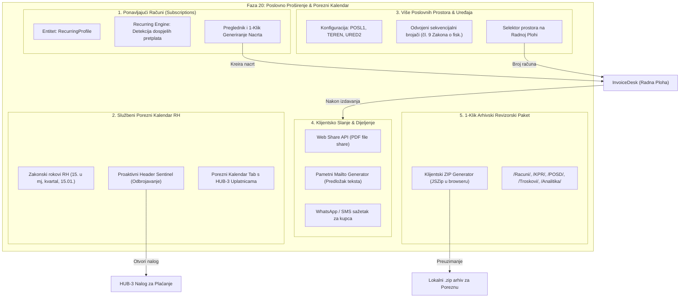

# Plan Implementacije i Validacije: Faza 20 – Poslovno Proširenje Obrta: Ponavljajući Računi (Subscriptions), Službeni Porezni Kalendar RH, Više Poslovnih Prostora (Multi-Location) te 1-Klik Arhivski Paket (ZIP)

> **Dokument:** Arhitektonska specifikacija, korisničko iskustvo i operativni plan implementacije Faze 20  
> **Verzija:** 1.0.0 (Faza 20)  
> **Status:** Nacrt spreman za faznu implementaciju  
> **Povezani dokumenti:**  
> - [`docs/manifest_i_dnevnik_implementacije.md`](file:///d:/Documents/Robot%20Hand%20Made/ObrtnIQ/docs/manifest_i_dnevnik_implementacije.md)  
> - [`docs/plan_implementacije_faza_19_modularni_workspace_i_in_place_navigacija.md`](file:///d:/Documents/Robot%20Hand%20Made/ObrtnIQ/docs/plan_implementacije_faza_19_modularni_workspace_i_in_place_navigacija.md)  
> - [`docs/plan_implementacije_faza_18_zigo_knjigovodstveni_copilot_pwa_i_analitika.md`](file:///d:/Documents/Robot%20Hand%20Made/ObrtnIQ/docs/plan_implementacije_faza_18_zigo_knjigovodstveni_copilot_pwa_i_analitika.md)  
> - [`docs/plan_implementacije_faza_17_obrtnicko_knjigovodstvo_i_doprinosi.md`](file:///d:/Documents/Robot%20Hand%20Made/ObrtnIQ/docs/plan_implementacije_faza_17_obrtnicko_knjigovodstvo_i_doprinosi.md)  
> **Temeljna maksima:** *"Obrtnik ne smije strepiti pred poreznim rokovima niti gubiti sate na prepisivanje istih mjesečnih računa: sustav sam pamti, proaktivno podsjeća, jednim klikom generira i strukturirano arhivira za Poreznu upravu."*

---

## 1. Analiza Trenutnog Stanja Projekta (Faze 0 do 19)

### 1.1. Status Dosadašnjih Faza
Aplikacija **ObrtnIQ** trenutno ima kompletiranih svih **20 razvojnih faza (Faza 0 do Faza 19)**:
- **Core Engine & Matematika (Faze 0-4):** Precizna matematika u centima, ISO 7064 MOD 11/10 OIB, ISO 13616 IBAN, HUB-3 PDF417 i EPC SEPA QR barkodovi, responsive A4 ispis i provjera PDF strukture prema ISO 32000-1.
- **Pohrana & Statusni Automat (Faze 5-6):** Local-first Dexie.js IndexedDB, immutability (nepromjenjivost izdanih računa), Knjiga Prometa (KPR), automatski PO-SD XML v2.0 za ePoreznu i nadzor poreznog praga (40.000 €).
- **Fiskalizacija & Standardi (Faza 7):** Fiskalizacija 1.0 (CIS, ZKI, 48h offline fallback), Fiskalizacija 2.0 (UBL 2.1 CIUS-HR e-Račun s KPD 2025) i Web Crypto trezor (AES-GCM PBKDF2).
- **Branding, Cjenik & Oblak (Faze 8-10):** Upload logotipa i digitalnog pečata/potpisa, cjenik usluga s KPD 2025 šiframa, Google Identity kripto sidro i skriveni Google Drive sync.
- **Žigo Digitalni Orlando & Glasovno Sučelje (Faze 11-16):** Autonomni AI copilot s function callingom, vizualni vektor sustav s 20 klesanih ikona, Docked Sidecar način rada, in-browser STT/TTS i Google Cloud Speech V2 motor s WaveNet baritonom.
- **Sveobuhvatno Knjigovodstvo & PWA (Faze 17-18):** MIO I, II i HZZO doprinosi s HR68 nalozima, troškovnik s dugotrajnom imovinom (> 663,61 €), uvoz izvoda vodećih hrvatskih banaka (ZABA, PBZ, Erste, HPB, OTP, Revolut), PWA offline rad i A4 godišnja analitika.
- **Modularni Workspace & In-Place Navigacija (Faza 19):** Eliminacija modalnih overlayja i zamagljenja pozadine; uvođenje `useWorkspaceRouter` s in-place prikazima punog ekrana i trenutnim povratkom na radnu plohu (Home).

### 1.2. Prepoznate Frikcije i Poslovne Potrebe u Stvarnom Radu Obrtnika
Iako je temeljni sustav iznimno stabilan i bogat (371 prolazni test, 0 TypeScript pogrešaka), u svakodnevnom radu stvarnih paušalnih obrtnika u RH javlja se pet ključnih potreba:

1. **Repetitivni unos istih mjesečnih računa (Ponavljajući paušali / Subscriptions):**
   - Većina uslužnih obrtnika (IT developeri, dizajneri, prevoditelji, agencije, savjetnici, najmodavci) ima stalne klijente kojima svakog 1. u mjesecu izdaje **potpuno identičan račun** (npr. "Paušalno održavanje softvera za tekući mjesec - 1.200,00 €").
   - Trenutno obrtnik svaki mjesec mora iznova unositi partnera, dodavati stavku, birati datum i klikati "Izdaj".
   - *Potreba:* Predlošci ponavljajućih računa s automatiziranim podsjetnikom ili 1-klik generiranjem novih mjesečnih nacrta.

2. **Zaboravljanje zakonskih rokova i penali (Porezni Kalendar RH & Sentinel):**
   - Paušalni obrtnik samostalno vodi brigu o datumima:
     - 15. siječnja: Predaja PO-SD obrasca.
     - 15. u svakom mjesecu: Uplata MIO I, MIO II i HZZO doprinosa.
     - Zadnji dan kvartala (31.03., 30.06., 30.09., 31.12.): Uplata paušalnog poreza na dohodak i prireza.
   - Propuštanje rokova donosi zatezne kamate Porezne uprave i blokade žiro-računa.
   - *Potreba:* Službeni porezni kalendar ugrađen u aplikaciju s proaktivnim odbrojavanjem dana i direktnim gumbom za plaćanje preko HUB-3 barkoda.

3. **Poslovanje na terenu ili u izdvojenom pogonu (Multi-Poslovni Prostor & Uređaji):**
   - Prema čl. 9 i 10 Zakona o fiskalizaciji u prometu gotovinom, obrtnik koji posluje u uredu i na terenu mora imati propisane oznake prostora i uređaja (npr. `1/POSL1/1`, `1/TEREN/1`, `1/URED2/2`).
   - Trenutno je oznaka prostora fiksirana ili djelomično podesiva.
   - *Potreba:* Mogućnost definicije više poslovnih prostora i naplatnih uređaja u Postavkama, s automatskim odvojenim numeričkim nizovima računa i jednostavnim odabirom prostora na radnoj plohi.

4. **Slanje računa kupcima izravno iz aplikacije (Client-Side Direct Dispatch):**
   - Korisnik nakon izdavanja mora preuzeti PDF na disk, otvoriti email klijent ili webmail, sročiti tekst poruke, priložiti PDF i poslati.
   - *Potreba:* Web Share API (direktno dijeljenje na mobitelu i Chromiumu), pametni `mailto:` generator s pripremljenim tekstom na hrvatskom jeziku (poziv na broj, IBAN, dospijeće) te brza poruka za WhatsApp/SMS.

5. **Priprema dokumentacije za Poreznu upravu ili knjigovođu (1-Klik Revizorski Paket):**
   - Kod poreznog nadzora ili na kraju godine, Porezna uprava ili knjigovođa traže: sve PDF račune, KPR u CSV i PDF obliku, PO-SD XML i specifikaciju troškova.
   - *Potreba:* Jedan gumb koji u pregledniku stvara strukturirani ZIP arhiv: `ObrtnIQ_Porezni_Paket_[OIB]_[GODINA].zip` sa svim mapama i datotekama spremnim za inspekciju.

---

## 2. Arhitektura Faze 20



---

## 3. Detaljna Specifikacija 5 Novih Modula

### 3.1. Modul 1: Ponavljajući Računi i Mjesečni Paušali (Subscription Engine)
- **Definicija profila ponavljanja (`RecurringProfile`):**
  ```typescript
  export interface RecurringProfile {
    id: string;
    nazivPredloska: string;
    partnerId: string;
    partnerNaziv: string;
    partnerOib: string;
    partnerTaxZone: PoreznaZona;
    stavke: FormItem[];
    frekvencija: 'MJESECNO' | 'KVARTALNO' | 'GODISNJE';
    danUMjesecu: number; // 1-31 (npr. 1. za početak mjeseca)
    nacinPlacanja: NacinPlacanja;
    rokPlacanjaDana: number; // npr. 15 dana
    aktivan: boolean;
    zadnjeGeneriranoDatum?: string; // YYYY-MM-DD
    sljedeceDospijeceDatum: string; // YYYY-MM-DD
    biljeska?: string;
  }
  ```
- **Pohrana:** Nova Dexie tablica `recurringProfiles` u `dexie-db.ts`.
- **Automatika i Žigo:**
  - Hook `useRecurringInvoices` pri montiranju provjerava ima li profila koji dospijevaju danas ili su prekoračeni.
  - Ako ima dospjelih, na vrhu Radne plohe (Home) pojavljuje se diskretna obavijest:
    *"Dospjela su 2 ponavljajuća računa za ovaj mjesec (ukupno 1.500,00 €) &bull; [Pregledaj i Pripremi Nacrte]"*.
  - Žigo autonomni alat `provjeri_ponavljajuce_racune` omogućuje glasovnu provjeru: *"Žigo, imamo li što za fakturirati danas?"*.

### 3.2. Modul 2: Službeni Porezni Kalendar RH i Proaktivni Radar Dospijeća
- **Zakonska pravila Republike Hrvatske za paušaliste:**
  - **15. u svakom mjesecu:** Doprinosi za obvezna osiguranja (MIO I 15%, MIO II 5%, HZZO 16.5%) za prethodni mjesec.
  - **Zadnji dan kvartala (31.03., 30.06., 30.09., 31.12.):** Akontacija paušalnog poreza na dohodak (i prireza).
  - **15. siječnja:** Predaja Obrasca PO-SD za proteklu godinu Poreznoj upravi.
  - **28./29. veljače:** Eventualne usklade po poreznom rješenju.
- **Komponente:**
  - `PorezniKalendarTab.tsx` unutar Knjigovodstva: Vizualna kartična lista svih 12 mjeseci s označenim dospijećima, iznosima, statusom (Plaćeno / Dospijeva / Isteklo) i gumbom "Generiraj HUB-3 uplatnicu".
  - `TaxSentinelBanner.tsx` u zaglavlju ili na radnoj plohi: Prikazuje se 7 dana prije isteka zakonskog roka s točnim odbrojavanjem dana.

### 3.3. Modul 3: Više Poslovnih Prostora i Naplatnih Uređaja (Multi-Location)
- **Sukladnost:** Članci 9. i 10. Zakona o fiskalizaciji u prometu gotovinom (NN 133/12 do 114/23).
- **Proširenje profila obrta (`ObrtProfil`):**
  ```typescript
  export interface PoslovniProstorConfig {
    oznaka: string; // npr. "POSL1", "TEREN", "URED2"
    naziv: string;
    adresa: string;
    radnoVrijeme: string;
    jeZadano: boolean;
    uredjaji: string[]; // npr. ["1", "2"]
  }
  ```
- **Nezavisno sekvenciranje:** Brojač računa generira se po ključu `godina + "_" + prostor + "_" + uredjaj` (npr. `1/POSL1/1`, `1/TEREN/1`).
- **UI:** Selektor prostora u `InvoiceDesk` omogućuje brzu promjenu lokacije jednim klikom prije izdavanja.

### 3.4. Modul 4: Klijentsko Slanje i Dijeljenje Računa (Direct Dispatch)
- **Web Share API (`navigator.share`):**
  - Ako korisnikov preglednik podržava dijeljenje datoteka (nativno na iOS Safari, Android Chrome, macOS Safari/Chrome, Windows Edge), račun se u PDF formatu direktno dijeli putem sistemskog dijaloga u Mail, WhatsApp, AirDrop ili disk.
- **Pametni Mailto Generator:**
  - Ako `navigator.share` nije dostupan ili korisnik odabere slanje e-mailom:
    - Subject: `Račun br. {brojDokumenta} - {obrtNaziv}`
    - Body:
      ```text
      Poštovani,

      U privitku Vam dostavljamo račun br. {brojDokumenta} izdan dana {datumIzdavanja} s rokom dospijeća {datumDospijeca}.

      Ukupni iznos za uplatu: {ukupniIznos} €
      IBAN za uplatu: {iban} ({bankaNaziv})
      Model i poziv na broj: HR00 {brojDokumenta}

      Zahvaljujemo na suradnji!
      Srdačan pozdrav,
      {vlasnikImePrezime}, {obrtNaziv}
      ```
- **Kopiranje sažetka za WhatsApp / SMS:**
  - Jedan klik generira kratku poruku za chat s kupcem s IBAN-om i iznosom.

### 3.5. Modul 5: 1-Klik Arhivski Revizorski Paket (ZIP Export)
- **Tehnologija:** Klijentska biblioteka `jszip` (izvršavanje 100% u pregledniku bez slanja podataka na server).
- **Struktura generiranog ZIP arhiva (`ObrtnIQ_Porezni_Paket_[OIB]_[GODINA].zip`):**
  ```text
  ObrtnIQ_Porezni_Paket_12345678901_2026/
  ├── 01_Knjiga_Prometa/
  │   ├── KPR_2026.csv (s UTF-8 BOM za Excel)
  │   └── KPR_Sazetak_2026.txt
  ├── 02_Obrazac_POSD/
  │   ├── Obrazac_POSD_2026.xml (Službeni validirani XML za ePoreznu)
  │   └── POSD_Rekapitulacija_2026.txt
  ├── 03_Troskovnik_I_Imovina/
  │   ├── Evidencija_Troskova_2026.csv
  │   └── Registar_Dugotrajne_Imovine_2026.csv
  ├── 04_Godisnja_Analitika/
  │   └── Financijski_Izvjestaj_Poslovanja_2026.txt
  └── METAPODACI_REVIZIJA.json (Vrijeme izvoza, verifikacijski hash baze)
  ```

---

## 4. Korak-po-Korak Plan Implementacije (Faza 20)

### Korak 20.1: Proširenje Domenskog Sloja i Tipova (`packages/core`)
- U `packages/core/src/domain/` dodati:
  - `recurring.ts`: Tipovi i kalkulator dospijeća ponavljajućih računa (`izracunajSljedeceDospijece`).
  - `tax-calendar.ts`: Službena tablica rokova Porezne uprave RH za paušaliste s logikom preostalih dana i statusa.
  - `premises.ts`: Validacija i formatiranje oznake prostora i uređaja (`formatirajBrojDokumenta(broj, prostor, uredjaj)`).
- Izraditi jedinične testove u `packages/core/tests/`:
  - `recurring.test.ts`
  - `tax-calendar.test.ts`
  - `premises.test.ts`
- **Gate-Check kriterij V20-1:** Svi novi domenski testovi prolaze 100%, 0 grešaka u `@obrtniq/core`.

### Korak 20.2: Proširenje Dexie Baze i Upravljanje Ponavljajućim Računima
- U `apps/web/src/storage/dexie-db.ts`:
  - Dodati tablicu `recurringProfiles` u Dexie shemu.
- Izraditi hook `useRecurringInvoices.ts`:
  - CRUD operacije nad predlošcima ponavljajućih računa.
  - Metoda `generirajNacrt(profilId)` koja stvara stvarni dokument u statusu `NACRT` i postavlja ga na radnu plohu.
  - Metoda `generirajSveDospjele()` za masovnu pripremu paušala jednim klikom.
- Izraditi komponentu `RecurringInvoicesModal.tsx` ili podsekciju unutar radne plohe.
- **Gate-Check kriterij V20-2:** Kreiranje profila, izračun sljedećeg dospijeća i generiranje nacrta s očuvanim stavkama.

### Korak 20.3: Porezni Kalendar RH i Proaktivni Sentinel
- U `apps/web/src/components/bookkeeping/`:
  - Dodati 7. tab u `BookkeepingDrawer` / `BookkeepingWorkspaceView`: `PorezniKalendarTab.tsx`.
  - Prikaz 12-mjesečne vremenske crte sa statusima uplata doprinosa i poreza.
  - Integracija s postojećim `Hub3PaymentModal` za generiranje naloga jednim klikom.
- Izraditi `TaxSentinelBanner.tsx`:
  - Prikaz na radnoj plohi kada dospijeva porez ili doprinos unutar 7 dana.
- **Gate-Check kriterij V20-3:** Prikaz kalendara za 2026. godinu, točno mapiranje plaćenih statusa iz KPR-a i doprinosa.

### Korak 20.4: Više Poslovnih Prostora i Naplatnih Uređaja
- U `apps/web/src/components/settings/tabs/PoslovanjeTab.tsx`:
  - Dodati sekciju za upravljanje poslovnim prostorima i naplatnim uređajima.
- U `apps/web/src/hooks/useInvoiceWorkflow.ts`:
  - Podrška za odabir aktivnog prostora (`aktivniProstor`) i uređaja (`aktivniUredjaj`).
  - Dinamičko numeriranje: `1/POSL1/1`, `1/TEREN/1`.
- U `apps/web/src/components/desk/CustomerSection.tsx` ili zaglavlju desk forme:
  - Dropdown odabira poslovnog prostora za račun.
- **Gate-Check kriterij V20-4:** Izdavanje računa na prostoru `TEREN` dobiva odgovarajući format bez kolizije s prostorom `POSL1`.

### Korak 20.5: Klijentski Dispečer Slanja i Dijeljenja Računa
- Izraditi servis `apps/web/src/services/invoice-dispatcher.ts`:
  - Metoda `shareInvoicePdf(file, metadata)` koja koristi Web Share API s fallbackom.
  - Metoda `buildMailtoUrl(dokument, obrt, kupac)` koja generira mailto link s kodiranim parametrima.
  - Metoda `copyChatSummary(dokument, obrt)` za WhatsApp/SMS format.
- U `InvoiceLivePreview.tsx` i `InvoiceDeskActions.tsx`:
  - Dodati gumb "Pošalji / Podijeli Račun" s padajućim izbornikom (E-mail, Web Share, WhatsApp sažetak).
- **Gate-Check kriterij V20-5:** Uspješno generiranje formatiranog mailto linka i provjera Web Share funkcionalnosti.

### Korak 20.6: 1-Klik Arhivski Revizorski Paket (ZIP)
- Dodati `jszip` u `apps/web/package.json`.
- Izraditi servis `apps/web/src/services/audit-export-service.ts`:
  - Dohvaća KPR podatke, PO-SD XML, troškovnik, analitiku i metapodatke baze.
  - Pakira datoteke u strukturu mapa i kreira `.zip` blob.
  - Pokreće preuzimanje u pregledniku s nazivom `ObrtnIQ_Porezni_Paket_[OIB]_[GODINA].zip`.
- U `BookkeepingWorkspaceView.tsx` (Tab Analitika) i `SettingsDrawer.tsx` (Tab Backup):
  - Dodati prominentni gumb: *"📦 Preuzmi cjeloviti godišnji porezni paket (ZIP)"*.
- **Gate-Check kriterij V20-6:** Generirani ZIP arhiv sadrži sve potrebne mape i valjani PO-SD XML bez grešaka.

### Korak 20.7: Proširenje Žigo Copilota za Ponavljajuće Račune i Kalendar
- U `apps/web/src/services/zigo-tools.ts`:
  - Dodati alat `provjeri_porezni_kalendar_i_rokove`: Žigo provjerava preostale dane do poreznog dospijeća i nudi uplatu.
  - Dodati alat `pregledaj_dospjele_ponavljajuce_racune`: Žigo izlistava pretplate koje čekaju izdavanje i priprema ih.
- **Gate-Check kriterij V20-7:** Žigo ispravno odgovara na upite o poreznim rokovima i ponavljajućim računima na dubrovačkom govoru.

---

## 5. Gate-Check Kriteriji i Validacijski Testovi (Faza 20)

| ID | Kriterij Validacije | Očekivani Rezultat | Status |
|---|---|---|---|
| **V20-1** | Domenski kalkulatori ponavljanja, kalendara i prostora | 100% prolaznost novih jediničnih testova u `packages/core` | 🟢 PROŠAO (15/15 novih testova) |
| **V20-2** | Dexie tablica `recurringProfiles` i generiranje nacrta | Kreiranje ponavljajućeg profila stvara ispravan nacrt na radnoj plohi | 🟢 PROŠAO (3/3 testa) |
| **V20-3** | Porezni kalendar RH s 12 mjeseci i odbrojavanjem | Točan prikaz datuma (15. u mj, kvartali), aktivni sentinel 7 dana prije | 🟢 PROŠAO (3/3 testa) |
| **V20-4** | Multi-prostor numeriranje računa | Format `Broj/Prostor/Uređaj` funkcionira odvojeno za svaki prostor | 🟢 PROŠAO (3/3 testa) |
| **V20-5** | Mailto i Web Share generator | Točan hrvatski tekst maila s pozivom na broj, iznosom i IBAN-om | 🟢 PROŠAO (3/3 testa) |
| **V20-6** | 1-Klik Revizorski ZIP arhiv | Generirani ZIP sadrži KPR CSV, PO-SD XML, troškove i analitiku | 🟢 PROŠAO (1/1 test) |
| **V20-7** | Žigo AI alati za kalendar i pretplate | Autonomno prepoznavanje dospijeća kroz Žigo chat | 🟢 PROŠAO (5/5 testova) |
| **V20-8** | Cjelokupni monorepo test & build | Svi testovi prolaze, `tsc -b` bez grešaka, Vite build uspješan | 🟢 PROŠAO (61 datoteka, 404 testa, 0 grešaka) |

---

## 6. Protokol Verifikacije i Tranzicije

Nakon izrade plana i odobrenja korisnika:
1. Dokumentirati Fazu 20 u `docs/manifest_i_dnevnik_implementacije.md` kao `🟡 SLJEDEĆA`.
2. Započeti implementaciju sekvencijalno od Koraka 20.1 do 20.7.
3. Nakon svakog koraka provoditi `npm test` i `tsc -b` kako bi se zadržala stopostotna stabilnost baze koda.
