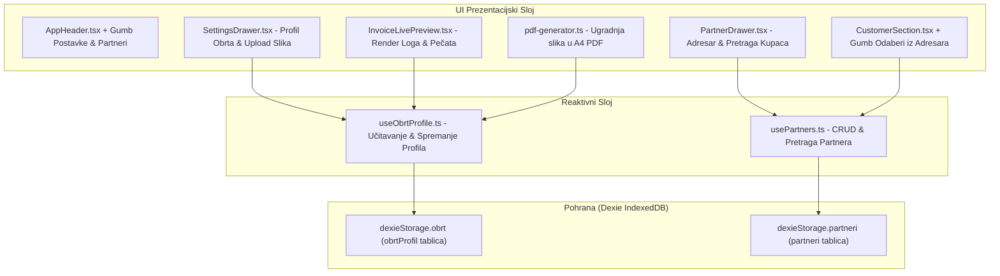

# Plan Implementacije: Faza 8 – Postavke Obrta, Adresar Partnera i Prilagodba Memoranduma

Ovaj dokument definira arhitekturu, komponente i korake implementacije za **Fazu 8** sustava [ObrtnIQ](file:///d:/Documents/Robot%20Hand%20Made/ObrtnIQ).

---

## 1. Cilj Faze 8

Omogućiti obrtniku potpunu personalizaciju sustava i profesionalnog memoranduma:
1. **Dinamički profil obrta**: Zamjena zadanih konstanti iz [obrt-profile.ts](file:///d:/Documents/Robot%20Hand%20Made/ObrtnIQ/apps/web/src/engine/obrt-profile.ts) trajnim podacima iz lokalne baze ([dexie-db.ts](file:///d:/Documents/Robot%20Hand%20Made/ObrtnIQ/apps/web/src/storage/dexie-db.ts)).
2. **Prilagodba memoranduma (Branding)**: Klijentski upload vizualnog identiteta (logotip obrta i digitalni pečat/potpis s prozirnom pozadinom) uz automatsko ugrađivanje u živi A4 račun i PDF dokument.
3. **Adresar partnera (Customer Management)**: Sustav za trajno pamćenje kupaca, pretragu po OIB-u ili nazivu te brzi odabir jednim klikom na radnoj plohi unosa.

---

## 2. Arhitektura i Novi Moduli

---

## 3. Detaljni Pregled Komponenti i Datoteka

### 1. Reaktivni Hookovi (`apps/web/src/hooks/`)

#### A. `useObrtProfile.ts`
- **Odgovornost:** Učitavanje profila iz Dexie baze (`dexieStorage.obrt`), pružanje zadanog profila ako baza još nema unosa, i spremanje izmjena.
- **Stanje:** `profil: ObrtProfil`, `isLoading: boolean`.
- **Funkcije:**
  - `saveProfil(noviProfil: ObrtProfil): Promise<void>`
  - `updateLogo(base64Data?: string): Promise<void>`
  - `updatePecat(base64Data?: string): Promise<void>`
  - `resetToDefault(): Promise<void>`

#### B. `usePartners.ts`
- **Odgovornost:** Upravljanje bazom kupaca.
- **Stanje:** `partneri: Partner[]`, `searchQuery: string`, `filteredPartneri: Partner[]`.
- **Funkcije:**
  - `addPartner(partner: Omit<Partner, 'id'>): Promise<Partner>`
  - `updatePartner(id: string, partial: Partial<Partner>): Promise<void>`
  - `deletePartner(id: string): Promise<void>`
  - `refreshPartners(): Promise<void>`

---

### 2. UI Komponente (`apps/web/src/components/`)

#### A. [SettingsDrawer.tsx](file:///d:/Documents/Robot%20Hand%20Made/ObrtnIQ/apps/web/src/components/SettingsDrawer.tsx)
Ladica za uređivanje postavki obrta podijeljena u tri vizualna taba:
1. **Tab 1: Osnovni podaci obrta**:
   - Naziv obrta, Ime i prezime vlasnika, OIB (s MOD 11 provjerom u hodu).
   - Ulica i broj, Poštanski broj, Mjesto/Grad, Država (ISO).
   - Poslovni email i kontakt telefon.
2. **Tab 2: Račun & Poslovni prostor**:
   - Poslovni IBAN (s MOD 97 provjerom i prikazom banke), BIC/SWIFT.
   - Oznaka poslovnog prostora (npr. `POSL1`), Oznaka naplatnog uređaja (`1`).
   - Preklopnici: Paušalist (da/ne), U sustavu PDV-a (da/ne).
3. **Tab 3: Memorandum & Vizualni Identitet**:
   - **Logotip obrta**: File input za učitavanje slike (PNG, JPG, SVG, max 500 KB), trenutačni pregled (thumbnail), gumb za uklanjanje.
   - **Digitalni pečat i potpis**: File input (PNG s transparentnom pozadinom, max 500 KB), preview i opcija uklanjanja.

#### B. [PartnerDrawer.tsx](file:///d:/Documents/Robot%20Hand%20Made/ObrtnIQ/apps/web/src/components/PartnerDrawer.tsx)
Ladica za upravljanje adresarom kupaca:
- Tražilica u realnom vremenu (filtriranje po nazivu, OIB-u ili mjestu).
- Popis spremljenih partnera s bedžom porezne zone (`DOMACI_B2B`, `EU_B2B_REVERSE_CHARGE`, `INOZEMSTVO`).
- Forma za brzi unos novog partnera (Naziv, OIB s provjerom, Ulica, Grad, Porezna zona).
- Akcija: *"Izdaj račun za ovog partnera"* (jednim klikom popunjava formu na radnoj plohi).

#### C. Nadogradnja radne plohe ([CustomerSection.tsx](file:///d:/Documents/Robot%20Hand%20Made/ObrtnIQ/apps/web/src/components/desk/CustomerSection.tsx))
- Dodavanje gumba **"Odaberi iz adresara"** pored naziva kupca.
- Klik na gumb otvara brzi popup/ladicu partnera; odabirom partnera automatski se popunjavaju Naziv, OIB i Porezna zona.

---

### 3. Integracija Memoranduma na A4 Račun i PDF

#### A. [InvoiceLivePreview.tsx](file:///d:/Documents/Robot%20Hand%20Made/ObrtnIQ/apps/web/src/components/InvoiceLivePreview.tsx)
- U gornjem dijelu zaglavlja računa dodaje se prikaz učitanog logotipa (`logoImageData` kao ``), elegantno poravnat nasuprot naziva dokumenta.
- Na dnu računa, u sekciji *"Račun izdao i potpisao"*, renderira se digitalni pečat/potpis (`pecatPotpisImageData`).

#### B. [pdf-generator.ts](file:///d:/Documents/Robot%20Hand%20Made/ObrtnIQ/apps/web/src/utils/pdf-generator.ts)
- DOM capture mehanizam (`html2canvas-pro`) automatski renderira logo i pečat u visokoj rezoluciji (High-DPI 2x scale) uz zadržavanje oštrine i transparentnosti.
- Vektorski fallback generator dodaje podršku za `addImage` u `jspdf`.

---

## 4. Koraci Implementacije

### Korak 1: Izrada Hookova (`useObrtProfile.ts`, `usePartners.ts`)
- Implementirati perzistenciju profila u Dexie bazi.
- Implementirati CRUD za partnere uz automatsko inicijalno punjenje oglednim kupcem.

### Korak 2: Izrada Ladica (`SettingsDrawer.tsx`, `PartnerDrawer.tsx`)
- Izraditi formu postavki s uploadom slika i pretvorbom u Base64 data URL.
- Izraditi adresar partnera s pretragom i filtriranjem.

### Korak 3: Povezivanje s Navigacijom i Radnom Plohom
- Dodati gumb *"Postavke"* (zupčanik) i *"Partneri"* u [AppHeader.tsx](file:///d:/Documents/Robot%20Hand%20Made/ObrtnIQ/apps/web/src/components/layout/AppHeader.tsx).
- Povezati `CustomerSection` s brzim odabirom partnera.
- Povezati `App.tsx` s dinamičkim profilom iz `useObrtProfile`.

### Korak 4: A4 Prikaz Memoranduma i PDF Validacija
- Integrirati prikaz logotipa i pečata u [InvoiceLivePreview.tsx](file:///d:/Documents/Robot%20Hand%20Made/ObrtnIQ/apps/web/src/components/InvoiceLivePreview.tsx) i [pdf-generator.ts](file:///d:/Documents/Robot%20Hand%20Made/ObrtnIQ/apps/web/src/utils/pdf-generator.ts).
- Provjeriti `@media print` stilove kako bi se logo i pečat ispravno tiskali.

### Korak 5: Testiranje i Gate-Check Verifikacija
- Pokrenuti `npm test` (svih 89 testova mora ostati zeleno).
- Pokrenuti `npm run build` (0 TypeScript grešaka).
- Ažurirati [manifest_i_dnevnik_implementacije.md](file:///d:/Documents/Robot%20Hand%20Made/ObrtnIQ/docs/manifest_i_dnevnik_implementacije.md).

---

## 5. Gate-Check Kriteriji za Fazu 8

1. **Perzistencija profila obrta:** Izmjene naziva, OIB-a, IBAN-a ili adrese u postavkama spremaju se u Dexie bazu i ostaju sačuvane nakon osvježavanja stranice.
2. **Branding & Slike:** Učitani logo i pečat/potpis prikazuju se na živom A4 računu i u izvezenom PDF dokumentu bez gubitka kvalitete.
3. **Adresar partnera:** Dodavanje novog partnera sprema ga u bazu; odabir partnera na radnoj plohi u manje od 1 sekunde popunjava sva relevantna polja.
4. **Nulta regresija:** Svi postojeći testovi (89/89) i produkcijski build prolaze s 0 grešaka.
