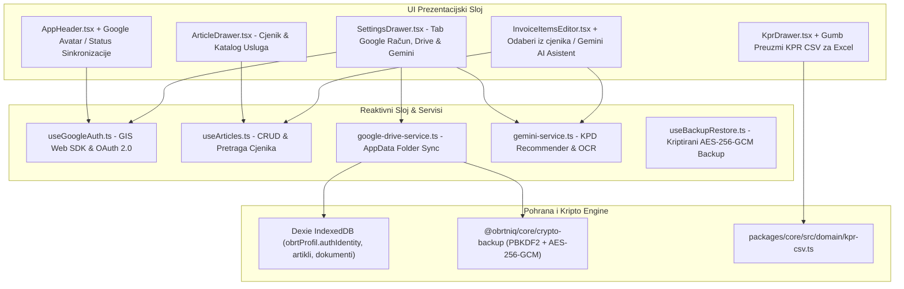

# Plan Implementacije: Faza 9 – Google Identity & Kripto Trezor, Povezani Servisi (Drive & Gemini AI), Cjenik s KPD 2025 i KPR CSV

Ovaj dokument definira detaljnu arhitekturu, sigurnosni model, korisničko sučelje i korake implementacije za **Fazu 9** sustava [ObrtnIQ](file:///d:/Documents/Robot%20Hand%20Made/ObrtnIQ).

---

## 1. Analiza Postojećeg Stanja i Cilj Faze 9

### 1.1. Status dosadašnje implementacije
Do sada su uspješno izgrađene i verificirane sve prethodne faze (Faze 1 do 8):
* **Faza 1 & 2**: Core domena, financijska matematika u centima, OIB/IBAN algoritmi, sekvence i Dexie perzistencija.
* **Faza 3**: Sharp UI primitivi, dinamički HSL Theme Engine (5 preseta + Hue rotacija) i split-screen radna ploha.
* **Faza 4**: Generator kodova (HUB-3 PDF417, EPC QR), pravopisna hrvatska tipografija, nativni `@media print` engine i ISO 32000-1 PDF validator.
* **Faza 4.5**: Lokalni višerazinski Scoped Logger s cirkularnim spremnikom (500 zapisa) i terminalskim drawerom.
* **Faza 5**: Životni ciklus računa (`NACRT -> IZDANO -> STORNIRANO`), immutability pravila, tipkovnički prečaci (`Alt+N`, `F2`) i [DocumentDrawer](file:///d:/Documents/Robot%20Hand%20Made/ObrtnIQ/apps/web/src/components/DocumentDrawer.tsx).
* **Faza 6**: Knjiga Prometa (KPR), nadzor praga 40.000 €, kvartalni obračun i službeni PO-SD XML generator za ePoreznu.
* **Faza 7**: Fiskalizacija 1.0 (CIS ZKI/JIR, offline 48h red) i Fiskalizacija 2.0 (UBL 2.1 CIUS-HR e-Račun s KPD 2025 šiframa i Web Crypto trezorom).
* **Faza 8**: Postavke obrta ([SettingsDrawer](file:///d:/Documents/Robot%20Hand%20Made/ObrtnIQ/apps/web/src/components/SettingsDrawer.tsx)), adresar partnera ([PartnerDrawer](file:///d:/Documents/Robot%20Hand%20Made/ObrtnIQ/apps/web/src/components/PartnerDrawer.tsx)), memorandum s logotipom i digitalnim pečatom.
* **Modularizacija (ADR-012) & Validacija ispisa i PDF-a**: Uspješno restrukturiran `App.tsx` na ~115 linija, 17 testnih datoteka, **92/92 prolaznih testova**, latencija generiranja PDF-a 16–54 ms.

### 1.2. Ciljevi Faze 9
1. **Google Identity kao Kriptografski & Lokalni ID (Zero-Server Auth)**:
   - Prijava putem Google Identity Services (GIS) Web SDK-a bez centralnog backend poslužitelja.
   - Povezivanje Google identifikatora (`sub` - jedinstveni nepromjenjivi 21-znamenkasti ID korisnika) s lokalnim profilom u Dexie bazi.
   - Izvođenje lokalnog kriptografskog ključa za enkripciju trezora i sigurnosnih kopija putem Web Crypto API-ja (`PBKDF2` + `AES-256-GCM`).
2. **Povezivanje na korisnikove Cloud servise (Zero-Server Cost)**:
   - **Google Drive AppData Folder (`drive.appdata` scope)**: Korištenje skrivene, privatne mape korisničkog Google Drivea za automatsku i ručnu sinkronizaciju kriptiranih `.obrtniq` backupa, uz nula troškova servera.
   - **Gemini API (Google AI Studio / BYOK)**: Povezivanje s Gemini 2.0 / 1.5 Flash modelom za inteligentnog asistenta:
     - Automatska preporuka KPD 2025 šifre iz opisa posla.
     - OCR analiza i izdvajanje podataka iz slika/PDF-ova uplatnica i računa.
   - **Priprema za Firebase / Cloud Firestore**: Predviđeno sučelje za unos konfiguracije ako korisnik želi opcionalni multi-device live sync.
3. **Katalog Artikala i Usluga (Cjenik s KPD 2025)**:
   - Reaktivni hook `useArticles.ts` i ladica `ArticleDrawer.tsx` za upravljanje cjenikom.
   - Brzi odabir artikla i akcija *"Spremi u cjenik"* na radnoj plohi unosa.
4. **Knjigovodstveni KPR CSV Izvoz za Excel**:
   - Generiranje službenog CSV izvoza Knjige Prometa prema hrvatskim standardima (točka-zarez, decimalni zarez, UTF-8 s BOM zaglavljem za MS Excel).

---

## 2. Arhitektura Faze 9



---

## 3. Detaljni Pregled Modula i Komponenti

### 3.1. Google Login kao Kriptografski i Lokalni ID (Zero-Server Auth)

#### A. Konceptualni model autentikacije bez vlastitog poslužitelja
Tradicionalne web aplikacije zahtijevaju centralni backend poslužitelj s bazom korisnika. U ObrtnIQ-u primjenjujemo **Zero-Server Client-Side OAuth 2.0**:
1. Preglednik komunicira direktno s Google Identity Services (`https://accounts.google.com/gsi/client`).
2. Google vraća:
   * **OpenID Connect ID Token (JWT)**: Dekodira se na klijentu i sadrži:
     - `sub` (Google Subject ID): Nepromjenjivi, globalno jedinstveni 21-znamenkasti identifikator korisnika (npr. `108392174981273981273`).
     - `email`: Poslovna/privatna adresa e-pošte.
     - `name`: Ime i prezime korisnika.
     - `picture`: URL avatara profila.
   * **OAuth 2.0 Access Token**: S opcionalnim scopeovima za korisnikove odabrane servise:
     - `https://www.googleapis.com/auth/drive.appdata` (skrivena mapa za backup).

#### B. Kriptografsko vezivanje (Crypto Anchor)
* **Izvođenje lokalnog ključa trezora**:
  Kako bismo osigurali da lokalni podaci i backupi budu kriptografski vezani za vlasnika računa, koristimo Web Crypto API:
  $$\text{MasterKey} = \text{PBKDF2}(\text{googleSub} + \text{Salt}, \text{iteracija}=100.000, \text{hash}=\text{SHA-256}, \text{alg}=\text{AES-256-GCM})$$
* **Prednosti**:
  - Privatnost: Google nikada ne vidi financijske podatke, račune ni certifikate obrtnika.
  - Sigurnost: Čak i ako netko fizički kopira IndexedDB datoteku s diska, bez Google prijave i lokalnog sola/PIN-a ne može dekriptirati trezor certifikata niti backup.
  - Multi-device kontinuitet: Prijavom s istim Google računom na novom računalu i unosom PIN-a, korisnik trenutačno povlači i otključava svoj backup iz Google Drive AppData mape!

#### C. Proširenje domenskog modela ([types.ts](file:///d:/Documents/Robot%20Hand%20Made/ObrtnIQ/packages/core/src/domain/types.ts))
```typescript
export interface GoogleAuthIdentity {
  provider: 'GOOGLE' | 'LOCAL';
  googleSub?: string;            // Jedinstveni nepromjenjivi Google ID
  email?: string;
  name?: string;
  pictureUrl?: string;
  connectedAt?: string;
  scopes?: string[];
}

export interface ConnectedServicesConfig {
  googleDriveEnabled: boolean;
  googleDriveLastSync?: string;
  geminiApiKey?: string;         // Korisnikov Google AI Studio API ključ
  geminiModel?: string;          // Zadani model: 'gemini-2.0-flash'
  firebaseConfig?: {
    apiKey: string;
    projectId: string;
    appId: string;
  };
}
```

---

### 3.2. Google Drive AppData Storage (Zero-Server Cloud Sync)

#### A. Zašto Google Drive `appDataFolder`?
Google Drive pruža skriveni prostor za pohranu pod nazivom **Application Data folder**:
- **Potpuna privatnost i čistoća**: Datoteke u ovoj mapi nisu vidljive korisniku u redovnom Google Drive sučelju, čime se sprječava slučajno brisanje ili gomilanje nepotrebnih datoteka među osobnim dokumentima.
- **Sigurnost**: Samo ObrtnIQ aplikacija (s pripadajućim Client ID-jem i autorizacijom) može čitati i pisati u tu mapu.
- **Nula troškova poslužitelja**: Koristi se besplatni prostor korisničkog Google računa (15 GB).

#### B. Implementacija servisa `google-drive-service.ts`
1. **Upload kriptiranog backupa**:
   - Poziva se `createBackupSnapshot(storage)`.
   - Podaci se enkriptiraju AES-256-GCM algoritmom u `.obrtniq` paket.
   - Šalje se multipart POST/PATCH na `https://www.googleapis.com/upload/drive/v3/files?uploadType=multipart` s metapodatkom `parents: ['appDataFolder']` i nazivom `obrtniq_backup_YYYYMMDD_HHmmss.obrtniq`.
2. **Popis i dohvat backupa**:
   - GET `https://www.googleapis.com/drive/v3/files?spaces=appDataFolder&orderBy=createdTime desc`.
   - Prikaz zadnje sinkronizacije i povijesti verzija.
3. **Restore iz oblaka jednim klikom**:
   - Preuzimanje najnovije datoteke, lokalna dekripcija i atomsko punjenje IndexedDB baze.

---

### 3.3. Gemini API Integracija (AI Pomoćnik za Paušaliste)

#### A. Bring-Your-Own-Key (BYOK) arhitektura
Korisnik u postavkama unosi svoj besplatni Google AI Studio API ključ (ili koristi Google OAuth token ako je dodijeljen scope). Ključ se čuva isključivo u lokalnom IndexedDB-u i nikada se ne šalje na vanjske servere osim direktno na službeni Google Generative Language REST API (`generativelanguage.googleapis.com`).

#### B. Funkcionalnosti AI Asistenta
1. **Smart KPD 2025 Recommender**:
   - Korisnik u unosu stavke upiše slobodni tekst: npr. *"izrada responzivnog dizajna i wireframea u Figmi"*.
   - Klikom na ikonu iskre (Gemini), asistent analizira službenu KPD 2025 nomenklaturu i predlaže:
     `Šifra: 74.10.11 (Usluge dizajna i oblikovanja softverskih sučelja)` s kratkim pravnim obrazloženjem.
2. **OCR Analiza Uplatnica i Računa**:
   - Korisnik uploada sliku/PDF uplatnice ili ponude dobavljača.
   - Gemini Vision model ekstrahira: Naziv platitelja, OIB, IBAN, datum, iznos i poziv na broj te automatski popunjava radnu plohu unosa!
3. **Porezni i PO-SD savjetnik**:
   - Odgovori na specifična pitanja o paušalnom oporezivanju u RH (pragovi 40.000 €, priznavanje inozemnih računa, rokovi predaje PO-SD obrasca do 15. siječnja).

---

### 3.4. Katalog Artikala i Usluga (Cjenik s KPD 2025)

#### A. Reaktivni hook `apps/web/src/hooks/useArticles.ts`
- Upravlja stanjem tablice `artikli` u Dexie bazi.
- Podržava CRUD operacije, pretragu po nazivu i filtriranje po KPD 2025 šifri.
- Uključuje inicijalni seed najčešćih paušalnih usluga u RH (softver, savjetovanje, dizajn, marketing, prevođenje).

#### B. Ladica cjenika `ArticleDrawer.tsx`
- Pregled svih spremljenih stavaka s cijenama, jedinicama mjere i KPD bedževima.
- Forma za brzi unos i izmjenu artikala.
- Gumb *"Dodaj na račun"* koji trenutno umeće stavku u radnu plohu nacrta računa.

#### C. Integracija na radnu plohu ([InvoiceItemsEditor.tsx](file:///d:/Documents/Robot%20Hand%20Made/ObrtnIQ/apps/web/src/components/desk/InvoiceItemsEditor.tsx))
- Gumb *"Odaberi iz cjenika"* u zaglavlju stavaka.
- Gumb *"Spremi stavku u cjenik"* na svakom retku stavke.
- Gumb *"AI Pomoć (Gemini)"* za automatsko određivanje KPD šifre.

---

### 3.5. Knjigovodstveni KPR CSV Izvoz za Excel

#### A. Core generator `packages/core/src/domain/kpr-csv.ts`
- Generira valjan CSV dokument prema hrvatskim standardima:
  - `\uFEFF` UTF-8 BOM na početku datoteke (jamči ispravan prikaz Č, Ć, Ž, Š, Đ u MS Excelu).
  - Točka-zarez (`;`) kao standardni separator stupaca za HR regionalne postavke.
  - Decimalni zarez za sve novčane iznose.
  - Zaglavlje: `R.br.;Datum uplate;Broj računa / temeljnice;Naziv uplatitelja / opis;Naplaćeno u gotovini (€);Naplaćeno bezgotovinski (€);Ukupno naplaćeno (€);Kvartal`.

#### B. Integracija u [KprDrawer.tsx](file:///d:/Documents/Robot%20Hand%20Made/ObrtnIQ/apps/web/src/components/KprDrawer.tsx)
- Gumb *"Preuzmi KPR (CSV / Excel)"* za trenutno preuzimanje `KPR_2026.csv`.

---

## 4. Akcijski Plan Implementacije (Korak po Korak)

### Korak 1: Domenski Tipovi i KPR CSV Generator (Core)
1. Proširiti `packages/core/src/domain/types.ts` s `GoogleAuthIdentity` i `ConnectedServicesConfig`.
2. Kreirati `packages/core/src/domain/kpr-csv.ts` i testove u `packages/core/tests/kpr-csv.test.ts`.
3. Provjeriti `npm test` u `@obrtniq/core`.

### Korak 2: Google Identity & Crypto ID Servis
1. Izraditi `apps/web/src/services/google-auth-service.ts` (inicijalizacija GIS SDK-a, token handling, offline/demo fallback).
2. Povezati izvođenje kriptografskog ključa iz Google `sub`-a s Web Crypto modulom.
3. Kreirati `useGoogleAuth.ts` hook za reaktivni status prijave u aplikaciji.

### Korak 3: Google Drive AppData Sync Servis
1. Izraditi `apps/web/src/services/google-drive-service.ts` za komunikaciju s Google Drive REST API v3.
2. Povezati upload i download enkriptiranih `.obrtniq` arhiva iz skrivene `appDataFolder` mape.

### Korak 4: Gemini AI Asistent Servis
1. Izraditi `apps/web/src/services/gemini-service.ts` za pozivanje Gemini 2.0 / 1.5 Flash API-ja.
2. Implementirati funkcije: `recommendKpdCode(description)` i `parseInvoiceReceipt(imageBlob)`.

### Korak 5: Reaktivni Hook i Ladica Cjenika (`useArticles.ts` & `ArticleDrawer.tsx`)
1. Izraditi `apps/web/src/hooks/useArticles.ts` s povezivanjem na `dexieStorage.artikli` i inicijalnim seedom.
2. Izraditi `apps/web/src/components/ArticleDrawer.tsx`.
3. Povezati gumb *"Odaberi iz cjenika"* i *"Spremi u cjenik"* u `InvoiceItemsEditor.tsx`.

### Korak 6: Nadogradnja Postavki ([SettingsDrawer.tsx](file:///d:/Documents/Robot%20Hand%20Made/ObrtnIQ/apps/web/src/components/SettingsDrawer.tsx))
1. Dodati tab *"Google Račun & Povezani Servisi"*:
   - Google Login / Logout gumb s prikazom avatara i emaila.
   - Google Drive AppData sinkronizacija (gumb *"Sinkroniziraj na Drive"*, prikaz zadnjeg backupa).
   - Gemini API postavke (unos API ključa, test veze).
   - Firebase opcionalna konfiguracija.
2. Dodati tab *"Sigurnosna kopija & Trezor"*:
   - Izvoz kriptiranog `.obrtniq` paketa i otvorenog JSON-a.
   - Uvoz i vraćanje baze uz dekripciju.

### Korak 7: Integracija u Zaglavlje i KPR Izvoz
1. U [AppHeader.tsx](file:///d:/Documents/Robot%20Hand%20Made/ObrtnIQ/apps/web/src/components/layout/AppHeader.tsx) dodati gumb *"Cjenik"* i Google avatar / status oblaka.
2. U [KprDrawer.tsx](file:///d:/Documents/Robot%20Hand%20Made/ObrtnIQ/apps/web/src/components/KprDrawer.tsx) dodati gumb *"Preuzmi KPR CSV za Excel"*.
3. Ažurirati [PhaseOverviewGrid.tsx](file:///d:/Documents/Robot%20Hand%20Made/ObrtnIQ/apps/web/src/components/layout/PhaseOverviewGrid.tsx) za FAZU 9.

### Korak 8: Verifikacija i Testiranje
1. Napisati testove za KPR CSV, cjenik i Google auth mapping.
2. Provjeriti `npm test` (svi testovi moraju biti zeleni).
3. Provjeriti `npm run build` (0 TypeScript / Vite grešaka).

---

## 5. Gate-Check Kriteriji za Fazu 9

| # | Kriterij provjere | Očekivani rezultat |
|---|---|---|
| **G1** | **Google Identity & Crypto Anchor** | Korisnik se može prijaviti putem Google računa; Google `sub` ID se sigurno povezuje s lokalnim profilom i koristi za izvođenje kriptografskog ključa. |
| **G2** | **Google Drive AppData Sync** | Kriptirani `.obrtniq` backup uspješno se sprema u skriveni Google Drive `appDataFolder` i po potrebi vraća na drugom uređaju bez ikakvog centralnog servera. |
| **G3** | **Gemini AI Asistent** | Unos opisa usluge (npr. *"izrada logotipa"*) putem Gemini API-ja točno preporučuje KPD 2025 šifru (`74.10.11`). |
| **G4** | **Cjenik Usluga & KPD 2025** | Korisnik može pregledavati, filtrirati i dodavati artikle; odabir artikla u manje od 100 ms popunjava formu stavke računa. |
| **G5** | **KPR CSV Excel format** | Preuzeta `KPR_2026.csv` datoteka otvara se u Excelu bez iskrivljenih znakova (UTF-8 BOM), s točka-zarezom i točnim financijskim zbrojevima. |
| **G6** | **Nulta regresija** | Svi postojeći testovi (92/92) i novi testovi Faze 9 prolaze, a produkcijski build prolazi s 0 grešaka. |
