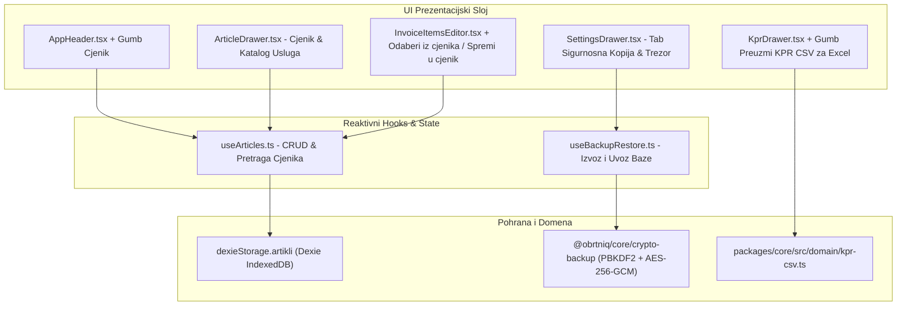

# Plan Implementacije i Validacije: Faza 9 – Katalog Artikala i Usluga (Cjenik s KPD 2025), KPR CSV Izvoz za Excel i Lokalni Kriptirani Backup (AES-256-GCM)

Ovaj dokument definira detaljnu arhitekturu, podatkovni model, korisničko sučelje, korake izvedbe i **potpuni validacijski protokol s Gate-Check kriterijima** za **Fazu 9** sustava [ObrtnIQ](file:///d:/Documents/Robot%20Hand%20Made/ObrtnIQ).

---

## 1. Analiza i Opseg Faze 9

### 1.1. Status sustava prije Faze 9
Sve temeljne funkcije izdavanja i fiskalizacije su uspješno dovršene i testirane:
* **Faze 1 do 8**: Matematika u centima, OIB/IBAN algoritmi, Sharp UI s HSL temama, HUB-3 PDF417 i EPC QR kodovi, nativni `@media print`, Scoped Logger, statusni automat (`NACRT -> IZDANO -> STORNIRANO`), KPR i PO-SD XML za ePoreznu, Fiskalizacija 1.0 (CIS) & 2.0 (UBL 2.1 e-Račun s KPD 2025), postavke obrta, adresar partnera i memorandum.
* **Testna baza**: 17 testnih datoteka, **92/92 prolazna testa**, latencija PDF generiranja 16–54 ms.

### 1.2. Cilj Faze 9 (Lokalna operativna efikasnost i zaštita podataka)
1. **Katalog Artikala i Usluga (Cjenik s KPD 2025)**:
   - Omogućiti obrtniku trajno spremanje i pretraživanje usluga/artikala umjesto ručnog upisivanja svakog retka.
   - Svaki artikl nosi propisanu KPD 2025 šifru (ključno za Fiskalizaciju 2.0), naziv, mjernu jedinicu i zadanu cijenu u eurima.
   - Brzi odabir artikla jednim klikom na radnoj plohi unosa i akcija *"Spremi u cjenik"* za novounesene stavke.
2. **Knjigovodstveni Izvoz Knjige Prometa (KPR CSV za Excel)**:
   - Hrvatski knjigovođe i banke traže KPR u tabličnom obliku. Generiranje CSV-a usklađenog s hrvatskim regionalnim postavkama (točka-zarez `;`, decimalni zarez i `\uFEFF` UTF-8 BOM zaglavlje protiv iskrivljavanja dijakritika u MS Excelu).
3. **Lokalni Kriptirani Sigurnosni Backup (AES-256-GCM Data Sovereignty)**:
   - Integracija Web Crypto modula iz `@obrtniq/core` u sučelje postavki ([SettingsDrawer](file:///d:/Documents/Robot%20Hand%20Made/ObrtnIQ/apps/web/src/components/SettingsDrawer.tsx)).
   - Izvoz zaštićenog `.obrtniq` paketa šifriranog korisničkom lozinkom/PIN-om (AES-256-GCM + PBKDF2 s 100.000 iteracija) i otvorenog JSON snapshota.
   - Uvoz i atomsko obnavljanje baze (Restore) uz provjeru sheme i integriteta.

---

## 2. Arhitektura Faze 9



---

## 3. Detaljni Pregled Komponenti i Modula

### 3.1. Katalog Usluga i Artikala (Cjenik s KPD 2025)

#### A. Reaktivni hook `apps/web/src/hooks/useArticles.ts`
- **Povezivanje**: Koristi `dexieStorage.artikli` iz [dexie-db.ts](file:///d:/Documents/Robot%20Hand%20Made/ObrtnIQ/apps/web/src/storage/dexie-db.ts).
- **Tip podatka**:
  ```typescript
  export interface Artikl {
    id: string;
    sifra?: string;
    kpdSifra: string;           // Npr. "62.01.11"
    naziv: string;              // Npr. "Razvoj aplikacijskog softvera"
    opis?: string;
    jedinicaMjere: string;      // "sat", "kom", "paušal", "dan", "mjesec", "projekt"
    cijenaOsnovica: number;     // Decimal (EUR)
    stopaPdv: number;           // 0.00 za paušaliste
    pdvKategorijaPoreza: 'E' | 'S' | 'AE' | 'Z';
    jeUsluga: boolean;
    aktivan: boolean;
  }
  ```
- **Operacije**:
  - `artikli: Artikl[]`, `isLoading: boolean`
  - `addArtikl(artikl: Omit<Artikl, 'id'>): Promise<Artikl>`
  - `updateArtikl(id: string, partial: Partial<Artikl>): Promise<void>`
  - `deleteArtikl(id: string): Promise<void>`
  - `searchArticles(query: string, samoAktivni?: boolean): Artikl[]`
  - `seedDefaultArticles(): Promise<void>` – automatski početni katalog s najčešćim paušalnim uslugama u RH:
    * `62.01.11` – Razvoj aplikacijskog softvera (75,00 € / sat)
    * `62.02.20` – Savjetovanje o računalnoj opremi i sistemima (60,00 € / sat)
    * `74.10.11` – Usluge grafičkog i vizualnog dizajna (50,00 € / sat)
    * `70.22.11` – Usluge poslovnog savjetovanja i vođenja (80,00 € / sat)
    * `74.30.11` – Usluge prevođenja tekstova (25,00 € / kartica)

#### B. Ladica za upravljanje cjenikom `apps/web/src/components/ArticleDrawer.tsx`
- **Tražilica u realnom vremenu**: Filtriranje po nazivu, KPD šifri ili internoj šifri.
- **Filter tipa**: Sve / Samo Usluge / Samo Roba.
- **Forma za brzi unos/uređivanje artikla**:
  - Naziv usluge/artikla.
  - KPD 2025 birač (`KpdPicker`) s hijerarhijskim pretraživanjem.
  - Jedinica mjere (dropdown sa standardnim jedinicama).
  - Cijena u eurima (`CurrencyInput`).
  - Preklopnik: Usluga ili roba.
- **Akcija**: *"Dodaj na račun"* – ako je otvoren nacrt računa, izabrani artikl se odmah dodaje kao nova stavka.

#### C. Integracija na radnu plohu unosa ([InvoiceItemsEditor.tsx](file:///d:/Documents/Robot%20Hand%20Made/ObrtnIQ/apps/web/src/components/desk/InvoiceItemsEditor.tsx))
- U zaglavlju sekcije stavaka dodaje se gumb **"Odaberi iz cjenika"** (ikona `BookMarked`).
- Na svakom retku stavke dodaje se diskretna akcija **"Spremi u cjenik"** – omogućuje obrtniku da stavku koju je upravo unio na račun jednim klikom trajno spremi u katalog za buduće račune.

---

### 3.2. Knjigovodstveni KPR CSV Izvoz za Excel

#### A. Core modul `packages/core/src/domain/kpr-csv.ts`
- Implementira generator `generateKprCsv(kprStavke: NaplataPromet[], godina: number): string`.
- **Hrvatski standard za Excel**:
  - `\uFEFF` Byte Order Mark (BOM) na početku datoteke za ispravno UTF-8 kodiranje u svim verzijama MS Excela (eliminira iskrivljavanje dijakritika).
  - Točka-zarez (`;`) kao delimiter stupaca.
  - Decimalni zarez za sve novčane iznose (`1250,50`).
  - Standardizirani nazivi stupaca:
    `R.br.;Datum uplate;Broj računa / temeljnice;Naziv uplatitelja / opis;Naplaćeno u gotovini (€);Naplaćeno bezgotovinski (€);Ukupno naplaćeno (€);Kvartal`

#### B. UI Integracija u [KprDrawer.tsx](file:///d:/Documents/Robot%20Hand%20Made/ObrtnIQ/apps/web/src/components/KprDrawer.tsx)
- U Tabu 1 (Knjiga Prometa) dodaje se gumb **"Preuzmi KPR (CSV / Excel)"**.
- Klikom se generira i preuzima datoteka naziva `KPR_2026.csv`.

---

### 3.3. Lokalni Kriptirani Sigurnosni Backup (AES-256-GCM)

#### A. UI Tab u postavkama ([SettingsDrawer.tsx](file:///d:/Documents/Robot%20Hand%20Made/ObrtnIQ/apps/web/src/components/SettingsDrawer.tsx)) ("Sigurnosna kopija & Trezor podataka")
1. **Izvoz podataka**:
   - **Kriptirani `.obrtniq` paket (AES-256-GCM)**: Korisnik unosi lozinku/PIN, sustav generira enkriptiranu datoteku.
   - **Otvoreni JSON snapshot**: Za tehnički uvid ili predaju knjigovođi.
2. **Uvoz i vraćanje podataka (Restore)**:
   - File picker za `.obrtniq` ili `.json` datoteke.
   - Ako je datoteka kriptirana, prikazuje se polje za unos lozinke.
   - Provjera sheme `v3.0` i sažetak sadržaja prije konačnog prepisivanja (npr. *"Pronađeno: 1 profil, 14 partnera, 8 artikala, 35 računa"*).
   - Sigurnosno upozorenje i potvrda prije restauracije.
3. **Reset baze (Tvorničke postavke)**:
   - Mogućnost potpunog pražnjenja svih IndexedDB tablica uz dvostruku potvrdu (upis riječi "OBRISI").

---

## 4. Akcijski Plan Koraka (Faza 9)

1. **Korak 1 (Core)**: Kreirati `packages/core/src/domain/kpr-csv.ts` i testove u `packages/core/tests/kpr-csv.test.ts`.
2. **Korak 2 (Hook)**: Kreirati `apps/web/src/hooks/useArticles.ts` s Dexie integracijom i početnim seedom.
3. **Korak 3 (UI Ladica)**: Izraditi `ArticleDrawer.tsx` s pretragom, filtriranjem i brzim unosom artikla.
4. **Korak 4 (Radna Ploha)**: Dodati gumb *"Odaberi iz cjenika"* i akciju *"Spremi u cjenik"* u [InvoiceItemsEditor.tsx](file:///d:/Documents/Robot%20Hand%20Made/ObrtnIQ/apps/web/src/components/desk/InvoiceItemsEditor.tsx).
5. **Korak 5 (Postavke Backup)**: Dodati tab *"Sigurnosna kopija & Trezor"* u [SettingsDrawer.tsx](file:///d:/Documents/Robot%20Hand%20Made/ObrtnIQ/apps/web/src/components/SettingsDrawer.tsx) s AES-256 izvozom i uvozom.
6. **Korak 6 (KPR Izvoz)**: Dodati gumb *"Preuzmi KPR (CSV / Excel)"* u [KprDrawer.tsx](file:///d:/Documents/Robot%20Hand%20Made/ObrtnIQ/apps/web/src/components/KprDrawer.tsx).
7. **Korak 7 (Navigacija & Pregled)**: Dodati gumb *"Cjenik"* u [AppHeader.tsx](file:///d:/Documents/Robot%20Hand%20Made/ObrtnIQ/apps/web/src/components/layout/AppHeader.tsx) i u [PhaseOverviewGrid.tsx](file:///d:/Documents/Robot%20Hand%20Made/ObrtnIQ/apps/web/src/components/layout/PhaseOverviewGrid.tsx).
8. **Korak 8 (Validacija)**: Pokrenuti cjelokupni validacijski protokol Faze 9.

---

## 5. Protokol Validacije i Gate-Check Kriteriji za Fazu 9

### 5.1. Automatski testovi (Vitest)
```bash
# 1. Pokretanje testova za KPR CSV generator
npx vitest run packages/core/tests/kpr-csv.test.ts

# 2. Pokretanje testova za AES-256-GCM kripto backup i restore
npx vitest run packages/core/tests/storage.test.ts

# 3. Pokretanje testova za reaktivni cjenik artikala
npx vitest run apps/web/tests/useArticles.test.ts

# 4. Pokretanje cjelokupnog paketa testova u monorepou
npm test
```

### 5.2. Tablica Gate-Check Kriterija (Faza 9)

| # | Kriterij provjere | Očekivani rezultat | Način provjere |
|---|---|---|---|
| **V9-1** | **KPR CSV Format za Excel** | Generirana datoteka počinje s `\uFEFF` (UTF-8 BOM), koristi točka-zarez `;`, decimalni zarez i točno sumira stupce gotovine i bezgotovinskih uplata bez iskrivljenja dijakritika (Č, Ć, Ž, Š, Đ) u MS Excelu. | Unit test + preuzimanje u pregledniku |
| **V9-2** | **Cjenik Usluga & KPD 2025** | Korisnik može dodati novu uslugu s cijenom i KPD šifrom u `ArticleDrawer`; artikl se trajno perzistira u Dexie bazi i pretražuje u realnom vremenu. | Interaktivni test u sučelju |
| **V9-3** | **1-klik odabir sa cjenika** | Klikom na artikl iz cjenika na radnoj plohi, polja naziva, KPD šifre, mjerne jedinice i cijene popunjavaju se u manje od 100 ms. | Interaktivni test unosa računa |
| **V9-4** | **Spremi stavku u cjenik** | Klikom na ikonu spremanja u retku stavke, novouneseni podaci se trenutno spremaju u bazu artikala i postaju dostupni za buduće račune. | Interaktivni test na radnoj plohi |
| **V9-5** | **AES-256-GCM Kriptirani Backup** | Izvoz baze sa zadanom lozinkom stvara validan `.obrtniq` paket. Uvoz s točnom lozinkom atomski vraća sve podatke; uvoz s netočnom lozinkom baca jasnu grešku bez oštećenja postojećih podataka. | Integracijski test u postavkama |
| **V9-6** | **Nulta regresija koda** | Svi postojeći testovi (92/92) plus novi testovi Faze 9 prolaze (`100% passed`), a `tsc -b && vite build` prolazi s 0 grešaka. | `npm test` && `npm run build` |

---

## 6. Most prema Fazi 10 i Zajednička Sinergija

Faza 9 postavlja ključne temelje koji se u Fazi 10 proširuju na Cloud i AI:
1. **Cjenik (Faza 9) ──► Gemini AI (Faza 10)**:
   Artikli i stavke definirani u Fazi 9 dobivaju u Fazi 10 inteligentni **Gemini AI KPD Recommender** koji iz slobodnog opisa posla automatski sugerira točnu KPD 2025 šifru i popunjava cjenik.
2. **Lokalni `.obrtniq` Backup (Faza 9) ──► Google Drive AppData Sync (Faza 10)**:
   Kriptirani paket podataka generiran u Fazi 9 postaje standardni format koji se u Fazi 10 automatski i na 1-klik sinkronizira u skriveni `appDataFolder` korisničkog Google Drivea.
3. **KPR CSV (Faza 9) ──► OCR Analiza (Faza 10)**:
   Evidencija naplata u KPR-u u Fazi 10 dobiva mogućnost automatskog unosa putem Gemini Vision OCR analize slika uplatnica i izvoda.

