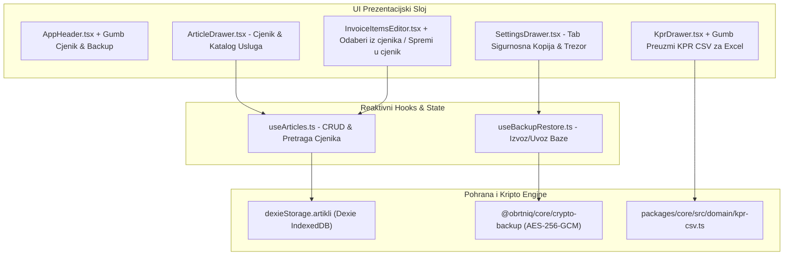

# Plan Implementacije: Faza 9 – Katalog Artikala i Usluga (Cjenik s KPD 2025), Kriptirani Backup (AES-256-GCM) i KPR CSV Izvoz

Ovaj dokument definira detaljnu arhitekturu, podatkovni model, korisničko sučelje i korake implementacije za **Fazu 9** sustava [ObrtnIQ](file:///d:/Documents/Robot%20Hand%20Made/ObrtnIQ).

---

## 1. Analiza Postojećeg Stanja i Cilj Faze 9

### 1.1. Status dosadašnje implementacije
Do sada su uspješno izgrađene i verificirane sve prethodne faze (Faze 1 do 8):
* **Faza 1 & 2**: Core domena, financijska matematika u centima, OIB/IBAN algoritmi, sekvence i Dexie perzistencija.
* **Faza 3**: Sharp UI primitivi, dinamički HSL Theme Engine (5 preseta + Hue rotacija) i split-screen radna ploha.
* **Faza 4**: Generator kodova (HUB-3 PDF417, EPC QR), pravopisna hrvatska tipografija, nativni `@media print` engine i ISO 32000-1 PDF validator.
* **Faza 4.5**: Lokalni višerazinski Scoped Logger s cirkularnim spremnikom (500 zapisa) i terminalskim drawerom.
* **Faza 5**: Životni ciklus računa (`NACRT -> IZDANO -> STORNIRANO`), immutability pravila, tipkovnički prečaci (`Alt+N`, `F2`) i [DocumentDrawer](file:///d:/Documents/Robot%20Hand%20Made/ObrtnIQ/apps/web/src/components/DocumentDrawer.tsx).
* **Faza 6**: Knjiga Prometa (KPR), nadzor praga 40.000 €, kvartalni obračun i službeni PO-SD XML generator za ePoreznu.
* **Faza 7**: Fiskalizacija 1.0 (CIS ZKI/JIR, offline 48h red) i Fiskalizacija 2.0 (UBL 2.1 CIUS-HR e-Račun s KPD 2025 šiframa i Web Crypto trezorom).
* **Faza 8**: Postavke obrta ([SettingsDrawer](file:///d:/Documents/Robot%20Hand%20Made/ObrtnIQ/apps/web/src/components/SettingsDrawer.tsx)), adresar partnera ([PartnerDrawer](file:///d:/Documents/Robot%20Hand%20Made/ObrtnIQ/apps/web/src/components/PartnerDrawer.tsx)), memorandum s logotipom i digitalnim pečatom.
* **Modularizacija (ADR-012) & Validacija ispisa i PDF-a**: Uspješno restrukturiran `App.tsx` na ~115 linija, 17 testnih datoteka, **92/92 prolaznih testova**, latencija generiranja PDF-a 16–54 ms.

### 1.2. Preostali operativni izazovi koje rješava Faza 9
1. **Ručni unos stavaka računa**: Obrtnik trenutno mora za svaki račun iznova ručno upisivati naziv usluge, tražiti KPD šifru, upisivati mjernu jedinicu i cijenu. Tablica `artikli` u Dexie bazi postoji, ali nema UI cjenika niti brzog odabira.
2. **Suverenitet podataka i sigurnosna kopija (Data Sovereignty)**: U Local-First arhitekturi podaci žive isključivo u IndexedDB bazi preglednika. Iako je modul [crypto-backup.ts](file:///d:/Documents/Robot%20Hand%20Made/ObrtnIQ/packages/core/src/storage/crypto-backup.ts) implementiran u `@obrtniq/core`, korisnik trenutno nema UI za preuzimanje kriptiranog `.obrtniq` backupa (AES-256-GCM) ili vraćanje podataka na drugom računalu.
3. **Izvoz KPR-a za knjigovođu**: Knjigovođe i banke traže Knjigu Prometa u tabličnom (Excel/CSV) formatu s hrvatskim regionalnim postavkama (točka-zarez, decimalni zarez i UTF-8 BOM).

---

## 2. Arhitektura Faze 9



---

## 3. Detaljni Pregled Modula i Komponenti

### 3.1. Katalog Usluga i Artikala (Cjenik s KPD 2025)

#### A. Reaktivni hook `apps/web/src/hooks/useArticles.ts`
- **Model podataka**: Koristi postojeći tip `Artikl` iz `@obrtniq/core`:
  ```typescript
  export interface Artikl {
    id: string;
    sifra?: string;
    kpdSifra: string;           // Npr. "62.01.11" (KPD 2025 standard)
    naziv: string;              // Npr. "Programiranje i razvoj softvera"
    opis?: string;
    jedinicaMjere: string;      // "sat", "kom", "paušal", "dan", "mjesec"
    cijenaOsnovica: number;     // Decimal (EUR)
    stopaPdv: number;           // 0.00 za paušaliste
    pdvKategorijaPoreza: 'E' | 'S' | 'AE' | 'Z';
    jeUsluga: boolean;
    aktivan: boolean;
  }
  ```
- **Funkcionalnosti**:
  - `artikli: Artikl[]`, `isLoading: boolean`
  - `addArtikl(artikl: Omit<Artikl, 'id'>): Promise<Artikl>`
  - `updateArtikl(id: string, partial: Partial<Artikl>): Promise<void>`
  - `deleteArtikl(id: string): Promise<void>`
  - `searchArticles(query: string, samoAktivni?: boolean): Artikl[]`
  - **Inicijalni Seed**: Ako je tablica prazna, automatski nudi uvoz oglednog cjenika najčešćih paušalnih djelatnosti u RH (softverske usluge, poslovno savjetovanje, grafički dizajn, digitalni marketing, prevođenje).

#### B. Ladica za upravljanje cjenikom `apps/web/src/components/ArticleDrawer.tsx`
- **Tražilica u realnom vremenu**: Pretraga po nazivu, KPD šifri ili internoj šifri.
- **Filter**: Sve / Samo Usluge / Samo Roba.
- **Forma za brzi unos/uređivanje artikla**:
  - Naziv usluge/artikla.
  - KPD 2025 birač (`KpdPicker`) s hijerarhijskim pretraživanjem.
  - Jedinica mjere (dropdown sa standardnim: `sat`, `kom`, `paušal`, `dan`, `mjesec`, `projekt`).
  - Cijena u eurima (`CurrencyInput`).
  - Preklopnik: Usluga ili roba.
- **Akcija jednim klikom**: *"Dodaj na račun"* – ako je otvoren nacrt računa, izabrani artikl se odmah dodaje kao nova stavka.

#### C. Integracija na radnu plohu unosa ([InvoiceItemsEditor.tsx](file:///d:/Documents/Robot%20Hand%20Made/ObrtnIQ/apps/web/src/components/desk/InvoiceItemsEditor.tsx))
- U zaglavlju sekcije stavaka dodaje se gumb **"Odaberi iz cjenika"** (ikona `BookMarked`).
- Na svakom retku stavke dodaje se diskretna akcija **"Spremi u cjenik"** – omogućuje obrtniku da stavku koju je upravo osmislio i unio na račun jednim klikom trajno spremi u katalog za buduće račune.

---

### 3.2. Kriptirani Sigurnosni Backup (AES-256-GCM Data Sovereignty)

#### A. Integracija Web Crypto enginea ([crypto-backup.ts](file:///d:/Documents/Robot%20Hand%20Made/ObrtnIQ/packages/core/src/storage/crypto-backup.ts))
* Već implementirani core moduli:
  - `createBackupSnapshot(storage)`: Kreira cjeloviti JSON objekt sa svim podacima (profil, partneri, artikli, dokumenti, KPR).
  - `encryptBackup(snapshot, password)`: Izvodi 256-bitni AES-GCM ključ putem PBKDF2 (100.000 iteracija SHA-256) s kriptografski nasumičnim 16-bajtnim saltom i 12-bajtnim IV-jem.
  - `decryptBackup(envelope, password)`: Dešifrira arhivu i verificira autentikacijski GCM tag.
  - `restoreBackupSnapshot(storage, data)`: Atomski puni Dexie tablice.

#### B. UI Tab u postavkama `SettingsDrawer.tsx` ("Sigurnosna kopija & Trezor podataka")
1. **Izvoz podataka**:
   - **Kriptirani `.obrtniq` paket (Preporučeno)**: Korisnik unosi PIN/lozinku, sustav generira enkriptiranu binarnu/JSON datoteku.
   - **Otvoreni JSON snapshot**: Za tehnički uvid ili predaju knjigovođi.
2. **Uvoz i vraćanje podataka (Restore)**:
   - File picker za `.obrtniq` ili `.json` datoteke.
   - Ako je datoteka kriptirana, prikazuje se polje za unos lozinke.
   - Provjera sheme `v3.0` i sažetak sadržaja prije konačnog prepisivanja (npr. *"Pronađeno: 1 profil, 14 partnera, 8 artikala, 35 računa"*).
   - Sigurnosno upozorenje i potvrda prije restauracije.
3. **Reset baze (Tvorničke postavke)**:
   - Mogućnost potpunog pražnjenja svih IndexedDB tablica uz dvostruku potvrdu (upisivanje riječi "OBRISI").

---

### 3.3. Knjigovodstveni Izvoz Knjige Prometa (KPR CSV za Excel)

#### A. Core modul `packages/core/src/domain/kpr-csv.ts`
- Implementira generator `generateKprCsv(kprStavke: NaplataPromet[], godina: number): string`.
- **Hrvatski standard za Excel**:
  - `\uFEFF` Byte Order Mark (BOM) na početku datoteke za ispravno UTF-8 kodiranje u svim verzijama MS Excela (eliminira čudne znakove poput `č`).
  - Točka-zarez (`;`) kao delimiter stupaca.
  - Decimalni zarez za sve novčane iznose (`1250,50`).
  - Standardizirani nazivi stupaca:
    `R.br.;Datum uplate;Broj računa / temeljnice;Naziv uplatitelja / opis;Naplaćeno u gotovini (€);Naplaćeno bezgotovinski (€);Ukupno naplaćeno (€);Kvartal`

#### B. UI Integracija u [KprDrawer.tsx](file:///d:/Documents/Robot%20Hand%20Made/ObrtnIQ/apps/web/src/components/KprDrawer.tsx)
- U Tabu 1 (Knjiga Prometa) dodaje se gumb **"Preuzmi KPR (CSV / Excel)"** pored postojećih gumba za ispis.
- Klikom se generira i preuzima datoteka naziva `KPR_2026.csv`.

---

## 4. Koraci Implementacije (Faza 9)

### Korak 1: Core modul za KPR CSV izvoz
1. Kreirati `packages/core/src/domain/kpr-csv.ts`.
2. Kreirati testove u `packages/core/tests/kpr-csv.test.ts` (validacija zaglavlja, BOM-a, zareza i sume).
3. Re-exportati iz `packages/core/src/index.ts`.

### Korak 2: Reaktivni hook `useArticles.ts`
1. Kreirati `apps/web/src/hooks/useArticles.ts` koji komunicira s `dexieStorage.artikli`.
2. Dodati predefinirane ogledne usluge za softver i paušaliste.
3. Napisati testove za hook u `apps/web/tests/useArticles.test.ts`.

### Korak 3: Ladica cjenika `ArticleDrawer.tsx`
1. Izraditi komponentu `ArticleDrawer.tsx` sa Sharp UI dizajnom.
2. Dodati pretragu po nazivu i KPD-u, filter roba/usluge, te unos/uređivanje stavki.
3. Dodati gumb *"Cjenik"* u [AppHeader.tsx](file:///d:/Documents/Robot%20Hand%20Made/ObrtnIQ/apps/web/src/components/layout/AppHeader.tsx) i uvezati ga u [AppDrawers.tsx](file:///d:/Documents/Robot%20Hand%20Made/ObrtnIQ/apps/web/src/components/drawers/AppDrawers.tsx).

### Korak 4: Povezivanje Cjenika s radnom plohom unosa
1. U [InvoiceItemsEditor.tsx](file:///d:/Documents/Robot%20Hand%20Made/ObrtnIQ/apps/web/src/components/desk/InvoiceItemsEditor.tsx) dodati gumb *"Odaberi iz cjenika"*.
2. Dodati akciju *"Spremi u cjenik"* za brzi upis nove stavke u bazu artikala.

### Korak 5: Tab Sigurnosne kopije u Postavkama ([SettingsDrawer.tsx](file:///d:/Documents/Robot%20Hand%20Made/ObrtnIQ/apps/web/src/components/SettingsDrawer.tsx))
1. Dodati 4. tab: `backup` ("Sigurnosna kopija & Trezor").
2. Povezati izvoz kriptiranog paketa (`.obrtniq`) s lozinkom i običnog JSON-a.
3. Povezati uvoz datoteke s dekripcijom i atomskim obnavljanjem baze.

### Korak 6: KPR CSV izvoz u [KprDrawer.tsx](file:///d:/Documents/Robot%20Hand%20Made/ObrtnIQ/apps/web/src/components/KprDrawer.tsx)
1. Dodati gumb *"Preuzmi KPR CSV"* u zaglavlje Knjige Prometa.
2. Uvezati generiranje CSV datoteke i preuzimanje u pregledniku.

### Korak 7: Ažuriranje Nadzorne Ploče i Verifikacija
1. Dodati FAZU 9 u [PhaseOverviewGrid.tsx](file:///d:/Documents/Robot%20Hand%20Made/ObrtnIQ/apps/web/src/components/layout/PhaseOverviewGrid.tsx).
2. Pokrenuti `npm test` i `npm run build` za potvrdu 100% zelene linije testova.

---

## 5. Gate-Check Kriteriji za Fazu 9

| # | Kriterij provjere | Očekivani rezultat |
|---|---|---|
| **G1** | **Cjenik artikala & KPD 2025** | Korisnik može dodati novu uslugu/artikl s cijenom i KPD šifrom u `ArticleDrawer`; artikl se trajno perzistira u Dexie bazi. |
| **G2** | **1-klik odabir stavke na račun** | Klikom na artikl iz cjenika, forma na radnoj plohi u manje od 100 ms popunjava naziv, KPD šifru, jedinicu mjere i cijenu. |
| **G3** | **AES-256-GCM Kriptirani Backup** | Izvoz baze sa zadanom lozinkom stvara validan `.obrtniq` paket. Uvoz s točnom lozinkom uspješno vraća sve podatke; uvoz s netočnom lozinkom baca jasnu grešku bez oštećenja postojećih podataka. |
| **G4** | **KPR CSV Excel format** | Preuzeti `KPR_2026.csv` otvara se u Excelu bez iskrivljenih dijakritika (UTF-8 BOM ispravan), sa stupcima odvojenim točka-zarezom i točnim zbrojevima. |
| **G5** | **Nulta regresija testova** | Svi postojeći testovi (92/92) plus novi testovi za Fazu 9 prolaze bez ijedne greške (`0 failed`), a `tsc -b && vite build` prolazi čisto. |
