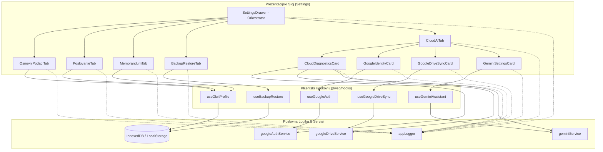

# Plan Optimizacije i Modularizacije: `SettingsDrawer.tsx`

## 1. Analiza Postojećeg Stanja (Monolitni Drawer)

Komponenta [`apps/web/src/components/SettingsDrawer.tsx`](file:///d:/Documents/Robot%20Hand%20Made/ObrtnIQ/apps/web/src/components/SettingsDrawer.tsx) trenutno broji **1.831 liniju koda** te sadrži 5 potpuno različitih domenskih cjelina i preko 25 stanja (`useState`):

```
apps/web/src/components/SettingsDrawer.tsx (1.831 linija)
├── 1. Imports & Props (linije 1-52)
├── 2. Stanja & Loggeri (linije 53-124) - 25+ useState varijabli
├── 3. Handleri profila i memoranduma (linije 125-205)
├── 4. Handleri sigurnosne kopije i vraćanja (linije 206-305)
├── 5. Handleri Google Autentifikacije (linije 306-347)
├── 6. Handleri Google Drive sinkronizacije (linije 348-385)
├── 7. Handleri Gemini AI modela (linije 386-414)
├── 8. Handler API dijagnostike / Health Check (linije 415-480)
├── 9. Header & Navigacijska traka (linije 481-588)
├── 10. TAB 1: Osnovni podaci obrta (linije 589-712) [~124 lin.]
├── 11. TAB 2: Poslovanje & Račun (linije 713-786) [~74 lin.]
├── 12. TAB 3: Memorandum & Grafika (linije 787-889) [~103 lin.]
├── 13. TAB 4: Sigurnosna kopija & Trezor (linije 890-1093) [~204 lin.]
├── 14. TAB 5: Google, Drive & Gemini AI (linije 1094-1804) [~710 lin.!]
│       ├── 0. Dijagnostika API-ja i dozvola (Health Check)
│       ├── 1. Google Identity & Kripto Sidro (Zero-Server)
│       ├── 2. Google Drive AppData Trezor
│       ├── 3. Google AI Studio (Gemini Asistent BYOK)
│       └── 4. Firebase / Firestore postavke
└── 15. Footer akcije za spremanje profila (linije 1805-1831)
```

---

## 2. Ciljna Arhitektura (Modularna Struktura)

Komponenta se dijeli na čisti **orkestrator** (`SettingsDrawer.tsx`) i specijalizirane tabove i kartice unutar novog direktorija [`apps/web/src/components/settings/`](file:///d:/Documents/Robot%20Hand%20Made/ObrtnIQ/apps/web/src/components/settings):

```
apps/web/src/components/
├── SettingsDrawer.tsx                     # Glavni orkestrator (~150 linija)
└── settings/                              # Modularne komponente postavki
    ├── types.ts                           # Tipovi i sučelja za postavke
    ├── SettingsTabsNav.tsx                # Navigacijski tabovi s bedževima
    ├── tabs/
    │   ├── OsnovniPodaciTab.tsx           # TAB 1: Naziv, OIB, adresa, vlasnik, kontakt
    │   ├── PoslovanjeTab.tsx              # TAB 2: IBAN, PDV/paušal, porezna, model plaćanja
    │   ├── MemorandumTab.tsx              # TAB 3: Upload logotipa i pečata (<500 KB)
    │   ├── BackupRestoreTab.tsx           # TAB 4: AES-256 šifriranje, JSON, uvoz, tvornički reset
    │   └── CloudAiTab.tsx                 # TAB 5: Kontejner za oblak i umjetnu inteligenciju
    └── cloud/                             # Podkomponente za Cloud & AI
        ├── CloudDiagnosticsCard.tsx       # 8 točaka dijagnostike i preporuke
        ├── GoogleIdentityCard.tsx         # Google profil, kripto-sidro, Client ID
        ├── GoogleDriveSyncCard.tsx        # AppData folder, PIN zaštita, verzije sigurnosnih kopija
        ├── GeminiSettingsCard.tsx         # BYOK API ključ, testiranje i izbor modela
        └── FirebaseSettingsCard.tsx       # Opcionalne postavke za Firebase
```

---

## 3. Povezanost s Backend Modulima i Hookovima



---

## 4. Faze Implementacije (STATUS: DOVRŠENO ✅)

### Faza 1: Priprema strukture, tipova i navigacije ✅
- **Status:** Dovršeno.
- **Komponente:**
  - [`apps/web/src/components/settings/types.ts`](file:///d:/Documents/Robot%20Hand%20Made/ObrtnIQ/apps/web/src/components/settings/types.ts): Definirani zajednički tipovi (`SettingsTabId`, prop sučelja za tabove i kartice).
  - [`apps/web/src/components/settings/SettingsTabsNav.tsx`](file:///d:/Documents/Robot%20Hand%20Made/ObrtnIQ/apps/web/src/components/settings/SettingsTabsNav.tsx): Navigacijski tabovi s bedževima, indikatorom Google prijave i responzivnim ikonama.

### Faza 2: Izdvajanje Tabova Profila Obrta (Tabovi 1, 2 i 3) ✅
- **Status:** Dovršeno.
- **Komponente:**
  - [`apps/web/src/components/settings/tabs/OsnovniPodaciTab.tsx`](file:///d:/Documents/Robot%20Hand%20Made/ObrtnIQ/apps/web/src/components/settings/tabs/OsnovniPodaciTab.tsx): Podaci obrta s `OibInput` i validacijama.
  - [`apps/web/src/components/settings/tabs/PoslovanjeTab.tsx`](file:///d:/Documents/Robot%20Hand%20Made/ObrtnIQ/apps/web/src/components/settings/tabs/PoslovanjeTab.tsx): Poslovanje i račun s `IbanInput`, oznakama prostora/uređaja i PDV/paušal postavkama.
  - [`apps/web/src/components/settings/tabs/MemorandumTab.tsx`](file:///d:/Documents/Robot%20Hand%20Made/ObrtnIQ/apps/web/src/components/settings/tabs/MemorandumTab.tsx): Upload logotipa i digitalnog pečata s potpisom (<500 KB limit), pregled i brisanje.

### Faza 3: Izdvajanje Sigurnosne Kopije i Trezora (Tab 4) ✅
- **Status:** Dovršeno.
- **Komponente:**
  - [`apps/web/src/components/settings/tabs/BackupRestoreTab.tsx`](file:///d:/Documents/Robot%20Hand%20Made/ObrtnIQ/apps/web/src/components/settings/tabs/BackupRestoreTab.tsx): AES-256 šifrirani izvoz, JSON snapshot, inspekcija datoteke, vraćanje podataka, tvornički reset s potvrdom "OBRISI" i osvježavanje profila.

### Faza 4: Modularizacija Cloud & AI Taba (Tab 5) ✅
- **Status:** Dovršeno.
- **Komponente:**
  - [`apps/web/src/components/settings/cloud/CloudDiagnosticsCard.tsx`](file:///d:/Documents/Robot%20Hand%20Made/ObrtnIQ/apps/web/src/components/settings/cloud/CloudDiagnosticsCard.tsx): 8 točaka dijagnostike (Origin, Network ping, Session, Scopes, Drive API, Gemini AI Studio) s preporukama.
  - [`apps/web/src/components/settings/cloud/GoogleIdentityCard.tsx`](file:///d:/Documents/Robot%20Hand%20Made/ObrtnIQ/apps/web/src/components/settings/cloud/GoogleIdentityCard.tsx): Google profil, Google Sub kripto-sidro, mjerač isteka tokena, Demo prijava i unos prilagođenog Client ID-a.
  - [`apps/web/src/components/settings/cloud/GoogleDriveSyncCard.tsx`](file:///d:/Documents/Robot%20Hand%20Made/ObrtnIQ/apps/web/src/components/settings/cloud/GoogleDriveSyncCard.tsx): AppData mapa, PIN zaštita, verzije sigurnosnih kopija i vraćanje s Drivea.
  - [`apps/web/src/components/settings/cloud/GeminiSettingsCard.tsx`](file:///d:/Documents/Robot%20Hand%20Made/ObrtnIQ/apps/web/src/components/settings/cloud/GeminiSettingsCard.tsx): BYOK API ključ, provjera pinga i ažurirani 2026 modeli (`gemini-3.8-flash`, `gemini-4-argon`, itd.).
  - [`apps/web/src/components/settings/cloud/FirebaseSettingsCard.tsx`](file:///d:/Documents/Robot%20Hand%20Made/ObrtnIQ/apps/web/src/components/settings/cloud/FirebaseSettingsCard.tsx): Sklopivi prozor za opcionalnu Firestore sinkronizaciju.
  - [`apps/web/src/components/settings/tabs/CloudAiTab.tsx`](file:///d:/Documents/Robot%20Hand%20Made/ObrtnIQ/apps/web/src/components/settings/tabs/CloudAiTab.tsx): Kontejner za sve Cloud & AI kartice.

### Faza 5: Refaktoriranje `SettingsDrawer.tsx` u Čisti Orkestrator ✅
- **Status:** Dovršeno.
- Sveden s 1.831 linije na samo 272 linije čistog koordinacijskog koda.
- Glavna stanja svedena na 3 varijable: `activeTab`, `formData` i `savedSuccess`.

### Faza 6: Verifikacija i Testiranje ✅
- **Status:** Dovršeno.
- Svi postojeći testovi prolaze: 162 testa kroz 27 testnih datoteka (100% prolaz).
- Dodan jedinični test: [`apps/web/tests/settings-drawer.test.ts`](file:///d:/Documents/Robot%20Hand%20Made/ObrtnIQ/apps/web/tests/settings-drawer.test.ts).
- Produkcijski Vite build (`npm run build`) prolazi bez ijednog upozorenja ili greške.

---

## 5. Usporedba Prije i Poslije

| Metrika | Prije refaktoriranja | Nakon modularizacije |
| :--- | :--- | :--- |
| **Veličina glavne komponente** | 1.831 linija koda | ~150 - 180 linija koda |
| **Broj `useState` u glavnoj komponenti** | 25+ stanja | 3 stanja (`activeTab`, `formData`, `savedSuccess`) |
| **Broj datoteka** | 1 monolitni file | 1 orkestrator + 8 specijaliziranih komponenti |
| **Izolacija re-rendera** | Tipkanje u jednom polju renderira svih 1.800 linija | Renderira se samo aktivna podkomponenta |
| **Održavanje i proširivost** | Visok rizik od regresije | Svaka kartica ima jasne granice odgovornosti |
| **Testabilnost** | Zahtijeva mockiranje svih 5 servisa odjednom | Svaki tab se testira u potpunoj izolaciji |

---

## 6. Arhitektura Logiranja i Telemetrija Podsustava Postavki

Podsustav postavki i integracije s oblakom integriran je u centralni aplikativni logger ([`appLogger`](file:///d:/Documents/Robot%20Hand%20Made/ObrtnIQ/apps/web/src/services/logger.ts)) temeljen na prstenastom međuspremniku ([`RingBuffer`](file:///d:/Documents/Robot%20Hand%20Made/ObrtnIQ/packages/core/src/logger/logger.ts)) kapaciteta 500 unosa.

### 6.1 Hijerarhija Scoped Loggera
Svaka podkomponenta i domenska cjelina ima vlastiti izolirani kontekst (`scope`):

| Scoped Logger | Komponenta / Hook | Svrha i Područje Praćenja |
| :--- | :--- | :--- |
| `SETTINGS` | [`SettingsDrawer.tsx`](file:///d:/Documents/Robot%20Hand%20Made/ObrtnIQ/apps/web/src/components/SettingsDrawer.tsx) | Otvaranje/zatvaranje drawera, navigacija tabova |
| `SETTINGS:PROFILE` | [`OsnovniPodaciTab.tsx`](file:///d:/Documents/Robot%20Hand%20Made/ObrtnIQ/apps/web/src/components/settings/tabs/OsnovniPodaciTab.tsx), [`PoslovanjeTab.tsx`](file:///d:/Documents/Robot%20Hand%20Made/ObrtnIQ/apps/web/src/components/settings/tabs/PoslovanjeTab.tsx) | Validacija OIB-a/IBAN-a, promjene profila, reset |
| `SETTINGS:MEMORANDUM` | [`MemorandumTab.tsx`](file:///d:/Documents/Robot%20Hand%20Made/ObrtnIQ/apps/web/src/components/settings/tabs/MemorandumTab.tsx) | Provjera limita veličine (< 500 KB), Base64 pretvorba, uklanjanje |
| `SETTINGS:BACKUP` | [`BackupRestoreTab.tsx`](file:///d:/Documents/Robot%20Hand%20Made/ObrtnIQ/apps/web/src/components/settings/tabs/BackupRestoreTab.tsx) | AES-256 izvoz, inspekcija arhive, vraćanje baze, tvornički reset |
| `SETTINGS:GOOGLE` | [`GoogleIdentityCard.tsx`](file:///d:/Documents/Robot%20Hand%20Made/ObrtnIQ/apps/web/src/components/settings/cloud/GoogleIdentityCard.tsx) | Google OAuth prijava, demo profil, ručni refresh tokena, Client ID |
| `SETTINGS:DRIVE` | [`GoogleDriveSyncCard.tsx`](file:///d:/Documents/Robot%20Hand%20Made/ObrtnIQ/apps/web/src/components/settings/cloud/GoogleDriveSyncCard.tsx) | Sinkronizacija u `appDataFolder`, povlačenje verzija, PIN zaštita |
| `SETTINGS:GEMINI` | [`GeminiSettingsCard.tsx`](file:///d:/Documents/Robot%20Hand%20Made/ObrtnIQ/apps/web/src/components/settings/cloud/GeminiSettingsCard.tsx) | BYOK API ključ, testiranje odziva modela, odabir 2026 verzije |
| `SETTINGS:DIAGNOSTICS` | [`CloudDiagnosticsCard.tsx`](file:///d:/Documents/Robot%20Hand%20Made/ObrtnIQ/apps/web/src/components/settings/cloud/CloudDiagnosticsCard.tsx) | Sveobuhvatni Health Check, mjerenje latencije, provjera dozvola |
| `AUTH:GOOGLE:SILENT` | [`google-auth-service.ts`](file:///d:/Documents/Robot%20Hand%20Made/ObrtnIQ/apps/web/src/services/google-auth-service.ts) | Pozadinsko tiho obnavljanje tokena bez ometanja korisnika |
| `DRIVE:SYNC` / `RESTORE` | [`useGoogleDriveSync.ts`](file:///d:/Documents/Robot%20Hand%20Made/ObrtnIQ/apps/web/src/hooks/useGoogleDriveSync.ts) | Kriptiranje snapshot-a i obnova baze s Google Drivea |

### 6.2 Granulacija Razine Log Zapisa (Log Levels)
- **`ERROR`**:
  - Neuspjela Google OAuth prijava (odbijen pristup, greška origin-a).
  - Neuspjelo slanje arhive na Google Drive (npr. kvota, nedostatak dozvola).
  - Neuspjela dekripcija arhive (pogrešna lozinka ili neispravan PIN).
  - Trajno tvorničko brisanje baze (Factory Reset).
  - *Automatska akcija:* Aktivira se [`triggerAutoOpen`](file:///d:/Documents/Robot%20Hand%20Made/ObrtnIQ/apps/web/src/services/global-error-trap.ts#L50) i korisniku se automatski otvara [`SystemLogDrawer`](file:///d:/Documents/Robot%20Hand%20Made/ObrtnIQ/apps/web/src/components/SystemLogDrawer.tsx) s prikazom call stacka.
- **`WARN`**:
  - Odbijanje slike memoranduma veće od 500 KB.
  - Istekao Google pristupni token (pokreće se tiho obnavljanje).
  - Nedostajući Google Drive scope (`drive.appdata`).
  - Korisnik odustao od tvorničkog reseta profila ili baze podataka.
- **`INFO`**:
  - Otvaranje prozora postavki.
  - Uspješno spremanje profila obrta u Dexie bazu.
  - Uspješna Google OAuth ili Demo prijava.
  - Uspješno dovršena sinkronizacija baze na Google Drive.
  - Izvoz AES-256 arhive ili JSON snimka.
- **`DEBUG`**:
  - Promjena aktivnog taba u sučelju.
  - Korisnik odabrao datoteku za inspekciju i obnovu.
  - Pozadinska provjera valjanosti Google sesije.
  - Mjerenje latencije Google API poslužitelja u milisekundama.
- **`VERBOSE`**:
  - Cjeloviti popisi dodijeljenih Google OAuth opsega (scopes).
  - Detaljni JSON metapodaci snimka baze podataka (broj računa, partnera, stavaka).

### 6.3 Pravila Maskiranja Osjetljivih Podataka (Data Redaction)
U skladu sa sigurnosnim standardom nultog povjerenja (Zero-Knowledge):
- **Google pristupni token (`access_token`):** Nikada se ne zapisuje u cijelosti u logove; u logovima se bilježi samo `***REDACTED***` ili duljina/status.
- **Lozinke za sigurnosnu kopiju:** Lozinka za AES-256 enkripciju nikada ne smije ući u log spremnik.
- **Korisnički PIN za Drive:** Maskira se kao `imaZastitniPin: boolean`.
- **Gemini API ključ:** Prikazuje se isključivo prefiks (npr. `AIzaSy...`) i status postavljenosti.

---

## 7. Debug Metodologija i Protokol za Dijagnostiku

Za brzo i pouzdano rješavanje problema implementiran je standardizirani dijagnostički protokol:

### 7.1 Protokol Trijaže u 4 Koraka
```
[1. DETEKCIJA] ──> [2. DIJAGNOSTIKA] ──> [3. INSPEKCIJA] ──> [4. VERIFIKACIJA]
Auto-open log       Health Check          Call Stack &         Simulacija i
kod ERROR stanja    8 točaka provjere     JSON izvoz logova    jedinični test
```

1. **Korak 1: Detekcija kvara**
   - Ako dođe do pogreške, [`initGlobalErrorTrap()`](file:///d:/Documents/Robot%20Hand%20Made/ObrtnIQ/apps/web/src/services/global-error-trap.ts#L63) presreće iznimku i automatski otvara [`SystemLogDrawer`](file:///d:/Documents/Robot%20Hand%20Made/ObrtnIQ/apps/web/src/components/SystemLogDrawer.tsx).
2. **Korak 2: Pokretanje automatskog Health Checka**
   - Korisnik ili programer otvara tab **"Google & AI"** i unutar kartice [`CloudDiagnosticsCard`](file:///d:/Documents/Robot%20Hand%20Made/ObrtnIQ/apps/web/src/components/settings/cloud/CloudDiagnosticsCard.tsx) klikne **"Pokreni Dijagnostiku"**.
   - Sustav u jednoj sekundi provjerava:
     1. Format Google Client ID-a.
     2. Valjanost Authorized JavaScript Origins (npr. `http://localhost:5173`).
     3. Mrežnu dostupnost Google poslužitelja uz mjerenje pinga.
     4. Integritet lokalne sesije i Google Sub kripto-sidro.
     5. Dodijeljene OAuth dozvole (Scopes).
     6. Dostupnost Google Drive API-ja i skrivene `appDataFolder` mape.
     7. Ispravnost Gemini AI ključa i odziv modela.
     8. Generira konkretne akcijske preporuke na hrvatskom jeziku.
3. **Korak 3: Inspekcija i preuzimanje dijagnostičkog paketa**
   - U konzoli ili kroz gumb **"Izvezi Dnevnik (JSON)"** generira se strukturirana JSON datoteka [`exportDiagnosticLog()`](file:///d:/Documents/Robot%20Hand%20Made/ObrtnIQ/apps/web/src/services/logger.ts#L90) koja sadrži točno vrijeme, razinu, kontekst, poruku i call stack svake greške.
4. **Korak 4: Verifikacija rješenja**
   - Izvršavanje ciljanih testova:
     - `npx vitest run apps/web/tests/google-auth.test.ts`
     - `npx vitest run apps/web/tests/google-drive.test.ts`
     - `npx vitest run apps/web/tests/settings-drawer.test.ts`

### 7.2 Dijagnostička Matrica Najčešćih Uzroka i Rješenja

| Simptom / Greška | Detektirani Kod | Uzrok | Akcijski Korak za Rješavanje |
| :--- | :--- | :--- | :--- |
| **Google popup se odmah zatvori** | `ORIGIN_MISMATCH` | Ishodište aplikacije (npr. `http://localhost:5173`) nije uneseno u Google Cloud konzolu. | Dodati točan URL u *Authorized JavaScript Origins* u Google Cloud Console. |
| **Greška "Korisnik je odbio pristup"** | `ACCESS_DENIED` | Korisnik je odznačio kućicu za pristup Google Driveu. | Ponoviti prijavu i obavezno ostaviti označenu kvačicu za Drive dozvolu. |
| **Greška 403 na Drive API pozivu** | `DRIVE_API_DISABLED` | Google Drive API nije omogućen u Google Cloud projektu. | Otvoriti ponuđeni link u dijagnostici i kliknuti gumb **Enable API**. |
| **Neuspjela obnova baze s Drivea** | `DECRYPTION_FAILED` | Upisan je pogrešan dodatni zaštitni PIN ili je korisnik prijavljen s drugim Google računom. | Prijaviti se s istim Google računom koji je izradio kopiju i unijeti točan PIN. |
| **Gemini Asistent ne prepoznaje KPD** | `INVALID_BYOK_KEY` | Neispravan API ključ s Google AI Studio ili prekoračena besplatna kvota. | Provjeriti ključ na [aistudio.google.com](https://aistudio.google.com/app/apikey) i testirati ga u tabu "Google & AI". |
| **Slika memoranduma se ne sprema** | `IMAGE_SIZE_EXCEEDED` | Datoteka logotipa ili pečata premašuje 500 KB. | Komprimirati sliku ili odabrati manji PNG/SVG format. |
