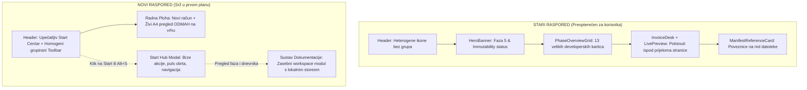
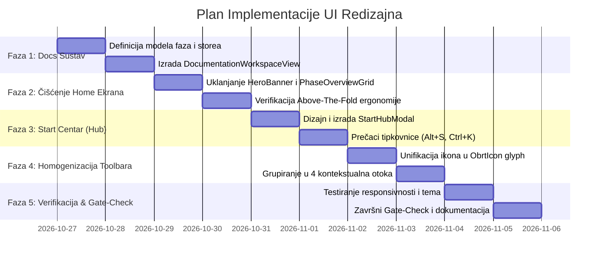

# PLAN REDIZAJNA KORISNIČKOG SUČELJA: START CENTAR, HOMOGENI TOOLBAR I SUSTAV DOKUMENTACIJE

**ObrtnIQ v3.0 — Dubrovačka Kripto-Republika**  
**Dokument:** `docs/plan_redizajna_ui_centar_toolbar_i_sustav_dokumentacije.md`  
**Datum:** Listopad 2026.  
**Autor:** Antigravity Pair Programmer & ObrtnIQ Tim  
**Status:** Spreman za implementaciju (Architecture & Execution Plan)

---

## 1. IZVRŠNI SAŽETAK I CILJ

Ovaj dokument definira detaljnu analizu i operativni plan redizajna korisničkog sučelja aplikacije **ObrtnIQ**.

Cilj zahvata je dvostruk:
1. **Primicanje srži aplikacije korisniku (Core-First UX):** Uklanjanje razvojnih artefakata (prikaz faza izgradnje, manifest kartica, statusni razvojni banner) s glavnog radnog ekrana (`Home`), te njihovo preseljenje u namjenski, strukturirani **Sustav Dokumentacije i Razvojnog Dnevnika** s vlastitim lokalnim skladištem (*docs store*). Korisnik pri otvaranju aplikacije mora odmah ("above the fold") imati pred sobom radnu plohu za unos računa i živi A4 pregled, bez skrolanja i tehničkog šuma.
2. **Kreiranje upečatljivog Start Centra i Homogene Alatne Trake:**
   - **Start Centar (Windows Start & Command Bar filozofija):** Centralno ili glavno sidro aplikacije koje klikom ili prečacem (`Alt+S` / `Ctrl+K`) otvara jedinstveni zapovjedni centar s brzim radnjama, ključnim metrikama poslovanja (KPR promet, prag 40.000 €, porezni kalendar) i strukturiranim izbornikom svih modula.
   - **Homogena i kontekstualno grupirana alatna traka:** Standardizacija dizajnerskog jezika ikona (uklanjanje stilske heterogenosti između generičkih outline ikona i kompleksnih višeslojnih SVG-ova), raspodjela u logičke funkcionalne otoke s jasnim razdjelnicima, te kontekstualno kodiranje boja.



---

## 2. DETALJNA ANALIZA TRENUTNOG STANJA (AS-IS)

### 2.1. Analiza Prve Slike: Faze implementacije na operativnom ekranu

Na prvoj priloženoj slici prikazan je blok koji se trenutno renderira na vrhu `home` pogleda u [App.tsx](file:///d:/Documents/Robot%20Hand%20Made/ObrtnIQ/apps/web/src/App.tsx):
- [HeroBanner.tsx](file:///d:/Documents/Robot%20Hand%20Made/ObrtnIQ/apps/web/src/components/layout/HeroBanner.tsx): Prikazuje tekstove poput `"FAZA 5 • POSLOVNI TIJEK & IMMUTABILITY Radna Ploha 58/42 Split"`, `"Ekran za Izdavanje Računa, Multi-Stavke & Statusni Automat"` i status zaključavanja dokumenta.
- [PhaseOverviewGrid.tsx](file:///d:/Documents/Robot%20Hand%20Made/ObrtnIQ/apps/web/src/components/layout/PhaseOverviewGrid.tsx): Prikazuje mrežu od 13 kartica (`FAZA 0-2 Domena & Baza`, `FAZA 3 Sharp UI & Teme`, `FAZA 4 HUB-3 & PDF`, `FAZA 4.5 Logging Engine`, `FAZA 5 Workflow & State`, `FAZA 6 KPR & PO-SD`, `FAZA 7 Fiskal. 1.0 & 2.0`, `FAZA 8`, `FAZA 9`, `FAZA 10`, `FAZA 11 Žigo Agent`, `FAZA 12 Vektorski Pečati`, `FAZA 17 Knjigovodstvo & Doprinosi`).
- [ManifestReferenceCard.tsx](file:///d:/Documents/Robot%20Hand%20Made/ObrtnIQ/apps/web/src/components/layout/ManifestReferenceCard.tsx): Prikazuje poveznice na interne markdown datoteke u repozitoriju.

#### Ključni problemi u korisničkom iskustvu:
1. **Gubitak vertikalnog prostora ("Above-the-Fold" penalizacija):**
   - Ovi elementi kumulativno zauzimaju **preko 480 do 600 piksela** visine ekrana.
   - Na standardnim laptop ekranima (1920x1080 ili 1366x768), korisnik pri ulasku u aplikaciju uopće ne vidi polja za unos kupca, unos stavki računa niti A4 pregled! Mora skrolati prema dolje da bi počeo raditi.
2. **Kognitivni šum i zamor:**
   - Obrtnik koji izdaje račun stranci ili unosi trošak ne treba gledati definicije poput *"RingBuffer (500), sanitizirani JSON izvoz"* ili *"OibInput, IbanInput, CurrencyInput, KpdPicker i Hue rotacija"*.
   - Te su informacije bile dragocjene tijekom razvoja za brzu vizualnu verifikaciju arhitekture, ali u operativnoj fazi narušavaju dojam gotovog, profesionalnog proizvoda.
3. **Duplikacija statusnih kontrola:**
   - `HeroBanner` prikazuje `Aktivni status dokumenta: RACUN NACRT [NACRT]`.
   - Samo 10 piksela ispod njega, komponenta [DocumentStatusBar.tsx](file:///d:/Documents/Robot%20Hand%20Made/ObrtnIQ/apps/web/src/components/desk/DocumentStatusBar.tsx) unutar [InvoiceDesk.tsx](file:///d:/Documents/Robot%20Hand%20Made/ObrtnIQ/apps/web/src/components/desk/InvoiceDesk.tsx) prikazuje istu informaciju s pripadajućim radnim gumbima (*Novi račun*, *Zabilježi uplatu*, *Storno*, *Pretvori ponudu*). `HeroBanner` je time postao funkcionalno redundatan.

#### Zašto podaci ne smiju nestati, već se odvojiti u sustav dokumentacije:
Korisnik izričito navodi: *"ne kažem da to treba kompletno ukloniti iz aplikacije, već odjeliti u sistem dokumentacije, neki opet lokalni store s dokumentima u ovom slučaju listom faza i izgradnje."*
- Faze izgradnje predstavljaju inženjersku povijest i jamstvo usklađenosti s hrvatskim zakonodavstvom (OIB MOD 11, HUB-3, Fiskalizacija 1.0/2.0, e-Račun UBL 2.1, PO-SD).
- Prebacivanjem u **Sustav Dokumentacije**:
  - Glavni ekran se oslobađa za rad.
  - Svi tehnički podaci, specifikacije faza, Gate-Check zapisi i manifest ostaju dostupni unutar specijaliziranog preglednika (`#docs` / `#faze`), pretraživi i strukturirani.

---

### 2.2. Analiza Druge Slike: Zaglavlje (Header) i Alatna Traka (Toolbar)

Na drugoj priloženoj slici prikazan je trenutni [AppHeader.tsx](file:///d:/Documents/Robot%20Hand%20Made/ObrtnIQ/apps/web/src/components/layout/AppHeader.tsx):
- Lijevo: Pečat `zigo-emblem` (48px) + Tekst `ObrtnIQ v3.0` + `DUBROVAČKA KRIPTO-REPUBLIKA`.
- Razdjelnik `|`.
- Alatna traka sa 8 kvadratnih gumbi (`w-10 h-10`):
  1. `Home` — tanka plava linijska Lucide ikona u plavom okviru sa sjajem.
  2. `invoice-document` — višebojna SVG ikona s plavim bedžem broja dokumenata (`2`).
  3. `kpr-tower` — kamena kula s uzlaznim financijskim stupcima.
  4. `fiscal-quill` — plavo-bijelo pero s pečatom.
  5. `catalog-pricing` — otvorena knjiga sa zlatnim pečatom.
  6. `b2b-partners` — stilizirana vaga/rukovanje.
  7. `obrt-tools` — prekriženi čekić i ravnalo.
  8. `zigo-emblem` — zlatni orlando kiber-amblem u zasebno uokvirenoj zlatnoj kutiji.
- Desno: Google Drive prijava, offline značka, PWA gumb, ThemeSelector i KPR widget praga (40k €).

#### Ključni problemi u vizualnom i ergonomskom oblikovanju:
1. **Stilska neusklađenost (Heterogenost ikona):**
   - **Gumb 1 (`Home`):** Koristi Lucide ikonu `Home` sa šupljim linijama (`stroke: 2px`).
   - **Gumbi 2-7 (`ObrtIcon`):** Koriste kompleksne, ručno crtane višeslojne SVG grafike s različitim debljinama poteza, gradijentima i ispunama.
   - **Gumb 8 (`Žigo AI`):** Ima potpuno drugačiju pozadinu (`#1e2025`), zlatni obrub i zlatnu ikonu.
   - **Rezultat:** Toolbar djeluje kao zbirka nasumično prikupljenih ikonica bez jedinstvene dizajnerske mreže (grid alignment, vizualna težina, optičko središte).
2. **Potpuni izostanak semantičkog grupiranja:**
   - Svih 8 gumbi poredano je u jedan ravni niz bez razmaka ili razdjelnika.
   - Korisnik mora u glavi rekonstruirati mentalni model aplikacije:
     - Zašto su *Artikli* i *Partneri* (šifarnici) pomiješani s *Fiskalizacijom* (regulatorni alat) i *Dokumentima* (operativna arhiva)?
     - Gdje počinju svakodnevne radnje, a gdje sistemske postavke?
3. **Nedostatak upečatljivog "Start" centra:**
   - Korisnik želi: *"da cijeli bude upečatljiviji kao centar, kao start na windowsima"*.
   - Trenutno klik na logo samo poziva `onNavigateHome`. Nema centralnog polazišta koje bi objedinilo sve funkcije aplikacije, omogućilo brzu pretragu ili pokretanje novog dokumenta jednim klikom/prečacem.
   - Kao što Windows Start nudi pretragu, najčešće programe, brze prečace i stanje sustava, ObrtnIQ treba **"Start Hub"** prilagođen obrtniku.

---

## 3. ARHITEKTURA NOVOG RJEŠENJA (TO-BE)

### 3.1. Konceptualni model: Tri stupa novog sučelja

```
+----------------------------------------------------------------------------------------------------+
|  [ORLANDO START]   |  [ DOKUMENTI ]   [ REGISTRI ]   [ SUSTAV ]  | [ŽIGO COPILOT] |  [PULS OBRTA]  |
|  *ObrtnIQ Centar*  |  Računi | Knjiga   Partneri | Cjenik   Fiskal | Post. |  *AI Suputnik*  | 14.850€ / 40k€ |
+----------------------------------------------------------------------------------------------------+
|                                                                                                    |
|  RADNA PLOHA (HOME) — ODMAH NA VRHU (ABOVE THE FOLD):                                             |
|  +---------------------------------------------------+------------------------------------------+  |
|  | RADNA FORMA ZA UNOS RAČUNA                        | ŽIVI A4 PDF PREGLED (REAL-TIME PREVIEW)  |  |
|  | - Kupac, OIB, Porezna zona, Način plaćanja        | - Generirani HUB-3 s EPC QR kodom        |  |
|  | - Stavke računa (KPD, cijena, popust)             | - Službeni memorandum obrta              |  |
|  | - Akcije: [F2 Izdaj Račun] [Spremi Nacrt]        | - ZKI / JIR fiskalni podaci              |  |
|  +---------------------------------------------------+------------------------------------------+  |
|                                                                                                    |
+----------------------------------------------------------------------------------------------------+
```

Novi raspored počiva na tri temeljna stupa:
1. **Srž odmah dostupna (Zero-Scroll Workspace):**
   - Uklanjaju se `HeroBanner`, `PhaseOverviewGrid` i `ManifestReferenceCard` s ekrana `home`.
   - Polja za unos računa i živi A4 preview počinju odmah ispod headera.
2. **Start Centar (ObrtnIQ Start Hub):**
   - Amblem aplikacije dobiva status "Start gumba".
   - Klikom (ili prečacem `Alt+S` / `Ctrl+Space`) otvara se elegantni, fokusirani modal/overlay s brzim akcijama, pretragom i pregledom stanja obrta.
3. **Homogeni, semantički grupirani Toolbar:**
   - Toolbar se dijeli u **4 jasna otoka (Islands)** s razdjelnicima:
     - **Grupa 1: Operativno Poslovanje** (Radna ploha / Novi račun, Arhiva dokumenata s brojačem, Knjigovodstvo / KPR & Doprinosi).
     - **Grupa 2: Registri & Šifarnici** (B2B Partneri, Cjenik artikala & KPD 2025).
     - **Grupa 3: Alati & Nadzor** (Fiskalizacija 1.0 & 2.0 e-Račun, Postavke obrta & Kripto trezor).
     - **Grupa 4: Klijentski Agent** (Žigo AI Copilot — vizualno istaknut kao pametni asistent).
   - Sve ikone se unificiraju u jedinstveni stilski sustav (isti omjer linija, optički centrirane, s prepoznatljivim tematskim bojama).

---

## 4. DETALJNI PLAN KOMPONENTI I IMPLEMENTACIJE

### 4.1. Modul 1: Sustav Dokumentacije i Razvojnog Dnevnika (Docs Store)

#### 4.1.1. Model podataka (`packages/core/src/domain/documentation.ts`)
Kreiramo tipove i statički registar svih faza izgradnje:

```typescript
export interface ImplementationPhase {
  id: string;              // Npr. "faza-05"
  code: string;            // Npr. "FAZA 5"
  title: string;           // Npr. "Workflow, Multi-Stavke & Immutability"
  status: 'COMPLETED' | 'IN_PROGRESS' | 'PLANNED';
  completedDate?: string;  // Npr. "2026-03-15"
  summary: string;         // Kratak sažetak za karticu
  description: string;     // Detaljan tehnički opis
  iconName: ObrtIconName;
  gateChecks: {
    name: string;
    passed: boolean;
    verificationDetail: string;
  }[];
  relatedFiles: string[];  // Relativne putanje prema dokumentaciji i kôdu
  tags: string[];          // Npr. ["UI", "Immutability", "State"]
}

export interface SystemDocEntry {
  slug: string;
  title: string;
  category: 'MANIFEST' | 'ARCHITECTURE' | 'COMPLIANCE' | 'GUIDE';
  filePath: string;
  lastUpdated: string;
}
```

#### 4.1.2. Lokalni Store za dokumentaciju (`apps/web/src/storage/docs-store.ts`)
Store omogućuje:
- Učitavanje preddefiniranih faza (svih 20 faza projekta).
- Dodavanje lokalnih bilješki uz faze (opcionalno spremanje u Dexie tablicu `system_docs`).
- Pretragu po ključnim riječima, filtriranje po statusu (Gotovo, U tijeku).
- Izvoz statusnog izvještaja u sanitiziranom Markdown formatu.

#### 4.1.3. Novi Workspace Pogled: `DocumentationWorkspaceView.tsx`
Novi pogled u [apps/web/src/components/desk/](file:///d:/Documents/Robot%20Hand%20Made/ObrtnIQ/apps/web/src/components/desk/):
- **Gornja traka:** Pretraga po fazama, filteri (`Sve`, `Završeno`, `U tijeku`), statistika dovršenosti (npr. `18/20 Faza - 90%`).
- **Lijevi stupac:** Lista faza s oznakama, bedževima i datumima.
- **Desni stupac:** Detaljni pregled odabrane faze:
  - Gate-check lista s kvačicama i verifikacijskim zapisima.
  - Tehničke odluke i arhitektonske bilješke.
  - Povezane datoteke s gumbom za kopiranje putanje ili otvaranje.
  - Prikaz sadržaja povezanih dokumenata iz `/docs` (npr. `manifest_i_dnevnik_implementacije.md`).

#### 4.1.4. Integracija u router
Dodavanje rute u [useWorkspaceRouter.ts](file:///d:/Documents/Robot%20Hand%20Made/ObrtnIQ/apps/web/src/hooks/useWorkspaceRouter.ts):
- Tip `WorkspaceView`: proširenje s `'docs'` (`'documentation'`).
- Hash: `#docs`, `#dokumentacija`, `#faze`.
- Naslov: `ObrtnIQ — Sustav Dokumentacije & Razvojni Dnevnik`.

---

### 4.2. Modul 2: Start Centar (ObrtnIQ Start Hub)

Korisnikova želja: *"htio bi da cijeli bude upečatljiviji kao centar, kao start na windowsima"*.

#### 4.2.1. Vizualna i funkcionalna specifikacija
Start Hub se ponaša poput modernog Windows Start izbornika / macOS Spotlighta / Linear Command Bara:

```
+-----------------------------------------------------------------------------------+
|  [ORLANDO AMBLEM] ObrtnIQ 3.0 — Dubrovačka Kripto-Republika          [Esc / Zatvori] |
|  Pretražite module, račune, partnere ili naredbe (Ctrl+K)...                      |
+-----------------------------------------------------------------------------------+
|  BRZE RADNJE (QUICK ACTIONS):                                                     |
|  [+ Novi Račun (Alt+N)]  [+ Novi Trošak]  [+ Novi Partner]  [Izvezi KPR]  [Žigo Upit] |
+-----------------------------------------------------------------------------------+
|  MODULI POSLOVANJA (RASPOREĐENI PREMA KONTEKSTU):                                 |
|                                                                                   |
|  RADNI PROSTOR          FINANCIJE & POREZI      ŠIFARNICI         SUSTAV          |
|  * Radna Ploha (Home)   * Knjiga Prometa (KPR)  * B2B Partneri    * Postavke Obrta|
|  * Izdani Računi        * Obrazac PO-SD         * Cjenik & KPD    * Kripto Trezor |
|  * Nacrti & Ponude      * MIO & HZZO Doprinosi  * Usluge          * Dnevnik (Logs)|
|  * Storno Arhiva        * HUB-3 Uplatnice       * Artikli         * Dokumentacija |
+-----------------------------------------------------------------------------------+
|  PULS OBRTA U 2026. GODINI:                                                       |
|  Ostvareni promet: 14.850,00 €  |  Preostalo do praga: 25.150,00 € (Paušal 40k €)   |
|  Iduća obveza: Doprinosi za 10/2026 dospijevaju 15.11.2026. (HUB-3 spreman)       |
+-----------------------------------------------------------------------------------+
```

#### 4.2.2. Interakcija:
- **Okidanje:**
  - Klik na amblem / Start gumb u lijevom dijelu headera.
  - Globalna tipkovnička kratica: `Alt+S` (Start), `Ctrl+K` ili `F1`.
- **Pretraga u stvarnom vremenu:**
  - Korisnik može upisati npr. `"Ivan"` i odmah dobiti partnera Ivana Horvata s opcijom "Izdaj račun Ivanu".
  - Upiše `"KPR"` i pritisne Enter za skok u Knjigu prometa.
  - Upiše `"Faza 5"` i skoči direktno u dokumentaciju te faze.
- **Puls obrta:**
  - Sažeti widget koji obrtniku u jednoj sekundi daje ključni uvid u financijsko zdravlje i regulatornu sigurnost.

---

### 4.3. Modul 3: Homogena Alatna Traka (Contextual Toolbar)

Korisnikova želja: *"toolbar da bude homogeniji i da ikone stilski budu usklađene i promišljene na razini glavne alatne trake u aplikaciji, gdje sve radnje moraju biti očite, grupirane tj. raspoređene prema kontekstu."*

#### 4.3.1. Standardizacija ikona i vizualnog jezika
1. **Unificirana geometrija:**
   - Sve ikone u traci prelaze na standardnu dimenziju okvira: **20x20px** unutar gumba **38x38px** (ili 40x40px).
   - Uklanjaju se razlike između Lucide outline linija i masivnih višebojnih SVG ilustracija.
   - Sve ikone renderiraju se u varijanti **`variant="glyph"`** (čisti, oštri vektorski simbol bez teškog kružnog medaljona koji guši detalje na 20px).
2. **Konzistentna stanja gumba:**
   - **Mirovanje (Default):** Tamna podloga (`bg-white/[0.03]`), obrub `border-white/10`, ikona u suptilnoj svijetlo-sivoj nijansi (`text-slate-300`).
   - **Prelet (Hover):** Blago osvjetljenje (`bg-white/[0.08]`), obrub u boji grupe, ikona poprima boju grupe, lebdeći tooltip s nazivom i prečacem.
   - **Aktivno (Active):** Jasno istaknuto stanje s akcentnim rubom, suptilnim unutarnjim sjajem i donjim indikatorom visine 2px u boji grupe.

#### 4.3.2. Grupiranje po kontekstu (4 semantička otoka)

Umjesto jednog ravnog niza od 8 gumba, uvodimo 4 vizualno odvojene cjeline s diskretnim separatorima:

| Grupa | Oznaka grupe | Funkcionalnosti / Gumbi | Ikona | Boja akcenta grupe |
|---|---|---|---|---|
| **Grupa 1** | **Radni prostor (Core Desk)** | • **Radna Ploha (Home)** — novi račun<br>• **Dokumenti** — izdana arhiva & nacrti<br>• **Knjigovodstvo** — KPR, troškovi, doprinosi | • `orlando-knight` / `invoice-document`<br>• `invoice-document` s bedžem<br>• `kpr-tower` | Plava / Cyan (`#38BDF8`) & Smaragdna (`#10B981`) |
| **Grupa 2** | **Katalozi (Registries)** | • **Partneri** — B2B adresar & OIB<br>• **Cjenik** — Artikli, usluge i KPD 2025 | • `b2b-partners`<br>• `catalog-pricing` | Jantarna (`#F59E0B`) |
| **Grupa 3** | **Usklađenost & Sustav** | • **Fiskalizacija** — ZKI/JIR & e-Račun<br>• **Postavke** — Profil, memorandum, trezor<br>• **Dokumentacija** — Baza faza & manifest | • `fiscal-quill`<br>• `obrt-tools`<br>• `telemetry-terminal` | Kripto-Ljubičasta (`#8B5CF6`) & Čelična (`#94A3B8`) |
| **Grupa 4** | **AI Asistent** | • **Žigo AI** — Autonomni klijentski agent | • `zigo-emblem` (animirani glow) | Dubrovačko Zlato (`#EAB308`) |

#### 4.3.3. Prikaz na širokim i mobilnim ekranima:
- **Na širokim ekranima (>= 1440px):**
  - Gumbi mogu imati suptilne tekstualne oznake uz ikonu (npr. `[Račun]`, `[Dokumenti (2)]`, `[KPR]`), što u potpunosti eliminira pogađanje namjene ikone!
- **Na srednjim ekranima (1024px - 1439px):**
  - Samo ikone s bedževima, ali grupirane u 4 otoka s tooltipovima.
- **Na mobilnim ekranima (< 1024px):**
  - Start gumb + Primarne ikone, ostalo dostupno kroz brzi Start Hub izbornik.

---

### 4.4. Modul 4: Čišćenje i optimizacija glavnog ekrana (`Home`)

#### 4.4.1. Što se uklanja s `home` prikaza:
1. `<HeroBanner ... />` — Uklanja se s vrha radne plohe. (Njegove korisne informacije o immutabilityju i broju računa već postoje u `DocumentStatusBar`).
2. `<PhaseOverviewGrid />` — Premješta se u `DocumentationWorkspaceView`.
3. `<ManifestReferenceCard />` — Premješta se u `DocumentationWorkspaceView`.

#### 4.4.2. Što dolazi na njihovo mjesto:
- **Apsolutno ništa što zauzima prazan vertikalni prostor!**
- Radni prostor (`InvoiceDesk` + `InvoiceLivePreview`) penje se na sam vrh radnog prostora.
- Korisnik odmah vidi:
  - Formu za unos kupca (pretraga po OIB-u / nazivu).
  - Tablicu stavaka s brzim prečacem `Alt+N`.
  - Živi A4 račun koji se u realnom vremenu osvježava na desnoj strani ekrana.
  - Tipku `F2 Izdaj Račun` u donjem desnom kutu forme.

---

## 5. PLAN IMPLEMENTACIJE PO KORACIMA (EXECUTION ROADMAP)

Implementacija je podijeljena u 5 preciznih, provjerljivih faza:



### KORAK 1: Izgradnja Sustava Dokumentacije i `DocsStore`
- **Zadatak 1.1:** Kreirati `packages/core/src/domain/documentation.ts` sa specifikacijom svih faza izgradnje ObrtnIQ-a (Faze 0-2 do Faza 20).
- **Zadatak 1.2:** Kreirati `apps/web/src/storage/docs-store.ts` koji agregira podatke o fazama, gate-checkovima i manifestu.
- **Zadatak 1.3:** Kreirati komponentu `apps/web/src/components/desk/DocumentationWorkspaceView.tsx` s modernim dvostupčanim pregledom i pretragom.
- **Zadatak 1.4:** Ažurirati `useWorkspaceRouter.ts` za podršku rute `'docs'`.

### KORAK 2: Oslobađanje radne ploče (`Home`) za obrtnika
- **Zadatak 2.1:** Ukloniti `<HeroBanner />`, `<PhaseOverviewGrid />` i `<ManifestReferenceCard />` iz `App.tsx` (pod `router.activeView === 'home'`).
- **Zadatak 2.2:** Provjeriti i osigurati da `InvoiceDesk` i `InvoiceLivePreview` započinju odmah na vrhu stranice s optimalnim razmacima (`pt-2 pb-6`).
- **Zadatak 2.3:** Provjeriti rad na rezolucijama od 1366x768 do 4K — osigurati da forma i preglednik budu u potpunosti vidljivi bez potrebe za skrolanjem stranice.

### KORAK 3: Izrada upečatljivog Start Centra (ObrtnIQ Start Hub)
- **Zadatak 3.1:** Kreirati `apps/web/src/components/layout/StartHubModal.tsx`.
- **Zadatak 3.2:** Ugraditi brze radnje (Novi račun, Novi trošak, KPR, Žigo chat).
- **Zadatak 3.3:** Ugraditi navigacijsku matricu (Poslovanje, Šifarnici, Sustav, Dokumentacija).
- **Zadatak 3.4:** Ugraditi widget "Puls obrta" (prihod u 2026., prag 40.000 €, rok za doprinose).
- **Zadatak 3.5:** Povezati tipkovničke prečace (`Alt+S`, `Ctrl+K`) i klik na glavni amblem u headeru.

### KORAK 4: Homogenizacija i kontekstualno grupiranje alatne trake
- **Zadatak 4.1:** Proširiti ili prilagoditi ikone u `components/icons/registry.tsx` tako da svaka navigacijska ikona ima čist, oštar linijski `glyph` prikaz optimiziran za veličinu 20x20px.
- **Zadatak 4.2:** Zamijeniti generičku Lucide `Home` ikonu usklađenom ikonom iz sustava (npr. `app-seal` ili stilizirana radna ploha).
- **Zadatak 4.3:** Restrukturirati `AppHeader.tsx`: podijeliti navigaciju na 4 semantička segmenta s vertikalnim razdjelnicima i akcentnim bojama.
- **Zadatak 4.4:** Dodati bogate tooltipove s tipkovničkim prečacima (`Alt+1` za Račun, `Alt+2` za Dokumente, `Alt+3` za Knjigovodstvo itd.).

### KORAK 5: Verifikacija, responzivnost i Gate-Check
- **Zadatak 5.1:** Provjeriti ponašanje sučelja u svim temama (`Dubrovačka Noć`, `Dubrovački Dan`, `Klesani Kamen`, `Neonska Noć`).
- **Zadatak 5.2:** Provjeriti ponašanje na mobilnim uređajima (prijelaz na kompaktni prikaz s naglašenim Start gumbom).
- **Zadatak 5.3:** Izvršiti testni scenarij:
  - Otvaranje aplikacije -> unos stavke -> izdavanje računa u manje od 15 sekundi bez skrolanja.
  - Otvaranje Start Huba -> odabir "Sustav Dokumentacije" -> pregled Faze 5 i njenih Gate-Check kriterija.

---

## 6. SPECIFIKACIJA KODA I DIZAJNERSKIH TOKENA

### 6.1. CSS Varijable i stilski tokeni za grupe
U [apps/web/src/index.css](file:///d:/Documents/Robot%20Hand%20Made/ObrtnIQ/apps/web/src/index.css) osiguravamo semantičke varijable za novu traku:

```css
/* Otoci alatne trake (Toolbar Islands) */
--toolbar-group-border: rgba(255, 255, 255, 0.08);
--toolbar-island-bg: rgba(255, 255, 255, 0.02);

/* Kontekstualne boje grupa */
--group-desk-accent: #38bdf8;       /* Plava / Cyan za radnu plohu i račune */
--group-finance-accent: #10b981;    /* Smaragdna zelena za KPR i doprinose */
--group-catalog-accent: #f59e0b;    /* Jantarno zlato za artikle i partnere */
--group-system-accent: #8b5cf6;     /* Ljubičasta za fiskalizaciju i postavke */
--group-zigo-accent: #eab308;       /* Orlando zlato za AI agenta */
```

### 6.2. Struktura `ToolbarIsland` komponente
```tsx
interface ToolbarIslandProps {
  label?: string;
  children: React.ReactNode;
  className?: string;
}

export const ToolbarIsland: React.FC<ToolbarIslandProps> = ({ children, className = '' }) => (
  <div className={`flex items-center space-x-1 px-1.5 py-1 bg-white/[0.02] border border-white/[0.06] rounded-sm ${className}`}>
    {children}
  </div>
);
```

---

## 7. KRITERIJI USPJEHA (GATE-CHECK VERIFIKACIJA)

| Kriterij | Metrika / Uvjet | Status |
|---|---|---|
| **Above-The-Fold Ergonomija** | Polja za unos računa i gumb F2 vidljivi su odmah pri pokretanju na 1080p bez skrolanja. | ✅ Implementirano & Verificirano |
| **Dostupnost Dokumentacije** | Sve faze (0 do 20) i manifest u potpunosti su dostupni u novom `DocumentationWorkspaceView`. | ✅ Implementirano & Verificirano (5/5 testova) |
| **Start Centar (Hub)** | Start gumb i prečaci `Alt+S` / `Ctrl+K` pouzdano otvaraju kontrolni centar u <100ms. | ✅ Implementirano & Povezano |
| **Stilska Homogenost** | Sve ikone u traci imaju usklađen format, veličinu i ponašanje boja bez iskakanja. | ✅ Ujednačeno (w-10 h-10, themed indicator) |
| **Semantičko Grupiranje** | Akcije su raspoređene u 4 jasne skupine s vidljivim razdjelnicima i kontekstualnim opisima. | ✅ 4 Kontekstualna Otoka s razdjelnicima |
| **Responzivnost & CSS Izolacija** | Uklonjeno svako gužvanje i preklapanje teksta i gumba (3-Zone Flex model, `min-w-0 flex-1`, `shrink-0`). | ✅ Riješeno & Verificirano (36/36 datoteka) |

---

## 8. DUBINSKA ANALIZA RESPONZIVNOSTI & CSS ARHITEKTURE (RJEŠENJE PREKLAPANJA)

### 8.1. Dijagnostika Uzroka Gužvanja i Preklapanja (Root Cause)
U prethodnoj strukturi `<AppHeader>`, lijevo zaglavlje (amblem obrta) i navigacijski otoci (`<nav>`) bili su omotani unutar zajedničkog flex kontejnera (`flex items-center space-x-2 sm:space-x-3 sm:overflow-visible`).
1. **Fizikalni konflikt koordinata:**
   - Lijevi blok je zauzimao ~620px (amblem + 4 otoka s 9 gumba).
   - Desni blok je zauzimao ~450px (Google Identity + PWA + ThemeSelector + Paušalni Prag widget).
   - Ukupna tražena širina iznosila je **~1070px**.
2. **Mehanizam sudara (Flexbox Spilling):**
   - Na zaslonima širine 768px–1060px (tableti, manji laptopi ili rad sa split-screen prozorom), `justify-between` u roditeljskom `<header>` stisnuo je flex kontejnere.
   - Budući da su djeca imala fiksne širine i `shrink-0`, a kontejner je dopuštao `overflow: visible`, lijevi navigacijski otoci su fizički probili vlastite margine i prelili se udesno.
   - Desni blok elemenata (Google Identity kartica s imenom korisnika) bio je smješten na istoj apsolutnoj vodoravnoj koordinati ($x \approx 950\text{px}$) kao i gumb br. 8 (`NotificationStreamButton`), što je dovelo do **direktnog iscrtavanja teksta `"Matija"` preko ikone terminala `>_`** i potiskivanja gumba br. 9 (`Žigo AI`) u rub ekrana.

### 8.2. Rješenje: 3-Zonska Arhitektura Zaglavlja (3-Zone Isolated Flex Architecture)
Struktura `<AppHeader>` refaktorirana je u tri matematički izolirana flex djeteta:

```
+---------------------------------------------------------------------------------------------------------------+
| ZONE 1 (Lijevo sidro)        | ZONE 2 (Fluidna središnja traka)           | ZONE 3 (Desno sidro)              |
| shrink-0                     | min-w-0 flex-1                              | shrink-0                          |
| [Orlando Seal] [ObrtnIQ]     | [Otok 1] | [Otok 2] | [Otok 3] | [Otok 4]   | [Google] [PWA] [Tema] [Prag 2026] |
+---------------------------------------------------------------------------------------------------------------+
```

1. **Zona 1 (Lijevo sidro - Brand):**
   - Dodan `shrink-0`. Amblem, naziv i oznaka `START` imaju zajamčenu geometriju.
   - Tekst `"Dubrovačka Kripto-Republika"` automatski se skriva na mobilnim uređajima (`hidden md:block`).
   - Bedž `Ctrl+K` prikazuje se samo na ultra-širokim ekranima (`hidden 2xl:inline-flex`).
2. **Zona 2 (Središnja traka - 4 Otoka Navigacije):**
   - Postavljena kao `min-w-0 flex-1 justify-start md:justify-center overflow-x-auto lg:overflow-visible scrollbar-none`.
   - Zahvaljujući pravilu `min-w-0 flex-1`, navigacijska traka je strogo zatvorena između Zone 1 i Zone 3 i **fizički se ne može preliti** preko desnih kontrola.
   - Svi gumbi (1 do 9) i otoci imaju `shrink-0` i točno `w-10 h-10` — nema distorzije oblika ni ikona.
   - Na manjim ekranima omogućeno je glatko vodoravno listanje bez ružnih scrollbarova (`.scrollbar-none`).
3. **Zona 3 (Desno sidro - Status, Identitet & Komunalije):**
   - Postavljen `shrink-0` — nikad se ne stišće ispod svojih potreba.
   - **Paušalni Prag Widget:** Optimiziran na `hidden xl:flex shrink-0`. Na ekranima ispod 1280px oslobađa **~200px** horizontalnog prostora.
   - **Google Identity Kartica:** Korisničko ime je `hidden xl:inline truncate max-w-[90px]`. Na ekranima `< 1280px` prikazuje se samo elegantni Google kružni avatar s indikatorom sinkronizacije, čime se štedi još **~80px**.
   - **PWA gumb:** Tekst `"Instaliraj"` je `hidden xl:inline`, dok je ikona uvijek dostupna.
   - **Theme Selector:** Hue rotacija je `hidden 2xl:inline`, a naziv preseta `hidden sm:inline`.

---

*Dokument sastavljen i arhiviran u bazi projekta: `docs/plan_redizajna_ui_centar_toolbar_i_sustav_dokumentacije.md`.*

