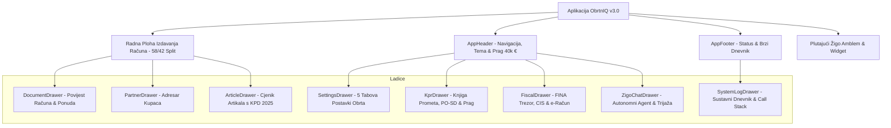

# Plan Validacije Korisničkog Sučelja i Statusa Faza Implementacije

**Aplikacija:** ObrtnIQ v3.0 (Local-First Paušalni & Dohodovni Sustav)  
**Datum:** 2026-10-25  
**Verzija dokumenta:** 1.0  
**Status:** Spreman za evaluaciju i izvršenje  

---

## 1. Izvršni Pregled i Statusna Matrica Implementiranih Faza

Projekt ObrtnIQ razvijan je inkrementalno prema strogom **Gate-Check** protokolu. Sustav trenutno broji **191 automatizirani test** raspoređen u **29 testnih datoteka** sa **100% prolaznošću**.

### 1.1. Matrica Statusa po Fazama

| Faza | Naziv Modula | Implementirane Funkcionalnosti | Testna Pokrivenost | Status |
|---|---|---|---|:---:|
| **Faza 0** | **Monorepo & Setup** | `npm workspaces` (`@obrtniq/core`, `@obrtniq/web`), Tailwind CSS v4, TypeScript 5.7, Vite 6, OPFS zaglavlja | 1 test | 🟢 **ZAVRŠENO** |
| **Faza 1** | **Core Engine & Matematika** | ISO 7064 MOD 11,10 OIB validator, MOD 97 IBAN validator s HNB registrom, kalkulator centi i popusta, HUB-3 parser | 32 testa | 🟢 **ZAVRŠENO** |
| **Faza 2** | **Sloj Pohrane (Storage)** | Apstraktni repozitorij, sekvenca brojeva računa bez rupa (`1/POSL1/1`), storno servis, AES-256-GCM enkripcija, Dexie IndexedDB adapter | 2 testa | 🟢 **ZAVRŠENO** |
| **Faza 3** | **Sharp UI Primitivi** | `OibInput`, `IbanInput` (auto-razmaci i bank lookup), `CurrencyInput` (€), `TaxZoneToggle` (zakonske klauzule), `KpdPicker` (KPD 2025 baza djelatnosti) | UI integracija | 🟢 **ZAVRŠENO** |
| **Faza 4** | **Kodovi & PDF Engine** | HUB-3 PDF417 klijentski barkod (bwip-js), EPC SEPA QR kod (EPC069-12), Porezna uprava fiskalni QR, ISO 32000-1 validator, DOM Flow PDF generator | 14 testova | 🟢 **ZAVRŠENO** |
| **Faza 4.5** | **Logging Engine** | Cirkularni RingBuffer (500 zapisa), Scoped Logger, 5 razina prioriteta, sanitizacija lozinki/tokena, Console Pipe | 7 testova | 🟢 **ZAVRŠENO** |
| **Faza 5** | **Workflow & Izdavanje** | Statusni automat (`NACRT` -> `IZDANO` -> `STORNIRANO`), immutability zaključavanje, prečaci F2 i Alt+N, `DocumentDrawer` | 7 testova | 🟢 **ZAVRŠENO** |
| **Faza 6** | **KPR & PO-SD Knjigovodstvo** | Knjiga prometa s kvartalima Q1-Q4, evidentiranje uplata, službeni PO-SD XML generator (shema v2.0 Porezne uprave), nadzor praga 40.000 € | 6 testova | 🟢 **ZAVRŠENO** |
| **Faza 7** | **Fiskalizacija 1.0 & 2.0** | Web Crypto PIN trezor certifikata, ZKI (RFC 1321 MD5), CIS gotovinska fiskalizacija s 48h offline fallbackom, e-Račun UBL 2.1 CIUS-HR s KPD 2025 šiframa, stateless CORS proxy | 17 testova | 🟢 **ZAVRŠENO** |
| **Faza 8** | **Postavke & Memorandum** | Profil obrta u Dexie bazi, `PartnerDrawer` adresar, klijentski upload logotipa i digitalnog pečata/potpisa (Base64) s automatskim ugrađivanjem u A4 račun i PDF | UI integracija | 🟢 **ZAVRŠENO** |
| **Faza 9** | **Cjenik, CSV & Kripto Trezor** | `ArticleDrawer` cjenik artikala i usluga s KPD 2025, KPR CSV izvoz s UTF-8 BOM-om za Excel, `.obrtniq` enkriptirani backup paket (AES-256-GCM / PBKDF2 100k) | 10 testova | 🟢 **ZAVRŠENO** |
| **Faza 10** | **Cloud & AI Ekosustav** | Google Identity invarijanta `sub` kao kripto-sidro, Google Drive `appDataFolder` automatski backup i restauracija točaka, Gemini BYOK asistent za KPD 2025 s offline heuristikom | 12 testova | 🟢 **ZAVRŠENO** |
| **Faza 10.5** | **Dijagnostika & Telemetrija** | Call Stack parser (`APP CODE` vs vendor okviri), globalni error trap (`onerror`, `unhandledrejection`), `<AppErrorBoundary>`, Auto-Open na grešku | 11 testova | 🟢 **ZAVRŠENO** |
| **Faza 11** | **Žigo Autonomni Agent** | Persona viteza Orlanda, Gemini 2.0 Function Calling s 12 sistemskih alata, multimodalni sken računa, perzistentni chat u Dexie v2, trijaža "Žigin rez", Ćevapi test | 8 testova | 🟢 **ZAVRŠENO** |
| **Stabilizacija** | **Modularizacija & Dnevnik Fix** | Rastavljanje `SettingsDrawer` na 5 tabova i kartica, migracija dnevnika na React 19 `useSyncExternalStore`, referencijalni cache, COOP (`same-origin-allow-popups`) i COEP (`credentialless`) | 24 testa | 🟢 **ZAVRŠENO** |

---

## 2. Detaljna Matrica Validacije Korisničkog Sučelja (UI & UX Matrix)

Korisničko sučelje sastoji se od **Glavne radne plohe (Split-Screen 58/42)** i **8 specijaliziranih ladica (Drawers)**.



---

### 2.1. Glavna Radna Ploha (Invoice Desk & Split Screen)

| Komponenta | Element za testiranje | Koraci verifikacije | Očekivani rezultat |
|---|---|---|---|
| **Kupac Sekcija** | `OibInput` | Unijeti ispravan OIB (11 znamenki, npr. `01234567890`) pa neispravan | Zelena kvačica pri MOD 11,10 prolazu; crveni obrub i blokada izdavanja pri neispravnom |
| **Kupac Sekcija** | `IbanInput` | Unijeti IBAN hrvatske banke (npr. PBZ `HR122340009...`) | Automatsko formatiranje u blokove od 4 znaka i trenutni ispis naziva banke |
| **Kupac Sekcija** | `TaxZoneToggle` | Prebaciti zonu: Tuzemstvo -> EU B2B -> Treće zemlje | Automatsko ažuriranje zakonske klauzule (čl. 90 st. 2, prijenos porezne obveze) |
| **Kupac Sekcija** | Gumb *Odaberi iz adresara* | Kliknuti gumb | Otvara `PartnerDrawer`, odabirom partnera automatski popunjava formu |
| **Editor Stavaka** | Dodavanje stavke (`Alt+N`) | Pritisnuti tipku `Alt+N` ili kliknuti *"Dodaj stavku"* | Dodaje novi redak stavke s fokusom na opis |
| **Editor Stavaka** | `KpdPicker` | Kliknuti na KPD polje i upisati *"softver"* | Command Palette filtrira KPD bazu (npr. `62.01.11`) i odabire službenu šifru |
| **Editor Stavaka** | `AI KPD Asistent` | Kliknuti ikonu zvjezdice (`Sparkles`), unijeti *"Izrada web stranice"* | Predlaže šifru `62.01.11`, naziv i cijenu; gumb *"Primijeni"* unosi podatke |
| **Editor Stavaka** | Izračun centi i popusta | Unijeti npr. `3 kom * 100,00 € - 10% popusta` | Prikazuje točno `270,00 €` bez floating-point grešaka |
| **Živi A4 Preglednik** | Renderiranje u realnom vremenu | Mijenjati polja u formi s lijeve strane | Desna strana u < 10 ms osvježava A4 prikaz računa |
| **Živi A4 Preglednik** | Barkodovi i QR | Provjeriti donji dio računa | Vidljiv HUB-3 PDF417 barkod (14 redaka) i EPC QR kod ili fiskalni QR |
| **Živi A4 Preglednik** | Preklopnik Tema / Bijeli papir | Kliknuti preklopnik izgleda | Račun se prebacuje između tamne teme i čistog bijelog papira |
| **Živi A4 Preglednik** | Izdavanje računa (`F2`) | Pritisnuti tipku `F2` ili kliknuti *"Izdaj račun"* | Status prelazi u `IZDANO`, dodjeljuje se trajni broj (npr. `1/POSL1/1`), forma se zaključava (read-only) |
| **Živi A4 Preglednik** | Storno račun | Kliknuti *"Storniraj račun"* na izdanom računu | Stvara se povezani storno dokument s negativnim predznakom |

---

### 2.2. Modularni Postavke Obrta Drawer (`SettingsDrawer`)

| Tab / Kartica | Element za testiranje | Koraci verifikacije | Očekivani rezultat |
|---|---|---|---|
| **Tab 1: Osnovni Podaci** | Forma obrta | Izmijeniti naziv, OIB, IBAN, vlasnika ili adresu te kliknuti *"Spremi"* | Podaci se perzistiraju u Dexie bazu, u dnevniku se bilježi `[SETTINGS:PROFILE]`, A4 račun se trenutno ažurira |
| **Tab 2: Račun & Prostor** | Oznake prostora | Promijeniti oznaku prostora (npr. `POSL2`) ili početni broj | Sljedeći izdani račun koristi novu oznaku sekvence |
| **Tab 3: Memorandum** | Upload logotipa | Učitati sliku logotipa (PNG/JPG) | Prikazuje se thumbnail u postavkama, logotip se odmah renderira u zaglavlju A4 računa |
| **Tab 3: Memorandum** | Upload digitalnog pečata | Učitati PNG pečat s prozirnom pozadinom | Pečat se odmah prikazuje iznad potpisa izdavatelja na dnu A4 računa |
| **Tab 3: Memorandum** | Uklanjanje slika | Kliknuti *"Ukloni logotip"* ili *"Ukloni pečat"* | Slike se brišu iz baze i uklanjaju s računa |
| **Tab 4: Trezor & Backup** | Enkriptirani `.obrtniq` izvoz | Unijeti lozinku i kliknuti *"Preuzmi Kriptiranu Kopiju"* | Preuzima se `.obrtniq` datoteka kriptirana AES-256-GCM algoritmom |
| **Tab 4: Trezor & Backup** | Otvoreni JSON snapshot | Kliknuti *"Izvezi JSON Snapshot"* | Preuzima se nezaštićeni JSON sa svim tablicama |
| **Tab 4: Trezor & Backup** | Uvoz sigurnosne kopije | Učitati datoteku i unijeti lozinku | Prikazuje pregled entiteta (broj računa, partnera) i uspješno restaurira podatke |
| **Tab 4: Trezor & Backup** | Tvorničko brisanje baze | Kliknuti *"Reset baze"*, upisati `OBRISI` i potvrditi | Baza se prazni i vraća na početne tvorničke postavke |
| **Tab 5: Google & AI** | Google Identity prijava | Kliknuti *"Prijavi se putem Google računa"* | Otvara se Google OAuth popup, autorizira korisnika i postavlja kripto-sidro |
| **Tab 5: Google & AI** | Demo prijava | Kliknuti *"Isprobaj Demo Prijavu"* | Trenutno postavlja offline demo korisnika (`demo@obrtniq.local`) za trenutni test |
| **Tab 5: Google & AI** | Google Drive sinkronizacija | Kliknuti *"Sinkroniziraj sada na Drive"* | Kriptirana arhiva šalje se u Google Drive `appDataFolder`; lista točaka oporavka se ažurira |
| **Tab 5: Google & AI** | Gemini API ključ & Ping | Unijeti API ključ i kliknuti *"Testiraj vezu"* | Provjerava model `gemini-2.0-flash` i javlja status veze s latencijom |
| **Tab 5: Google & AI** | Dijagnostika API-ja | Kliknuti *"Pokreni Dijagnostiku"* | Provjerava mrežnu dostupnost `accounts.google.com` i `googleapis.com` bez COEP blokada |
| **Header Postavki** | Gumb `>_ Dnevnik` | Kliknuti gumb u gornjem desnom kutu ladice | Otvara se donji panel sustavnog dnevnika s parametrima |

---

### 2.3. Sustavni Dnevnik & Telemetrija (`SystemLogDrawer`)

| Element za testiranje | Koraci verifikacije | Očekivani rezultat |
|---|---|---|
| **Interaktivni testni zapis** | Kliknuti na gumb **`[⚡ Test]`** u zaglavlju ili na gumb u praznom stanju | Istog trenutka se pojavljuje zeleni redak `INFO [vrijeme] [DIAGNOSTIKA:TEST]` |
| **Reaktivnost (`useSyncExternalStore`)** | Otvoriti dnevnik, a zatim u drugoj ladici kliknuti neku radnju (npr. spremanje postavki) | Dnevnik u realnom vremenu sinkrono prikazuje novi redak bez kašnjenja |
| **Filteri razina** | Kliknuti tabove: `Sve`, `Error`, `Warn`, `Info`, `Debug`, `Verbose` | Lista prikazuje samo zapise odabrane razine; brojači na tabovima odgovaraju stanju |
| **Filter po modulu** | Odabrati modul iz padajućeg izbornika (npr. `SETTINGS`, `AUTH`, `FISCAL`) | Prikazuju se isključivo zapisi tog modula |
| **Tekstualna pretraga** | Upisati pojam u tražilicu (npr. `Google`, `UBL`, `profil`) | Filtrira zapise prema tekstu poruke i sadržaju data payload-a |
| **Sklopivi detalji & Call Stack** | Kliknuti strelicu pored zapisa s podacima ili greškom | Proširuje se JSON payload; ako postoji greška, prikazuje se strukturirani Call Stack s istaknutim `APP CODE` okvirima i gumbom za kopiranje |
| **Prag bilježenja** | Promijeniti padajući izbornik "Prag zapisa" (npr. `DEBUG` ili `VERBOSE`) | Preferencija se sprema u `localStorage`; logger počinje bilježiti detaljnije razine |
| **Izvoz JSON dijagnostike** | Kliknuti gumb *"Izvezi JSON"* | Preuzima se datoteka `obrtniq-diagnostic-log-[timestamp].json` sa svim sanitiziranim zapisima |
| **Pražnjenje dnevnika** | Kliknuti ikonu kante za smeće (*"Isprazni spremnik"*) | Spremnik se prazni (0 unosa), UI se trenutno ažurira u prazno stanje |

---

### 2.4. Knjiga Prometa (KPR) i Obrazac PO-SD Drawer (`KprDrawer`)

| Tab / Element | Koraci verifikacije | Očekivani rezultat |
|---|---|---|
| **Tab 1: Knjiga Prometa** | Prikaz stavaka | Otvoriti KPR ladicu | Prikazuju se sve evidentirane uplate s rednim brojem, datumom, brojem računa i iznosom |
| **Tab 1: Knjiga Prometa** | Ručni unos uplate | Kliknuti *"Dodaj uplatu"*, unijeti datum, opis i iznos gotovine/žiro | Nova uplata ulazi u KPR i automatski se pribraja odgovarajućem kvartalu |
| **Tab 1: Knjiga Prometa** | CSV / Excel izvoz | Kliknuti gumb *"Preuzmi CSV"* | Preuzima se `KPR_[GODINA]_[OIB].csv` s UTF-8 BOM-om; u Excelu se naša slova (Č, Ć, Ž, Š, Đ) otvaraju bez greške |
| **Tab 2: Obrazac PO-SD** | Kvartalni sažetak | Otvoriti tab PO-SD | Prikazuju se 4 kvartalne kartice (Q1-Q4) s točnim sumama gotovinskog i bezgotovinskog prometa |
| **Tab 2: Obrazac PO-SD** | Preuzimanje XML-a | Kliknuti *"Preuzmi PO-SD XML"* | Generira se XML prema službenoj shemi Porezne uprave v2.0 s ispravnim zaglavljem i namespace-om |
| **Tab 3: Porezni Razredi** | Prag 40.000 € | Pogledati grafički indikator praga | Prikazuje točan postotak iskorištenosti limita od 40.000 € i mapira obrt u odgovarajući porezni razred (1-5) |

---

### 2.5. Fiskalizacija 1.0 & 2.0 Drawer (`FiscalDrawer`)

| Tab / Element | Koraci verifikacije | Očekivani rezultat |
|---|---|---|
| **Tab 1: FINA Trezor** | FINA DEMO certifikat | Provjeriti status certifikata | Prikazuje aktivan demo certifikat; PIN unos omogućuje otključavanje privatnog ključa |
| **Tab 2: CIS Gotovina** | ZKI & JIR izračun | Provjeriti status fiskalizacije gotovinskog računa | Prikazuje generirani 32-znakovni ZKI (MD5 sažetak) i JIR porezne uprave |
| **Tab 2: CIS Gotovina** | Offline 48h red | Simulirati prekid veze pri gotovinskom računu | Račun dobiva status `OFFLINE_ZKI_IZDAN`, pokreće se tajmer od 48h za naknadno slanje |
| **Tab 3: e-Račun UBL 2.1** | UBL 2.1 XML Generator | Odabrati izdani račun i pregledati e-Račun tab | Prikazuje strukturirani UBL 2.1 XML s obaveznim KPD 2025 šiframa na svim stavkama i čl. 90 st. 2 klauzulom |
| **Tab 3: e-Račun UBL 2.1** | Preuzimanje XML-a | Kliknuti *"Preuzmi UBL 2.1 XML"* | Preuzima se validna `.xml` datoteka spremna za slanje informacijskom posredniku |

---

### 2.6. Adresar Partnera (`PartnerDrawer`) i Cjenik Artikala (`ArticleDrawer`)

| Komponenta | Koraci verifikacije | Očekivani rezultat |
|---|---|---|
| **PartnerDrawer** | Pretraga partnera | Otvoriti adresar, upisati naziv, OIB ili grad | Lista se trenutno filtrira u realnom vremenu |
| **PartnerDrawer** | Unos novog partnera | Kliknuti *"Novi partner"*, ispuniti formu (Naziv, OIB, Adresa, IBAN) | Partner se sprema u Dexie bazu i odmah je dostupan za odabir |
| **PartnerDrawer** | Odabir partnera | Kliknuti *"Odaberi"* na kartici partnera | Podaci partnera se trenutno prebacuju na radnu plohu računa |
| **ArticleDrawer** | Pretraga artikala | Otvoriti cjenik, upisati pojam (npr. *"savjetovanje"*) | Filtrira artikle po nazivu, šifri ili KPD 2025 oznaci |
| **ArticleDrawer** | Filter kategorija | Kliknuti preklopnik: `SVE` / `USLUGE` / `ROBA` | Prikazuje artikle odabrane kategorije |
| **ArticleDrawer** | Dodavanje na račun | Kliknuti *"Dodaj na račun"* pored artikla | Stavka se automatski dodaje na radnu plohu računa s KPD oznakom i cijenom |

---

### 2.7. Žigo Autonomni Agent (`FloatingZigoWidget` & `ZigoChatDrawer`)

| Element za testiranje | Koraci verifikacije | Očekivani rezultat |
|---|---|---|
| **Plutajući Widget** | Prikaz amblema | Pogledati donji desni kut ekrana | Vidljiv brončano-kameni amblem sa štitom i Q-prstenom; klik ga otvara |
| **Brzi gumb "Žigo, presijeci"** | Kliknuti brzi gumb na widgetu | Automatski pokreće trijažu u tri točke (1. Što gori, 2. Što čeka, 3. Akcija sad) |
| **Chat Sučelje** | Slanje poruke | Poslati poruku: *"Dodaj stavku Konzultantske usluge 500 eura"* | Žigo poziva alat `dodaj_stavku_racuna`, stavka se pojavljuje u formi na radnoj plohi |
| **Porezni filtar (Ćevapi Test)** | Poslati poruku: *"Knjiži račun za ćevape i pivo 35 eura"* | Žigo prepoznaje nepriznati privatni trošak i s orlandovskim humorom odbija knjiženje |
| **Multimodalni Sken** | Povući sliku ili PDF računa u chat prozor | Žigo analizira sliku, prepoznaje iznos i nudi unos u bazu troškova/artikala |
| **Povijest Sesija** | Kliknuti *"Nova sesija"* ili odabrati raniju sesiju | Razgovori su trajno sačuvani u IndexedDB bazi (`chatSesije`) |

---

## 3. Četveroslojna Metodologija Validacije

Validacija se provodi kroz 4 komplementarna sloja kako bi se osigurala potpuna pouzdanost:

```
┌────────────────────────────────────────────────────────┐
│  SLOJ 1: Automatizirani Testovi (Vitest Monorepo)       │
│  - 191/191 testova prolazi u 29 datoteka               │
├────────────────────────────────────────────────────────┤
│  SLOJ 2: Statička & Build Verifikacija                 │
│  - TypeScript (tsc -b) i Vite produkcijski build       │
├────────────────────────────────────────────────────────┤
│  SLOJ 3: Interaktivna Browser Subagent Provjera        │
│  - Automatizirano klikanje kroz UI i snimanje WebP     │
├────────────────────────────────────────────────────────┤
│  SLOJ 4: Korisnički Smoke-Test Protokol (Uživo)        │
│  - 10 koraka za korisnika u pregledniku                │
└────────────────────────────────────────────────────────┘
```

### Sloj 1: Automatizirani Testovi (Vitest Monorepo)
- **Komanda:** `npm test` u korijenu monorepoa.
- **Kriterij prolaznosti:** 191 test prolazan, 0 grešaka.
- **Ključni testni paketi:**
  - `@obrtniq/core`: 107 testova (OIB, IBAN, kalkulator, HUB-3, EPC QR, Fiskalni QR, KPR, PO-SD, Fiskalizacija 1.0, UBL 2.1, Trezor, KPR CSV, Cjenik, Kripto sidro).
  - `@obrtniq/web`: 84 testa (Gemini, Google Auth, Google Drive, Settings Drawer, Sustavni Dnevnik, Žigo Agent, PDF generator, Barcode).

### Sloj 2: Statička & Build Verifikacija
- **Komanda:** `npm run build` u `apps/web`.
- **Kriterij prolaznosti:** Uspješno kompajliranje TypeScripta (`tsc -b`) i Vite produkcijskog bundlea bez grešaka i bez cirkularnih ovisnosti.

### Sloj 3: Interaktivna Browser Provjera (Subagent E2E)
- Pokretanje browser subagenta na dev serveru (`http://localhost:5173/`).
- Izvršavanje standardnih korisničkih scenarija:
  1. Otvaranje `SettingsDrawer` -> prelazak kroz svih 5 tabova.
  2. Klik na `[⚡ Test]` u `SystemLogDrawer` -> provjera pojave zelenog retka dnevnika.
  3. Klik na *"Isprobaj Demo Prijavu"* -> provjera pojave `AUTH:HOOK` i `SETTINGS:GOOGLE` zapisa.
  4. Dodavanje stavke na račun, promjena KPD šifre i provjera živog A4 računa.
  5. Otvaranje `KprDrawer` i provjera PO-SD tablica.
  6. Otvaranje `ZigoChatDrawer` i provjera orlandovske dobrodošlice.
- Automatsko generiranje WebP video snimke sesije.

### Sloj 4: Korisnički Smoke-Test Protokol (10 koraka za korisnika)
Kontrolna lista za brzu provjeru u korisničkom pregledniku (trajanje ~3 minute):
1. **Osvježavanje preglednika (`F5`)** na `http://localhost:5173/`.
2. **Provjera dnevnika:** Kliknuti `>_ Dnevnik` na dnu ekrana -> kliknuti `[⚡ Test]` -> provjeriti zeleni redak.
3. **Provjera Postavki:** Otvoriti Postavke obrta -> provjeriti svih 5 tabova (Osnovni podaci, Račun, Memorandum, Trezor, Google & AI).
4. **Provjera Google demo prijave:** Tab 5 -> kliknuti *"Isprobaj Demo Prijavu"* -> otvoriti dnevnik i provjeriti zapise.
5. **Provjera Dijagnostike:** Tab 5 -> kliknuti *"Pokreni Dijagnostiku"* -> provjeriti zeleni status veze bez COEP greške.
6. **Provjera unosa stavke:** Na radnoj plohi unijeti stavku s KPD šifrom -> provjeriti ažuriranje A4 računa s desne strane.
7. **Provjera izdavanja računa:** Pritisnuti tipku `F2` -> račun dobiva status `IZDANO`, ZKI kod i fiskalni QR.
8. **Provjera KPR evidencije:** Otvoriti KPR ladicu u zaglavlju -> provjeriti upisani iznos u KPR i kvartalu PO-SD.
9. **Provjera Cjenika:** Otvoriti Cjenik u zaglavlju -> provjeriti listu predefiniranih IT/poslovnih usluga.
10. **Provjera Žigo agenta:** Kliknuti plutajući amblem u donjem desnom kutu -> poslati *"Pozdrav Žigo"* -> provjeriti diplomatski odgovor.

---

## 4. Kriteriji Prihvaćanja (Definition of Done)

Faza implementacije i korisničko sučelje smatraju se **potpuno validiranima** kada su zadovoljeni sljedeći mjerljivi uvjeti:

1. **Testna pokrivenost:** Svi automatizirani testovi (191/191) prolaze s kodom izlaza 0.
2. **Build stabilnost:** `npm run build` prolazi bez TypeScript (`tsc -b`) i Vite grešaka.
3. **Integritet Dnevnika:** Svaka akcija na sučelju (promjena postavki, autorizacija, izdavanje računa, dijagnostika) odmah je vidljiva u `SystemLogDrawer` uz nula propuštenih zapisa.
4. **Mrežna i sigurnosna usklađenost:** U DevTools konzoli nema COEP (`Cross-Origin-Embedder-Policy`) niti COOP blokada za vanjske servise (`userinfo`, `accounts.google.com`).
5. **Responzivnost i izgled:** Sučelje je u potpunosti prilagođeno Desktop Split prikazu (1440px) i mobilnom pregledu s glatkim animacijama, tabovima i ladicama.
