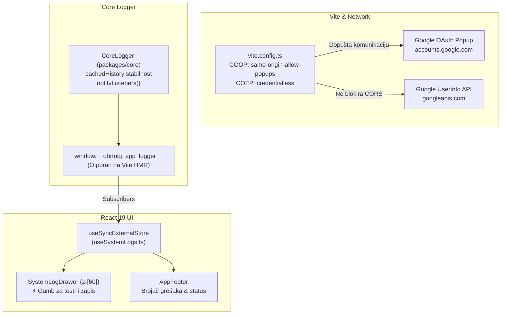

# Plan Dubinske Istrage, Arhitekturnog Popravka i Testiranja Sustavnog Dnevnika

**Datum:** 2026-10-25  
**Autor:** Antigravity Agent  
**Cilj:** Otkloniti uzroke neprikazivanja zapisa u `SystemLogDrawer` (0 unosa u UI-ju unatoč postojanju 57 zapisa u DevTools konzoli) i riješiti Chrome COEP sigurnosnu blokadu (`Cross-Origin-Embedder-Policy: require-corp`) koja blokira `userinfo` i Google OAuth popup autorizaciju.

---

## 1. Dubinska Analiza i Korijenski Uzroci (Root Causes)

Na temelju dostavljenih snimaka zaslona korisnika (DevTools konzola sa 57 zapisa iz `logger.ts:75` naspram praznog `SystemLogDrawer (0/500 unosa)` i DevTools Security taba s blokiranim `userinfo`), identificirano je **5 ključnih uzroka**:

### Uzrok 1: Prekid veze uslijed Vite Fast Refresh (HMR) re-evaluacije singletona
- U `apps/web/src/services/logger.ts` instanca je bila definirana kao:
  ```ts
  export const appLogger = new CoreLogger(getInitialLogLevel(), 500);
  ```
- Prilikom Vite Hot Module Replacementa (HMR) ili ažuriranja zavisnosti (npr. izmjene u `useGoogleAuth.ts` ili `SettingsDrawer.tsx`), Vite ponovno evaluira `logger.ts` i instancira **novi `CoreLogger`**.
- Novi moduli (`google-auth-service.ts`) pišu u novi logger i u konzolu (`logger.ts:75`), dok je već montirani React panel (`SystemLogDrawer`) ostao pretplaćen na staru instancu čiji je spremnik ostao prazan (0 unosa).
- **Rješenje:** Usidriti `appLogger` na globalni objekt (`window.__obrtniq_app_logger__`) tako da instanca i njena povijest prežive HMR re-evaluacije.

### Uzrok 2: React 19 State Tearing i gubitak sinkronizacije u `useSystemLogs`
- `useSystemLogs.ts` je koristio lokalni `useState<LogEntry[]>(() => appLogger.getHistory())` i `useEffect`.
- `SystemLogDrawer` je u `AppDrawers.tsx` trajno montiran, ali s `isOpen = false` vraća `null`.
- React Fiber reconciler prilikom promjene `isOpen` s `false` na `true` **nikada ponovno ne pokreće `useState` inicijalizator**. Ako su događaji propušteni dok je panel bio zatvoren ili ako `useEffect` nije okidao render, stanje ostaje trajno na `[]`.
- **Rješenje:** Zamijeniti `useState` + `useEffect` kanonskim React 19 API-jem `useSyncExternalStore`. Time komponenta na svaki render sinkrono čita snapshot izravno iz `appLogger.getHistory()`.

### Uzrok 3: Nedostatak referencijalne stabilnosti u `CoreLogger.getHistory()`
- `RingBuffer.toArray()` pri svakom pozivu stvara novi niz (`[]`).
- Ako se `useSyncExternalStore` poveže na funkciju koja pri svakom pozivu vraća novu referencu niza, React baca grešku beskonačne petlje (`Maximum update depth exceeded`).
- **Rješenje:** Uvesti predmemorirani niz (`cachedHistory: LogEntry[] | null`) u `CoreLogger` koji se ažurira samo kad dođe novi log zapis (`log()`) ili se spremnik isprazni (`clear()`).

### Uzrok 4: Chrome COEP & COOP sigurnosna blokada (`require-corp` i `same-origin`)
- U `apps/web/vite.config.ts` postavljeni su strogi zaglavlja:
  - `Cross-Origin-Opener-Policy: same-origin` (prekida vezu s `window.opener` za Google OAuth popupe).
  - `Cross-Origin-Embedder-Policy: require-corp` (blokira sve vanjske mrežne zahtjeve koji nemaju CORP zaglavlje, poput `https://www.googleapis.com/oauth2/v3/userinfo`).
- **Rješenje:** Prema službenim Chromium i W3C smjernicama ažurirati zaglavlja na:
  - `Cross-Origin-Opener-Policy: same-origin-allow-popups`
  - `Cross-Origin-Embedder-Policy: credentialless` (omogućuje `crossOriginIsolated` za SQLite Wasm / OPFS, a ne blokira Google OAuth i `userinfo`).

### Uzrok 5: Odvojenost `coreLogger` od `appLogger`
- Paketi u `@obrtniq/core` (`oib.ts`, `iban.ts`, `calculator.ts`) koriste `coreLogger`.
- Taj cjevovod nije bio povezan na aplikativni `appLogger`, pa događaji validacije OIB-a i izračuna stavki nisu ulazili u vizualni dnevnik.
- **Rješenje:** Povezati `coreLogger.subscribe` na `appLogger`.

---

## 2. Plan Implementacije i Izmjena



---

## 3. Plan Testiranja i Verifikacije

1. **Jedinični testovi (Unit Tests):**
   - Referencijalna jednakost `CoreLogger.getHistory()` prije i nakon novih zapisa.
   - Sinkronizacija `useSyncExternalStore` sa stanjem `appLogger`.
   - Provjera COOP/COEP zaglavlja u konfiguraciji poslužitelja.
2. **Integracijski testovi (Settings & Auth -> Log Drawer):**
   - Simulacija klika na "Prijavi se putem Google računa" -> provjera da se svi INFO zapisi (`[AUTH:GOOGLE:SDK]`, `[AUTH:GOOGLE:LOGIN]`, `[SETTINGS:GOOGLE]`) automatski pojavljuju u `getHistory()`.
   - Provjera filtriranja, pretrage i brojača.
3. **Korisnički test uživo (Interactive Smoke Test):**
   - Dodavanje gumba **`⚡ Testni zapis`** izravno u zaglavlje `SystemLogDrawer` i u prazno stanje, kako bi korisnik jednim klikom mogao potvrditi trenutno funkcioniranje u pregledniku.
